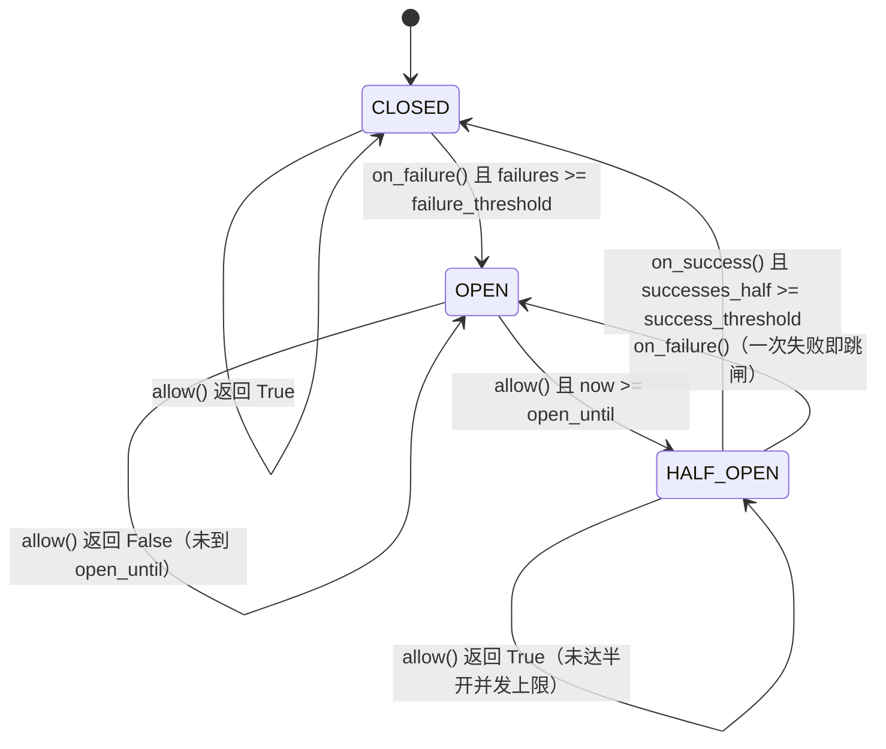
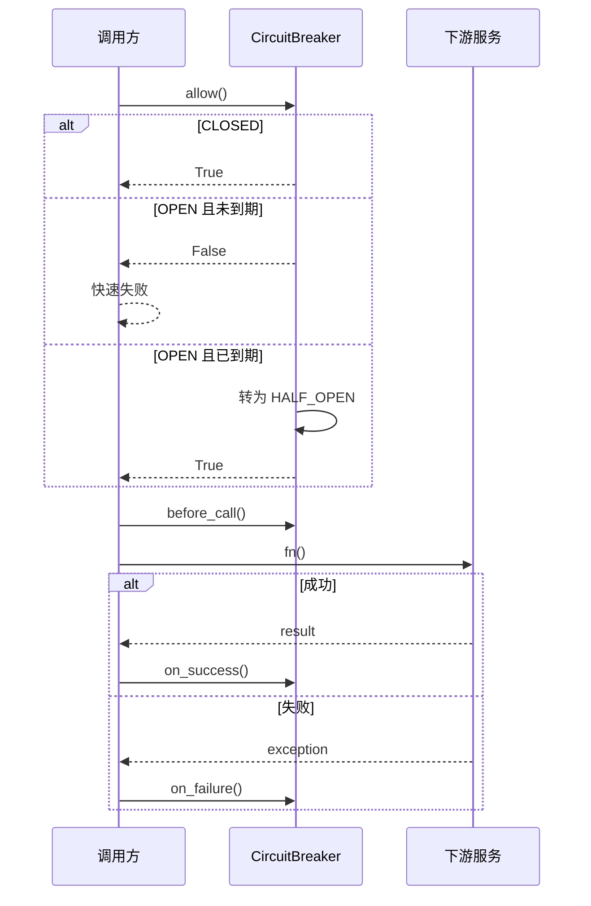

# 01 · 熔断器与指数退避重试

一个不依赖第三方库的最小实现，用来演示模型路由场景里的**下游保护**：

- **熔断器（Circuit Breaker）**：下游持续故障时快速失败，避免请求继续砸向已经不可用的服务。
- **指数退避 + 抖动（Exponential Backoff + Jitter）**：失败重试时逐步拉长等待时间，并用随机抖动打散重试，避免惊群。
- **重试包装器**：把两者组合成一个可直接调用的 `call_with_breaker_and_retry`。

核心逻辑在 [`breaker/circuit_breaker.py`](breaker/circuit_breaker.py)。

---

## 目录结构

```
01/
├── main.py                 # 三个演示场景
├── README.md
└── breaker/
    ├── __init__.py         # 对外导出
    ├── state.py            # 三态枚举
    ├── circuit_breaker.py  # 熔断器核心逻辑
    ├── retry.py            # 熔断 + 重试包装器
    └── backoff.py          # 指数退避 + 抖动
```

## 运行

需要 **Python 3.12+**（`retry.py` 使用了 PEP 695 的泛型语法 `def f[T](...)`）。

```bash
cd 01
python main.py
```

`main.py` 演示了三个场景：

1. 偶发失败，重试后成功（熔断器保持 `CLOSED`）。
2. 连续失败达到阈值，触发熔断（变为 `OPEN`）。
3. 熔断打开期间，请求被直接拒绝（`RuntimeError("circuit_open")`）。

---

## 为什么需要熔断器

一次下游调用失败时，重试是合理的；但如果下游已经整体不可用，每一个请求仍然先发出去、再超时、再重试，就会造成：

- 请求线程/连接被长时间占用；
- 重试流量进一步压垮下游，形成“重试风暴”；
- 故障恢复被持续流量拖慢。

熔断器的思路是：**连续观察到足够多的失败后，直接进入“打开”状态，不再发真实请求，而是立即失败**；等待一段冷却时间后，再放少量探测请求验证下游是否恢复。

---

## 三态模型



| 状态 | 行为 | 出口 |
|---|---|---|
| `CLOSED` | 正常放行所有请求 | 连续失败达 `failure_threshold` → `OPEN` |
| `OPEN` | 拒绝所有请求（`allow()` 返回 `False`） | 到达 `open_until` → `HALF_OPEN` |
| `HALF_OPEN` | 限量放行探测请求 | 连续成功达 `success_threshold` → `CLOSED`；任意一次失败 → `OPEN` |

要点：

- **CLOSED 的失败计数是“连续”的**：中间只要成功一次，`failures` 就会清零。
- **HALF_OPEN 的失败不需要达到阈值**：探测请求失败一次就重新跳闸，说明下游还没恢复。
- **OPEN → HALF_OPEN 是懒触发的**：由下一次 `allow()` 调用来完成转换，而不是后台定时器。

---

## 配置参数

`CircuitBreaker` 是一个 `@dataclass`，构造参数即配置项：

| 参数 | 默认值 | 含义 |
|---|---|---|
| `failure_threshold` | `5` | CLOSED 状态下，连续失败多少次触发跳闸 |
| `success_threshold` | `2` | HALF_OPEN 状态下，累计成功多少次恢复为 CLOSED |
| `open_seconds` | `30.0` | OPEN 状态持续多久后允许试探 |
| `half_open_max_calls` | `3` | HALF_OPEN 状态下最多允许多少个并发探测请求 |

```python
from breaker import CircuitBreaker

breaker = CircuitBreaker(
    failure_threshold=3,
    success_threshold=2,
    open_seconds=2.0,
    half_open_max_calls=2,
)
```

---

## 运行时状态

这些属性**不是构造参数**，而是在 `__post_init__` 中初始化：

| 属性 | 初始值 | 含义 |
|---|---|---|
| `state` | `State.CLOSED` | 当前状态 |
| `failures` | `0` | CLOSED 下的连续失败计数 |
| `successes_half` | `0` | HALF_OPEN 下的累计成功计数 |
| `open_until` | `0.0` | OPEN 状态的截止时间戳 |
| `half_open_inflight` | `0` | HALF_OPEN 下当前在途的探测请求数 |

### 为什么用 `__post_init__` 而不是 `__init__`

`@dataclass` 会检测到类中没有自定义 `__init__`，自动生成一个只接收四个配置字段的构造函数，并在末尾调用 `__post_init__()`：

```python
# @dataclass 生成的 __init__ 等价于：
def __init__(self, failure_threshold=5, success_threshold=2,
             open_seconds=30.0, half_open_max_calls=3):
    self.failure_threshold = failure_threshold
    self.success_threshold = success_threshold
    self.open_seconds = open_seconds
    self.half_open_max_calls = half_open_max_calls
    self.__post_init__()   # 如果定义了的话
```

这样做的好处：

- 配置项仍然出现在构造参数里，运行时状态不会暴露给调用方；
- 不需要手写 `__init__`，避免把字段默认值抄两遍；
- `state`、`failures` 等不会参与 `repr` 和 `==`。

注意：由于这些运行时属性没有声明成 dataclass 字段，**拼写错误不会被静态检查发现**，要到运行时才会暴露。如果想更严格，可以改成：

```python
from dataclasses import dataclass, field

state: State = field(init=False, default=State.CLOSED)
failures: int = field(init=False, default=0)
successes_half: int = field(init=False, default=0)
open_until: float = field(init=False, default=0.0)
half_open_inflight: int = field(init=False, default=0)
```

---

## 方法逻辑详解

### `_trip()`：统一跳闸

```python
def _trip(self):
    self.state = State.OPEN
    self.open_until = time.time() + self.open_seconds
    self.failures = 0
    self.successes_half = 0
    self.half_open_inflight = 0
```

所有“进入 OPEN”的路径都汇聚到这里：

1. 状态置为 `OPEN`；
2. 记录冷却截止时间 `open_until = now + open_seconds`；
3. 清空所有计数器，避免旧数据影响下一轮。

### `allow()`：放行判定 + 状态到期转换

```python
def allow(self) -> bool:
    now = time.time()
    if self.state == State.OPEN:
        if now >= self.open_until:
            self.state = State.HALF_OPEN
            self.successes_half = 0
            self.half_open_inflight = 0
        else:
            return False
    if self.state == State.HALF_OPEN:
        return self.half_open_inflight < self.half_open_max_calls
    return True
```

按状态拆解：

| 当前状态 | 条件 | 结果 |
|---|---|---|
| `CLOSED` | — | 直接 `True` |
| `OPEN` | `now < open_until` | `False`，快速失败 |
| `OPEN` | `now >= open_until` | 转为 `HALF_OPEN`，重置计数，继续走半开逻辑 |
| `HALF_OPEN` | `inflight < half_open_max_calls` | `True` |
| `HALF_OPEN` | 并发探测已满 | `False` |

两个容易忽略的点：

1. **`allow()` 有副作用**：OPEN 到期时它会推进状态机。即使调用方拿到 `True` 后没有真正发起请求，状态也已经变成 `HALF_OPEN`。
2. **OPEN 到期后会“穿透”到 HALF_OPEN 分支**：因为第一个 `if` 没有 `return`，转换后继续执行下面的半开判定。

### `before_call()`：登记在途探测

```python
def before_call(self):
    if self.state == State.HALF_OPEN:
        self.half_open_inflight += 1
```

只在 `HALF_OPEN` 下生效，用来给并发探测“占位”。CLOSED 下不跟踪在途请求。

`allow()` 和 `before_call()` 是**两步式**的：先判断能不能过，再登记。调用方必须在 `allow()` 返回 `True` 之后调用它，否则并发上限会失效。

### `on_success()`：成功回调

```python
def on_success(self):
    if self.state == State.HALF_OPEN:
        self.successes_half += 1
        if self.successes_half >= self.success_threshold:
            self.state = State.CLOSED
            self.successes_half = 0
    else:
        self.failures = 0

    if self.state == State.HALF_OPEN:
        self.half_open_inflight = max(0, self.half_open_inflight - 1)
```

- **CLOSED 下**：把连续失败计数清零。这就是“连续失败”语义的来源。
- **HALF_OPEN 下**：成功计数加一；达到 `success_threshold` 就恢复 `CLOSED` 并清零成功计数。
- 最后释放一个在途名额。

### `on_failure()`：失败回调

```python
def on_failure(self):
    self.failures += 1
    if self.state == State.HALF_OPEN or self.failures >= self.failure_threshold:
        self._trip()
    if self.state == State.HALF_OPEN:
        self.half_open_inflight = max(0, self.half_open_inflight - 1)
```

- `failures` 先自增；
- **HALF_OPEN 下失败一次就直接 `_trip()`**，不看阈值；
- **CLOSED 下失败累计到 `failure_threshold` 才跳闸**；
- `_trip()` 内部会把 `half_open_inflight` 清零，所以末尾那次递减在半开失败路径上通常不会执行（见“已知限制”）。

---

## 一次完整生命周期

以 `failure_threshold=3, success_threshold=2, open_seconds=30, half_open_max_calls=3` 为例：

1. `CLOSED` 状态下连续失败 3 次。
2. 第 3 次 `on_failure()` 时 `failures >= 3`，触发 `_trip()` → `OPEN`，`open_until = now + 30s`。
3. 接下来 30 秒内，所有 `allow()` 都返回 `False`，调用方立即失败。
4. 30 秒后第一次 `allow()`：`OPEN → HALF_OPEN`，计数清零，返回 `True`。
5. `before_call()` 让 `half_open_inflight = 1`，随后发出真实探测请求。
6. 若探测**成功**：`successes_half = 1`，仍是 `HALF_OPEN`；再来一次成功 → `successes_half = 2` → 恢复 `CLOSED`。
7. 若探测**失败**：立即 `_trip()` → 回到 `OPEN`，重新计时 30 秒。



---

## 与重试、退避的组合

### `call_with_breaker_and_retry`

```python
def call_with_breaker_and_retry[T](
    fn: Callable[[], T],
    breaker: CircuitBreaker,
    max_retries: int = 3,
) -> T:
    if max_retries < 1:
        raise ValueError("max_retries must be >= 1")

    for attempt in range(max_retries):
        if not breaker.allow():
            raise RuntimeError("circuit_open")
        breaker.before_call()
        try:
            result = fn()
            breaker.on_success()
            return result
        except Exception:
            breaker.on_failure()
            if attempt == max_retries - 1:
                raise
            time.sleep(exponential_backoff(attempt))

    raise RuntimeError("unreachable: retry loop exited without returning")
```

每次尝试都严格遵循：

```
allow() → before_call() → fn() → on_success() / on_failure()
```

语义说明：

- `max_retries` 是**总尝试次数**，不是“额外重试次数”。`max_retries=3` 表示最多调用 3 次，中间最多睡 2 次。
- **每个重试尝试都会独立计入熔断器**。一个逻辑请求重试 3 次，可能贡献 3 次失败。
- 如果熔断器在重试中途跳闸，下一轮 `allow()` 会返回 `False`，抛出 `RuntimeError("circuit_open")`，**原始异常会被掩盖**。
- 循环末尾的 `raise RuntimeError(...)` 是给类型检查器的兜底：向它证明函数不会隐式返回 `None`。
- `except Exception` 不会捕获 `KeyboardInterrupt`、`SystemExit` 这类 `BaseException`。

### 指数退避

```python
def exponential_backoff(attempt: int, base: float = 0.5, cap: float = 8.0) -> float:
    jitter = random.random() * 0.25
    return min(cap, base * (2**attempt) + jitter)
```

等待时间约为：

| attempt | 基础等待 | 加上抖动 |
|---|---|---|
| 0 | 0.5s | 0.50 ~ 0.75s |
| 1 | 1.0s | 1.00 ~ 1.25s |
| 2 | 2.0s | 2.00 ~ 2.25s |
| 3 | 4.0s | 4.00 ~ 4.25s |
| ... | ... | 上限 8s |

抖动的作用是避免大量客户端在同一时刻重试，形成新的流量峰值。

---

## 使用示例

### 方式一：使用重试包装器

```python
from breaker import CircuitBreaker, call_with_breaker_and_retry

breaker = CircuitBreaker(failure_threshold=5, open_seconds=30.0)

result = call_with_breaker_and_retry(
    lambda: call_model("gpt-4o-mini"),
    breaker,
    max_retries=3,
)
```

### 方式二：手动控制调用流程

需要自定义重试策略（比如按异常类型过滤）时，直接使用四个方法：

```python
if not breaker.allow():
    raise RuntimeError("circuit_open")

breaker.before_call()
try:
    result = call_model("gpt-4o-mini")
except Exception:
    breaker.on_failure()
    raise
else:
    breaker.on_success()
```

---

## 已知限制与注意事项

这些是实现中的边界行为，使用时值得了解：

1. **时钟使用 `time.time()`**
   墙钟时间可能被系统校时或回拨，导致 `open_until` 计算偏差。计时场景更稳妥的是 `time.monotonic()`。

2. **HALF_OPEN → CLOSED 时没有释放在途计数**
   `on_success()` 先把状态改成 `CLOSED`，最后 `if self.state == State.HALF_OPEN` 就不再成立，`half_open_inflight` 会残留 1。由于下次进入 HALF_OPEN（`allow()` 或 `_trip()`）会重置为 0，目前没有实际影响，但状态不完全自洽。

3. **`on_failure()` 末尾的递减是死代码**
   HALF_OPEN 失败时 `_trip()` 已把状态改成 `OPEN` 并把 `half_open_inflight` 清零，因此后面的 `if self.state == State.HALF_OPEN` 永远为假。

4. **`allow()` 与 `before_call()` 不是原子操作**
   在多线程或 `asyncio` 并发场景下，多个调用方可能同时通过 `allow()` 检查，导致半开探测数超过 `half_open_max_calls`。当前实现适合单线程同步调用；并发场景需要加锁或使用原子计数。

5. **“连续成功”在并发下不严格连续**
   `successes_half` 是累加计数，HALF_OPEN 允许并发探测，因此它不是严格意义上的“连续”成功。顺序调用时语义正常。

6. **重试与熔断的计数叠加**
   重试的每次尝试都会调用 `on_failure()`，所以一个逻辑请求可能让失败计数快速增长。如果希望“一个逻辑请求只计一次失败”，需要把熔断逻辑移到重试循环外层。

7. **原始异常可能被 `circuit_open` 掩盖**
   如果熔断在重试中途触发，下一次循环会抛 `RuntimeError("circuit_open")`，而不是上一次的真实异常。

8. **`half_open_max_calls <= 0` 会导致永久拒绝**
   `allow()` 在半开阶段返回 `inflight < half_open_max_calls`，若配置为 0 或负数，将永远无法放行。

---

## 参数调优建议

| 参数 | 偏小 | 偏大 | 建议 |
|---|---|---|---|
| `failure_threshold` | 容易误跳闸 | 故障反应慢 | 3 ~ 10，视调用量而定 |
| `open_seconds` | 恢复探测过于频繁 | 下游恢复后仍被拒绝很久 | 略大于下游典型恢复时间，10 ~ 60s |
| `success_threshold` | 恢复判断草率 | 半开状态停留过久 | 1 ~ 3 |
| `half_open_max_calls` | 探测吞吐低 | 半开阶段压力大、并发语义复杂 | 1 ~ 3 |

---

## 可以继续扩展的方向

- 使用 `time.monotonic()` 替代 `time.time()`；
- 为 `CircuitBreaker` 增加线程锁，或提供 `asyncio` 版本；
- 按模型 / endpoint 维护独立的熔断器实例；
- 暴露指标：状态、跳闸次数、拒绝次数、半开探测结果；
- 增加“慢调用”判定，而不只统计异常；
- 在 `main.py` 中补充 HALF_OPEN 恢复的演示场景（用短 `open_seconds` + `sleep`）。
