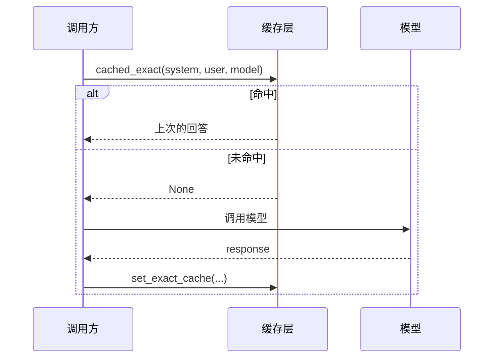

# 02 · Token 计数与请求指纹缓存

一个零依赖（可选 `tiktoken`）的最小实现，用来演示模型路由场景里的**成本控制**与**重复请求消除**：

- **Token 估算**：调用前先知道 prompt 大概要花多少 token，用于预算、限流、路由决策。
- **请求指纹（fingerprint）**：把 `system + user + model` 规范化后做 SHA256，得到一个稳定、定长的缓存键。
- **精确匹配缓存（exact cache）**：相同请求第二次到达时直接返回上次的结果，跳过真实模型调用。

核心逻辑在 [`cache/`](cache/) 目录。

---

## 目录结构

```
02/
├── main.py                  # 演示：token 计数 + 缓存命中
├── README.md
└── cache/
    ├── __init__.py          # 对外导出
    ├── tokens.py            # token 估算（tiktoken，带兜底）
    ├── fingerprint.py       # 请求指纹（SHA256）
    └── exact_cache.py       # 精确匹配缓存（内存 dict + lru_cache）
```

## 运行

```bash
cd 02
python main.py
```

需要 **Python 3.10+**（用到了 `str | None` 这种联合类型写法）。不需要第三方库即可运行；如果装了 `tiktoken`，`tokens.py` 会自动使用真实分词器。

实测输出（未安装 `tiktoken`，走兜底估算）：

```
=== Token 计数 ===
  文本长度: 25 字符
  估算 token: 6
  请求指纹: 0c981704de28d0d5...

=== 精确缓存 ===
  第 1 次调用（未命中）: [mock:gpt-4o] RAG 检索增强生成，把外部知识检索后再交给 LLM 回答。
  第 2 次调用（命中）:   [mock:gpt-4o] RAG 检索增强生成，把外部知识检索后再交给 LLM 回答。
  两次结果相同: True
```

> 25 个字符算出 6 个 token，是 `25 // 4` 的结果，说明当前环境没有 `tiktoken`。中文一个字通常就接近一个 token，所以**兜底值会明显低估中文 prompt**。

---

## Token 计数：为什么不能只靠 `len // 4`

计费、上下文窗口、限流几乎都以 token 为单位，而 token 数和字符数并不是线性关系：

| 文本 | 大约 token/字符 | 说明 |
|---|---|---|
| 英文普通文本 | ~1/4 | `len // 4` 大致成立 |
| 中文 | ~1/1 | 一个汉字常常就是一个 token |
| 代码 / JSON | ~1/3 | 标点、缩进、符号切分更碎 |
| emoji / 罕见字符 | > 1/1 | 可能被拆成多个 byte 级 token |

所以 `len // 4` 只能当兜底，不能当预算依据。`tokens.py` 的策略是：

```python
try:
    import tiktoken
except ImportError:
    tiktoken = None


def approx_token_count(text: str, model: str = "gpt-4o") -> int:
    if tiktoken is None:
        return max(1, len(text) // 4)
    enc = tiktoken.encoding_for_model(model)
    return len(enc.encode(text))
```

要点：

1. **优先真实分词**：`encoding_for_model(model)` 会选中该模型对应的 BPE 编码表（例如 `gpt-4o` → `o200k_base`）。
2. **导入失败才兜底**：把 `tiktoken` 做成可选依赖，避免因为一个统计功能拖垮整个服务启动。
3. **兜底至少返回 1**：空串也返回 1，避免上层出现 `0` 导致除零或“免费请求”的判断。
4. **每次调用都重新取 encoder**：`encoding_for_model` 内部有缓存，但显式复用 encoder 更清晰，也更省一点开销。

### 用法

```python
from cache import approx_token_count

tokens = approx_token_count("用三句话解释什么是 RAG。", "gpt-4o")
```

注意模型名必须是 `tiktoken` 认识的；传入未知模型会抛 `KeyError`。如果需要兼容任意模型名，可以退化为：

```python
enc = tiktoken.get_encoding("o200k_base")
```

---

## 请求指纹：缓存键怎么构造

```python
def request_fingerprint(system: str, user: str, model: str) -> str:
    raw = json.dumps({"system": system, "user": user, "model": model}, sort_keys=True)
    return hashlib.sha256(raw.encode("utf-8")).hexdigest()
```

三个设计点：

| 决策 | 原因 |
|---|---|
| 用 `json.dumps` 而不是字符串拼接 | 拼接会有歧义：`("ab", "c")` 和 `("a", "bc")` 会得到同一个键；JSON 的引号与转义天然消除了边界问题 |
| `sort_keys=True` | 保证同样的语义字段顺序稳定，键不随字典构造顺序变化 |
| 包含 `model` | **同一个 prompt 换模型必须视为不同请求**，否则会把 `gpt-4o` 的回答返回给 `gpt-4o-mini` 的调用方，导致计费和质量判断全部失真 |

指纹是 64 位十六进制字符串（SHA256），适合直接作为缓存键。`main.py` 里只打印前 16 位是为了可读性——**生产环境必须用完整值，前缀截断会增加碰撞风险**。

### 指纹里应该放什么、不该放什么

- **应该放**：所有会改变模型输出的输入，例如 `system`、`user`、`model`、`temperature`、`max_tokens`、`tools`、图片哈希等。
- **不应该放**：`request_id`、时间戳、用户标识（除非你要按用户隔离缓存）、`Authorization` 之类的凭据。
- **参数顺序无关**：只要字段集合和值相同，指纹就相同，这正是 `sort_keys` 的作用。

当前实现只覆盖了 `system/user/model`，是演示级别的键。真实项目里漏掉 `temperature` 这类参数，会把“确定性输出”和“随机输出”混在同一个键上。

---

## 精确缓存：只认完全相同的请求

```python
_STORE: dict[str, str] = {}

@lru_cache(maxsize=1024)
def cached_exact(system: str, user: str, model: str) -> str | None:
    key = request_fingerprint(system, user, model)
    return _STORE.get(key)

def set_exact_cache(system: str, user: str, model: str, response: str) -> None:
    key = request_fingerprint(system, user, model)
    _STORE[key] = response
    cached_exact.cache_clear()
```

调用链（`main.py`）：

```python
def call_model(system: str, user: str, model: str) -> str:
    hit = cached_exact(system, user, model)
    if hit is not None:
        return hit

    response = f"[mock:{model}] RAG 检索增强生成，把外部知识检索后再交给 LLM 回答。"
    set_exact_cache(system, user, model, response)
    return response
```



### 为什么是“精确”

- 不做语义匹配：措辞不同但意思相同的两个 prompt 是两条缓存。
- 不做归一化：多余的空格、大小写差异都会改变指纹。
- 不做模糊匹配：避免把近似问题的答案错误地返回给用户。

“精确”换来了**零误命中**，代价是命中率偏低。语义缓存（embedding 相似度）是另一个层次的问题，风险也高得多，不适合放在第一版。

### 为什么用 `lru_cache`，又为什么必须 `cache_clear`

`cached_exact` 上挂 `@lru_cache` 是一个**演示用的优化**：把“键 → 查询结果”也缓存起来，避免重复算指纹和查字典。但它有一个关键副作用：

> `lru_cache` 会把 `None`（未命中）也缓存下来。

因此在写入新结果后，必须调用 `cached_exact.cache_clear()` 让读缓存失效，否则第二次调用仍然拿到缓存的 `None`，缓存永远不命中。代码里也标注了“演示用，勿在生产使用”。

在真实系统里，这层 `lru_cache` 通常是**多余的**：真正的缓存在 Redis，每次读本来就是一次网络往返，本地再缓存一层反而会引入一致性问题（多实例写、TTL 过期都感知不到）。

---

## 缓存键与失效策略

| 维度 | 当前实现 | 生产建议 |
|---|---|---|
| 存储 | 进程内 `dict` | Redis / Memcached |
| 过期 | 无 | `SETEX` 设置 TTL（如 24h） |
| 容量 | 无上限 | 按内存预算做 LRU / 定期清理 |
| 一致性 | 单进程内一致 | 多实例共享时注意写入后本地缓存失效 |
| 隔离 | 全局共享 | 按租户 / 模型 / 版本分 namespace |

写缓存时建议至少考虑：

1. **TTL**：模型回答不是永久有效，知识会过时；同时 TTL 能兜住“忘记删除”的情况。
2. **显式失效**：`system` prompt 或知识库更新后，旧键必须能批量清掉（例如键里带 prompt 版本号）。
3. **只缓存成功结果**：异常、超时、空响应不要写入，否则会把故障“固化”下来。
4. **注意隐私**：缓存内容可能包含用户输入，落盘前要确认合规要求，必要时加密或按用户隔离。
5. **审计字段**：键外可以额外存 `created_at`、`model`、`token_usage`，方便统计命中率和节省的成本。

---

## 已知限制与注意事项

1. **中文 token 被低估**
   没有 `tiktoken` 时 `len // 4` 对中文大约低估 3~4 倍，用它做预算会导致实际费用超支。

2. **`lru_cache` 的 `None` 缓存**
   如上所述，读取结果被缓存，写入后必须 `cache_clear()`。如果在 `set_exact_cache` 之外还有别的写入口（比如后台回填），这条约束很容易被破坏。

3. **`lru_cache` 的键是原始参数**
   `cached_exact` 以 `(system, user, model)` 三元组作为缓存键，而不是指纹。两者语义一致，但意味着长 prompt 会被完整保留在 `lru_cache` 里，内存占用比“只存 64 字符哈希”大得多。

4. **进程内缓存不跨实例**
   多副本部署时，每个进程各有一份 `_STORE`，命中率随副本数线性下降，且重启即清空。

5. **没有并发保护**
   `_STORE` 是普通 `dict`，单进程内 CPython 的 `GIL` 让单次读写安全，但“查不到 → 调用模型 → 写入”这个流程不是原子的，高并发下会重复调用模型（cache stampede）。生产环境需要**请求合并**（single-flight）或分布式锁。

6. **指纹字段不全**
   只包含 `system/user/model`，未包含 `temperature`、`tools`、图片等多模态输入。接入真实 API 时需要扩展 `request_fingerprint`，并同步更新所有调用方。

7. **`tiktoken` 不认识自定义模型名**
   `encoding_for_model` 对未知模型会抛 `KeyError`，需要 try/except 或显式指定编码。

8. **精确缓存对 prompt 微小变化不敏感地失效**
   改一个标点、加一个空格都是新键。如果上游会动态拼时间戳、会话历史，缓存命中率会接近于零。

---

## 可以继续扩展的方向

- 把 `_STORE` 换成 Redis，`set_exact_cache` 用 `SETEX`，并做键的 namespace 隔离；
- 用 `single-flight`（如按 key 加锁）合并并发的相同请求；
- 在指纹中加入 `temperature`、`max_tokens`、`prompt_version`；
- 记录命中率与节省的 token，输出指标（`cache_hit_total`、`tokens_saved_total`）；
- 增加“只缓存确定性请求”的策略（`temperature == 0` 时才写缓存）；
- 在 `main.py` 中补充“不同 prompt 不命中”“不同 model 不命中”的对照演示；
- 引入语义缓存前的评估：需要离线标注来量化误命中带来的质量损失。
