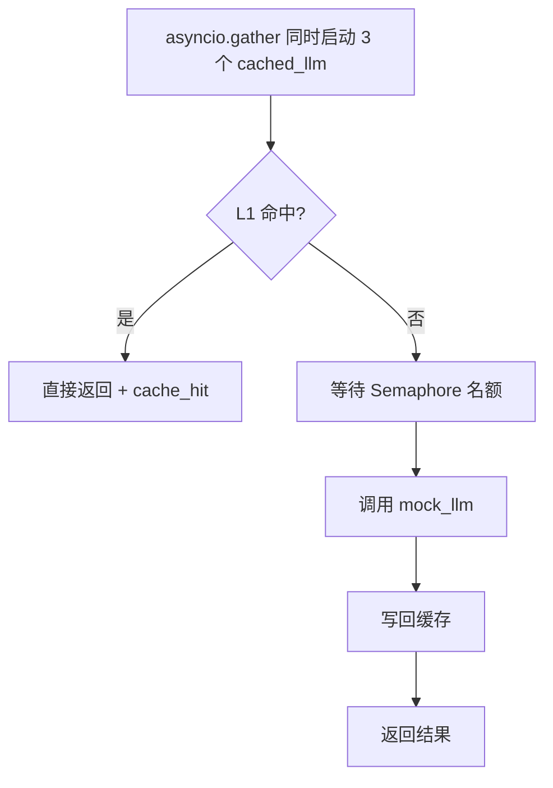
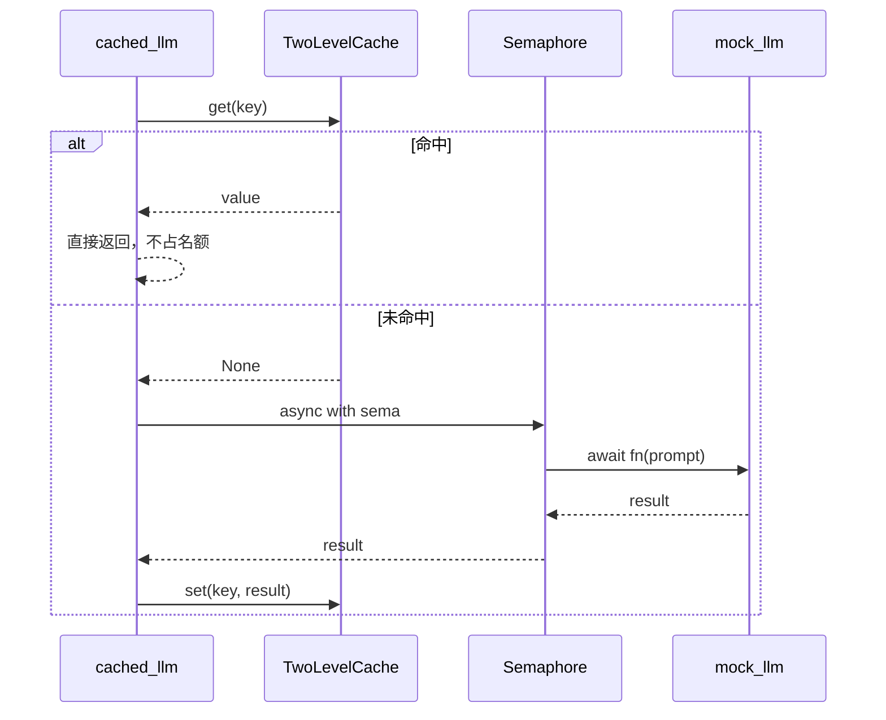

# 03 · 异步并发限流与两级缓存

一个不依赖第三方库的最小实现，用来演示模型路由场景里的**高并发调用保护**与**重复调用消除**：

- **`asyncio.gather`**：把多个 LLM 请求同时发出去，而不是一个等一个。
- **`asyncio.Semaphore`**：限制真正打到下游的并发数，防止打爆 API 配额。
- **`TwoLevelCache`**：L1 进程内 dict + L2 Redis（demo 用内存 mock），相同请求直接返回缓存结果。
- **PEP 695 泛型**：`limited_llm_call` 用 `ParamSpec` 透传参数签名，`TwoLevelCache[T]` 用 `TypeVar` 描述缓存值类型，调用处不需要强制转换。

核心逻辑在 [`runtime/`](runtime/) 目录。

---

## 目录结构

```
03/
├── main.py                     # 演示：并发未命中 → 全部命中缓存
├── README.md
└── runtime/
    ├── __init__.py             # 对外导出
    ├── limited_call.py         # 带并发上限的调用包装器
    └── two_level_cache.py      # L1 + L2 两级缓存
```

## 运行

需要 **Python 3.12+**（使用了 PEP 695 的 `class TwoLevelCache[T]` 和 `def limited_llm_call[**P, R]`；仓库的 `pyproject.toml` 声明的是 `>=3.13`）。无第三方依赖。

```bash
cd 03
python main.py
```

实测输出（Python 3.14.3，`CONCURRENCY = 2`，`CALL_DELAY = 0.3`）：

```
=== 阶段 1：3 路并发（上限 2）===
  [q-rag] 什么是 RAG？ -> [llm] 什么是 RAG？
  [q-agent] 什么是 Agent？ -> [llm] 什么是 Agent？
  [q-route] 什么是模型路由？ -> [llm] 什么是模型路由？
  耗时: 0.60s

=== 阶段 2：相同 key 再次请求（应全部 L1 命中）===
  [q-rag] 什么是 RAG？ -> [llm] 什么是 RAG？ (cache_hit)
  [q-agent] 什么是 Agent？ -> [llm] 什么是 Agent？ (cache_hit)
  [q-route] 什么是模型路由？ -> [llm] 什么是模型路由？ (cache_hit)
  耗时: 0.00s（应接近 0）
L1 条目数: 3
```

两个数字值得注意：

| 阶段 | 耗时 | 原因 |
|---|---|---|
| 阶段 1 | ≈ 0.60s = 0.3 × ⌈3 / 2⌉ | 3 个请求并发出，但信号量只放行 2 个；第 3 个等第一批释放名额 |
| 阶段 2 | ≈ 0.00s | 3 个 key 全部命中 L1，不占并发名额、不调用 `mock_llm` |

---

## 整体流程



`cached_llm` 是整套机制的汇合点：

```python
async def cached_llm(
    cache: TwoLevelCache[str],
    sema: asyncio.Semaphore,
    key: str,
    prompt: str,
) -> str:
    hit = await cache.get(key)
    if hit is not None:
        return f"{hit} (cache_hit)"

    result = await limited_llm_call(sema, mock_llm, prompt)
    await cache.set(key, result)
    return result
```

顺序很关键：**先查缓存，再抢信号量**。缓存命中时完全不需要排队，否则热门 key 会白白占着并发名额。

---

## 并发：`gather` + `Semaphore`

### `gather` 负责“同时发出去”

```python
first = await asyncio.gather(
    *[cached_llm(cache, sema, key, prompt) for key, prompt in unique]
)
```

1. 列表推导式调用 `async def` 函数并**不会执行函数体**，只创建 3 个 coroutine 对象。
2. `*` 把列表展开成 `gather(coro1, coro2, coro3)`。
3. `gather` 把它们包装成 Task 并发调度，全部完成后返回结果列表。
4. 结果**按传入顺序**排列，与完成先后无关，所以后面的 `zip(unique, first)` 能正确配对。

对比三种写法：

| 写法 | 耗时 |
|---|---|
| `for` 循环里逐个 `await` | 0.3 × 3 = 0.9s |
| `gather`，不限并发 | 0.3s |
| `gather` + `Semaphore(2)`（当前） | 0.3 × 2 = 0.6s |

`gather` 提升吞吐，信号量负责保护下游，两者解决的是不同问题。

### `limited_llm_call` 负责“最多同时几个”

```python
async def limited_llm_call[**P, R](
    sema: asyncio.Semaphore,
    fn: Callable[P, Awaitable[R]],
    /,
    *args: P.args,
    **kwargs: P.kwargs,
) -> R:
    async with sema:
        return await fn(*args, **kwargs)
```

四个设计点：

1. **`async with sema` 而不是手写 `acquire()/release()`**：`fn` 抛异常或被取消时，`__aexit__` 仍会释放名额，不会泄漏。手写的话很容易漏掉 `try/finally`。
2. **信号量由调用方传入**：它必须被所有请求共享。每个调用各建一个 `Semaphore` 等于没有限制。
3. **`/` 让 `sema`、`fn` 变成仅位置参数**：避免被包装函数恰好也有名为 `fn` 或 `sema` 的关键字参数时发生绑定冲突。
4. **`ParamSpec` 保留参数签名**：`P` 捕获 `mock_llm` 的 `(prompt: str)`，`R` 捕获 `await` 之后的返回值 `str`。因此 `limited_llm_call(sema, mock_llm, 123)` 会被静态检查拒绝，而不用 `ParamSpec` 的 `Callable[..., Awaitable[Any]]` 什么都查不出来。

```python
result = await limited_llm_call(sema, mock_llm, prompt)
reveal_type(result)   # str
```

注意 `Callable[P, Awaitable[R]]` 里的 `Awaitable`：`fn(...)` 返回的是协程对象，`await` 之后才是 `R`。

### 为什么 `Semaphore` 不是“限速器”

- 它限制的是**同时在途的调用数**，不是 QPS。
- 它只在**单进程内**生效。多 worker / 多副本时全局并发 = 进程数 × `CONCURRENCY`。
- 排队是**无界**的：信号量不限制等待队列长度，请求洪峰时协程会在内存里堆积。
- 它不提供**超时**：如果 `fn` 卡住，名额会被一直占用，需要在 `fn` 内部加 `asyncio.timeout(...)`。

---

## 两级缓存

### 各自解决什么

| | L1（进程内 dict） | L2（Redis） |
|---|---|---|
| 延迟 | 亚微秒，纯内存 | 约 0.1–1 ms，网络 + 序列化 |
| 共享范围 | 仅当前进程 | 所有进程 / 副本 |
| 重启后 | 丢失 | 保留（取决于持久化） |
| 容量 | 进程内存，需自己淘汰 | 独立扩容，原生 TTL / LRU |

真实系统的读路径是：**L1 命中直接返回；L1 未命中查 L2；L2 命中则回填 L1；都未命中才调用 LLM。**

### 当前实现

```python
class TwoLevelCache[T]:
    def __init__(self) -> None:
        self.l1: dict[str, T] = {}
        self.redis = None
        self._l2_mock: dict[str, T] = {}

    async def get(self, key: str) -> T | None:
        if key in self.l1:
            return self.l1[key]
        val = self._l2_mock.get(key) if self.redis is None else None
        if val is not None:
            self.l1[key] = val
        return val

    async def set(self, key: str, value: T, ttl: int = 300) -> None:
        self.l1[key] = value
        if self.redis is None:
            self._l2_mock[key] = value
```

泛型 `T` 让缓存不只服务字符串：换成 `TwoLevelCache[list[float]]` 就能缓存 embedding，`set` 会立刻拦住类型不符的写入。

### 这个 demo 里 L2 其实不会命中

`set` 同时写 L1 和 L2，而 L1 没有 TTL 也没有容量上限，所以**同一进程内第二次读取必然在 L1 命中**，L2 永远走不到。阶段 2 打印的 `(cache_hit)` 全部来自 L1。

`_l2_mock` 也只是同一个进程里的 dict，模拟的是 Redis 的**接口**，而不是 Redis 的**跨进程能力**。它存在的意义是把生产结构摆出来，标注好接 Redis 的位置：

```python
# val = await self.redis.get(key)
# await self.redis.setex(key, ttl, value)
```

真正需要 L2 的场景是**多进程/多副本**：进程 A 写入缓存后，进程 B 的 L1 是空的，只有共享的 L2 能让它免于重复调用模型。换句话说，**L2 的价值来自“共享”，而不是“更快”**。

### 缓存与限流的配合



这两层是正交的：**缓存减少“调用次数”，信号量限制“同时调用数”**。缓存命中率越高，信号量就越少成为瓶颈。

---

## 类型注解

`runtime/` 使用的是 PEP 695 内联类型参数：

```python
class TwoLevelCache[T]: ...
async def limited_llm_call[**P, R](...): ...
```

- `T` / `R` 是 `TypeVar`，描述“一个类型”；
- `**P` 是 `ParamSpec`，描述“一组参数”（名字、类型、默认值、位置/关键字属性）。

`main.py` 里能直接推导出的类型：

| 表达式 | 推导结果 |
|---|---|
| `cache = TwoLevelCache[str]()` | `TwoLevelCache[str]` |
| `await cache.get(key)` | `str \| None` |
| `await limited_llm_call(sema, mock_llm, prompt)` | `str` |
| `first` / `second` | `list[str]` |

注意两点：

1. 写裸 `TwoLevelCache`（不带 `[str]`）会让 `T` 退化成未知类型，`get` 的返回值也就无法窄化。
2. `cache.get` 返回 `str | None` 而不是用 `""` 表示未命中，这样 `if hit is not None` 才能正确区分“缓存里存了空串”和“没有缓存”。

---

## 已知限制与注意事项

1. **L2 是内存 mock，且永远不会命中**
   单进程内 L1 总是先被填充；`_l2_mock` 也不能跨进程共享。要观察 L2，需要先 `cache.l1.clear()`，或接入真实 Redis 后跑多进程。

2. **`ttl` 参数没有被使用**
   `set(..., ttl=300)` 只写进了签名，L1 和 `_l2_mock` 都没有过期机制，会无限增长。

3. **L1 没有容量上限**
   生产环境需要 LRU 或定期清理，否则高基数 key 会把进程内存吃满。

4. **信号量只在单进程内生效**
   多 worker 部署时，实际并发是 `worker 数 × CONCURRENCY`；跨进程限流需要 Redis 令牌桶或网关层限流。

5. **没有调用超时**
   `limited_llm_call` 只限制并发，不限制时长。慢请求会占着名额，建议在 `fn` 内部加 `asyncio.timeout`。

6. **没有请求合并（single-flight）**
   同一个未命中的 key 被 N 个请求同时查询时，N 个都会穿透到模型。高并发下需要按 key 加锁或用 `asyncio.Future` 合并。

7. **`gather` 的异常语义**
   任一任务抛错时，`await gather(...)` 会立即抛出该异常，但其余任务**不会被取消**，仍在后台继续跑。需要“失败也收集”时加 `return_exceptions=True`；需要“一个失败就取消全部”时用 `asyncio.TaskGroup`。

8. **`self.redis = None` 的类型是 `None`**
   之后赋真实客户端时静态检查会报错。接入 Redis 时应改成 `self.redis: Redis | None = None`。

9. **缓存只适合可复用、确定性的请求**
   带会话历史、随机采样（`temperature > 0`）或包含时间戳的 prompt，命中率会接近 0，且可能返回过期语义的结果。键里应包含 `model`、`temperature`、prompt 版本等所有影响输出的字段。

---

## 可以继续扩展的方向

- 把 `_l2_mock` 换成真实 `redis.asyncio`，用 `SETEX` 实现 TTL，并按模型/租户做 namespace；
- 给 L1 加 TTL 与 LRU，让 L2 真正被读到；
- 用 single-flight 合并同一个 key 的并发未命中；
- 为 `limited_llm_call` 增加超时与排队上限（超限快速失败，而不是无限堆积）；
- 用 `asyncio.TaskGroup` 替代 `gather`，获得更严格的失败即取消语义；
- 暴露指标：缓存命中率、限流等待时长、下游并发峰值、节省的 token 数；
- 把信号量换成令牌桶，从“限制并发”升级为“限制 QPS”；
- 在 `main.py` 中增加“超过并发上限”和“缓存被清空后回落 L2”的对照场景。
