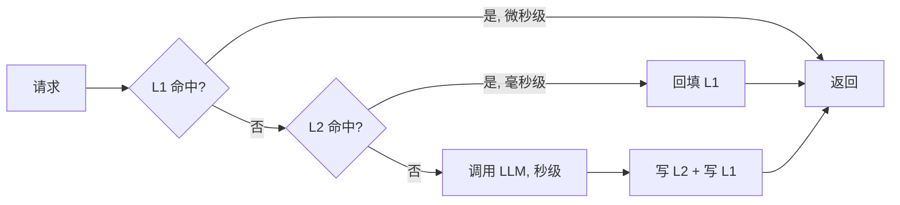
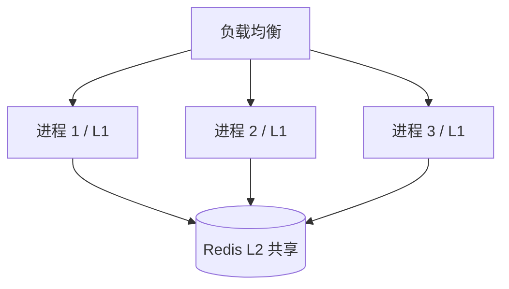

# 为什么这个 demo 需要两级缓存？

> 本文是 `03` demo 的补充说明，对应代码：[`runtime/two_level_cache.py`](runtime/two_level_cache.py)。总览见 [`README.md`](README.md)。

## 先说实话：在这个 demo 里，两级缓存**严格来说不是必需的**

按现在的代码跑，L2 一次都不会被读到：

```python
async def set(self, key, value, ttl=300):
    self.l1[key] = value          # 先写 L1
    if self.redis is None:
        self._l2_mock[key] = value  # 再写 L2

async def get(self, key):
    if key in self.l1:            # L1 有就直接返回
        return self.l1[key]
    val = self._l2_mock.get(key)  # 只有 L1 没有才走这里
```

`set` 同时写了 L1 和 L2，而 L1 又没有任何淘汰/TTL，所以同一个进程里 L2 永远是“写了但读不到”。阶段 2 打印的 `(cache_hit)` 全部来自 L1。

所以这个 demo 的 `TwoLevelCache` 是**教学脚手架**：它把真实生产里的结构、接口（`get`/`set`/`ttl`）、以及接 Redis 的位置（`# await self.redis.setex(...)`）都摆出来，让你照着改成生产实现；但它本身并不是“为了这个 demo 能跑”而存在的。

## 那真实场景为什么需要两级？

因为 **延迟** 和 **共享范围** 这两个目标没法用一层同时满足：

| | L1（进程内 dict） | L2（Redis） |
|---|---|---|
| 访问延迟 | ~0.1 µs，纯内存 | ~0.1–1 ms，要走网络 + 序列化 |
| 共享范围 | **仅当前进程** | 所有进程 / 所有 Pod / 所有实例 |
| 重启后 | 丢失 | 保留（取决于持久化） |
| 容量 | 受进程内存限制，且需自己管淘汰 | 独立扩容，原生 TTL / LRU |
| 一致性 | 各自为政，可能不一致 | 单一数据源，相对一致 |



三层延迟差了好几个数量级：微秒 → 毫秒 → 秒。缓存分层的意义就是把「热数据」放在最快的那层，「温数据」放在能跨进程共享的那层，「冷数据」才付出真实调用代价。

**为什么 L2 必须是独立服务（Redis）**：因为 L1 是进程私有的。你一旦用 `uvicorn --workers 4`、gunicorn 多进程，或者部署 3 个副本，就变成 4~N 份互不相通的 L1：



用户 A 的请求打到进程 1，把「什么是 RAG？」缓存进进程 1 的 L1；用户 B 问同样的问题打到进程 2，进程 2 的 L1 是空的——这时**只有 L2 能救它**。这才是两级缓存真正的价值：让一次昂贵的 LLM 调用惠及所有进程、所有用户。

顺带一个概念上的坑：demo 里的 `_l2_mock` 虽然叫 L2，但它**仍然是同一个进程里的 dict**，并不能跨进程共享。它模拟的只是 Redis 的“第二层接口”，不是 Redis 的“跨进程能力”。

## 怎么让这个 demo 真的演示出 L2

三个改法，任选：

**1. 给 L1 加 TTL / 容量上限**，让 L1 会“漏”，从而落到 L2：

```python
self.l1: dict[str, tuple[T, float]] = {}   # value + expire_at
```

**2. 手动清 L1 再请求**，直观展示回填：

```python
cache.l1.clear()
await cached_llm(cache, sema, "q-rag", "什么是 RAG？")   # 会命中 L2 并回填 L1
```

**3. 跑两个进程**（最接近真实），第二个进程 L1 为空 → 命中第一个进程留下的 L2。但要注意 mock 版做不到，必须换成真 Redis 才会生效。

另外 `set` 的 `ttl: int = 300` 现在完全没被使用，L1 和 `_l2_mock` 都是永久驻留——这也是“L2 永远读不到”的直接原因之一。

## 什么时候**不需要**两级

- 单进程、单实例的脚本/离线任务：一层 dict 足够，加 Redis 纯属增加运维成本。
- 数据集很小、命中率极高：L1 就能覆盖，网络开销反而拖慢。
- 对一致性要求很强：两层的过期时间不同步，会出现“L1 已过期但 L2 还是旧值”这类问题，需要谨慎设计 TTL 和失效广播。

## 这个 demo 没做、但生产必须考虑的

1. **缓存击穿/惊群（singleflight）**：阶段 1 里 3 个不同 key 不受影响；但如果 10 个并发请求同一个未命中的 key，10 个都会穿透到 LLM。需要按 key 加锁或 `asyncio.Future` 合并。
2. **TTL 与抖动**：L2 写 `ttl=300`，L1 也应该有更短的 TTL，避免长期脏读。
3. **序列化**：真实 Redis 要 `json`/`msgpack` 序列化，`T` 必须是可序列化类型——这也是为什么 `TwoLevelCache[T]` 泛型在接入 Redis 时要多一层约束。
4. **负缓存**：LLM 失败的结果要不要缓存？否则故障期间会被反复重试打爆。

一句话总结：**这个 demo 里 L2 是“为了展示架构”而存在的；它的必要性来自多进程/多副本共享和重启存活，而不是单进程跑通这段代码。**
