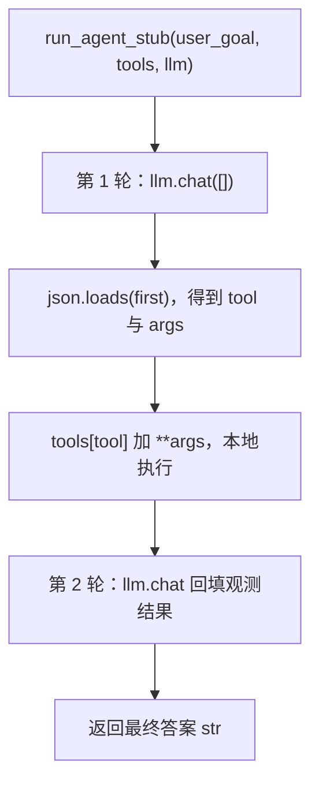

# 04 · Mock LLM 与 Agent 编排的集成测试

一个只依赖 `pytest` 的最小实现，用来演示模型路由场景里**如何对 Agent 编排做确定性测试**：

- **`LLM` Protocol**：用结构化子类型定义「模型」的最小接口，测试替身与真实客户端可以互换。
- **`FakeLLM`**：按预设 `replies` 的顺序逐条返回，替代真实 API，零成本、零网络、毫秒级。
- **`run_agent_stub`**：两轮编排 —— 模型吐 tool JSON → 本地执行工具 → 观测结果回填 → 模型给出最终答案。
- **`main.py` + `pytest.ini`**：真正的测试入口，退出码可被 CI 消费，而不是手写 `print` 脚本。

核心逻辑在 [`agent/`](agent/) 目录。

---

## 目录结构

```
04/
├── main.py                 # 入口：在 04/ 下启动 pytest，并透传退出码
├── pytest.ini              # pythonpath / testpaths
├── README.md
├── agent/
│   ├── __init__.py         # 对外导出 FakeLLM / run_agent_stub
│   ├── llm.py              # Message(TypedDict) + LLM(Protocol)
│   ├── fake_llm.py         # Mock 模型：按序吐出预设回复
│   └── stub.py             # 两轮编排：tool 调用 → 执行 → 终答
└── tests/
    └── test_agent.py       # 集成测试：工具参数正确 + 终答包含预期内容
```

## 运行

需要 **Python 3.13+**（仓库 `pyproject.toml` 声明 `requires-python = ">=3.13"`），唯一依赖是 `pytest`。

```bash
cd 04
pytest -v
```

也可以直接跑入口脚本，它会自动切到 `04/` 目录并透传退出码：

```bash
python main.py
```

实测输出（Python 3.13.5 / pytest 9.1.1）：

```
================ test session starts ================
platform darwin -- Python 3.13.5, pytest-9.1.1, pluggy-1.7.0
cachedir: .pytest_cache
rootdir: .../model-route/04
configfile: pytest.ini
testpaths: tests
collected 1 item

tests/test_agent.py::test_agent_calls_tool_once PASSED [100%]

================= 1 passed in 0.01s =================
```

和 `01`～`03` 不同，这里**没有业务打印输出**——被验证的不是「跑得对不对」，而是「行为是否符合断言」。

---

## 为什么用 Mock 而不是真实 API 测编排

Agent 编排的 bug 大多不在模型，而在**胶水代码**：

- 工具被调用了几次？参数是不是模型给的那个？
- 工具结果有没有被正确回填进下一轮上下文？
- 模型返回非法 JSON 时会不会崩？未知工具名怎么处理？
- 调用次数超出预期时有没有报错？

这些问题如果用真实 API 测，会同时继承四个麻烦：**不确定（模型每次输出不同）、要花钱、要联网、慢**。而 `FakeLLM` 把「模型」这个唯一的外部变量固定成一张纸条序列，于是：

| | 真实 API | `FakeLLM` |
|---|---|---|
| 确定性 | 输出有随机性 | 完全确定 |
| 成本 | 按 token 计费 | 0 |
| 网络 | 需要 | 不需要 |
| 耗时 | 秒级 | 毫秒级 |
| 边界构造 | 难（很难让它故意吐坏 JSON） | 一行字符串就行 |

**契约先固定，再逐个替换实现**——这是所有 mock 类测试的共同逻辑：`FakeLLM` 和真实客户端都必须满足 [`agent/llm.py`](agent/llm.py) 里的 `LLM` 协议。

---

## 整体流程



一次调用只走**一轮工具**，没有循环、没有重试、没有 messages 历史累积。这是「单步 ReAct」的最小形态：模型决定调什么 → 本地执行 → 结果回填 → 模型总结。

---

## `agent/llm.py`：先定契约

```python
from collections.abc import Sequence
from typing import Literal, Protocol, TypedDict


class Message(TypedDict):
    role: Literal["system", "user", "assistant", "tool"]
    content: str


class LLM(Protocol):
    def chat(self, messages: Sequence[Message]) -> str: ...
```

### 为什么用 `Protocol` 而不是 ABC

`Protocol` 是**结构化子类型**（鸭子类型的静态版本）：只要一个类「长得像」`LLM`（有匹配签名的 `chat` 方法），它就**自动**是 `LLM`，不需要显式继承。

```python
class FakeLLM:                      # 注意：没有继承 LLM
    def chat(self, messages: Sequence[Message]) -> str: ...
```

换成 `class LLM(ABC)` 的话，`FakeLLM` 必须写 `class FakeLLM(LLM)` 并实现抽象方法。两者都能达到目的，但 `Protocol` 的优势是：

- **不侵入实现**：第三方客户端、已有的类、甚至一个 `lambda` 包装都能满足协议；
- **零运行时开销**：`Protocol` 不参与 `isinstance` 检查（除非加 `@runtime_checkable`），纯粹给类型检查器看；
- **依赖方向正确**：`stub.py` 依赖抽象 `LLM`，而不是具体的 `FakeLLM`。

这一点很关键。如果 `run_agent_stub` 的签名写成 `llm: FakeLLM`，编排逻辑就被硬绑在**测试替身**上了——一旦写真实的 `OpenAILLM`，类型检查立刻报「参数类型不匹配」，只能回去改 `stub.py` 的签名。抽成 `Protocol` 之后，测试和生产共用同一份编排代码。

### `Message` 为什么是 `TypedDict`

```python
class Message(TypedDict):
    role: Literal["system", "user", "assistant", "tool"]
    content: str
```

| 决策 | 原因 |
|---|---|
| `TypedDict` 而不是 `dict[str, str]` | 精确表达「必须有 `role` 和 `content` 两个键」。`dict[str, str]` 无法阻止 `messages[0]["roles"]` 这种拼写错误 |
| `role` 用 `Literal` 而不是 `str` | 非法角色（如 `"asistant"`，少一个 `s`）在静态检查阶段就被拦下，而不是等到模型行为异常 |
| `TypedDict` 而不是 dataclass | 这正是 OpenAI / Anthropic 等 API 的线上格式，构造时直接写字面量，不需要转换 |

### `messages` 为什么是 `Sequence[Message]`

`Sequence` 是**只读**且**协变**的，而 `list` 是**不变**的：

- 参数位置写 `list[Message]` 更严格，也更难传（`list` 不变 → 必须精确匹配）；
- `Sequence[Message]` 能接受 `list[Message]`、`tuple[Message, ...]`，且满足「函数只读 messages」的语义。

顺带一提 `messages` 目前**根本没有被读取**（`FakeLLM` 只用调用次数），这也是这个协议的最小化极限：真实实现会用它拼 prompt，而 `FakeLLM` 故意忽略它。

---

## `agent/fake_llm.py`：把模型固定成纸条序列

```python
class FakeLLM:
    def __init__(self, replies: Iterable[str]) -> None:
        self.replies: Iterator[str] = iter(replies)

    def chat(self, messages: Sequence[Message]) -> str:
        try:
            return next(self.replies)
        except StopIteration:
            raise AssertionError(
                "FakeLLM 的预设回复已用完：实际调用次数超过了预设的 replies 数量"
            ) from None
```

### `iter()` + `next()`：用迭代器承载「第几次调用」

```python
self.replies = iter(replies)   # 把「列表」变成「迭代器」
return next(self.replies)      # 取下一个，并把游标前移
```

- **可迭代对象**（`list`、`tuple`、`str`）只承诺「能被遍历」，**不记录遍历到哪**；
- **迭代器**自带游标，每次 `next()` 前移一格；
- `for x in replies` 在底层就是先 `iter()` 再反复 `next()`，这里只是把这两步手动拆开。

好处是**零状态管理**：不用写 `self.i = 0` / `self.i += 1`，也不必担心多个 `chat()` 并发改索引。

代价是**一次性**：同一个 `FakeLLM` 实例的游标不会回退（`iter(iterator)` 返回的还是它自己，不会重置）。测试里想重跑就得**新建实例**。

> 类型上写成 `replies: Iterable[str]`（宽进）→ `self.replies: Iterator[str]`（如实反映「有 `__next__`、会被消耗」）。如果属性标注成 `Iterable[str]`，`next()` 调用会被类型检查器报告——因为 `Iterable` 不保证有 `__next__`。

### `raise ... from None`：切断异常链

```python
except StopIteration:
    raise AssertionError("...") from None
```

`raise A from B` 是 Python 的**异常链**语法，设置 `A.__cause__ = B`。三个变体：

| 写法 | traceback 里的措辞 | 适用场景 |
|---|---|---|
| `raise A(...)` | `During handling of the above exception...` | 接受默认行为 |
| `raise A(...) from err` | `The above exception was the direct cause of...` | 底层是真错误，需要保留线索 |
| `raise A(...) from None` | 只显示 `A` | 底层是**预期内的控制流**，或含敏感信息 |

这里用 `from None` 的理由是：**`StopIteration` 不是错误，而是「遍历正常结束」的信号**。它不是「处理异常时又出错」，印一句 `During handling...` 会误导排障的人以为底层真有故障。截断之后，报错信息只剩一条真正有用的结论：

> `FakeLLM 的预设回复已用完：实际调用次数超过了预设的 replies 数量`

注意 `from None` **只是不显示**，不是删除：`e.__context__` 依然能拿到那个 `StopIteration`（`__suppress_context__` 被置为 `True`）。

### 为什么抛 `AssertionError`

1. **pytest 会把它当成普通断言失败（`FAILED`）而不是意外错误（`ERROR`）**，输出更干净，语义也对：回复不够用 = 测试自己写错了。
2. `raise AssertionError(...)` **不受 `python -O` 影响**，而 `assert` 语句在优化模式下会被整个删掉。测试辅助类里前者更可靠。

---

## `agent/stub.py`：两轮编排

```python
def run_agent_stub(
    user_goal: str,
    tools: Mapping[str, Callable[..., object]],
    llm: LLM,
) -> str:
    first = llm.chat([])
    action = json.loads(first)
    obs = tools[action["tool"]](**action["args"])
    second = llm.chat([{"role": "user", "content": str(obs)}])
    return second
```

逐行看：

| 行 | 干什么 | 要点 |
|---|---|---|
| `llm.chat([])` | 第 1 轮，期望模型返回 tool JSON 字符串 | 传空 messages，`user_goal` 没有被用到（见「已知限制」） |
| `json.loads(first)` | 解析成 `{"tool": ..., "args": {...}}` | 返回 `Any`，失去静态类型保障 |
| `tools[action["tool"]](**action["args"])` | 按名查表并执行 | 工具名不存在 → `KeyError`；`args` 对不上 → `TypeError` |
| `llm.chat([...])` | 把观测结果拼成一条 `user` 消息回填 | 第 2 次调用，`FakeLLM` 吐出终答 |
| `return second` | 返回最终答案 | 类型精度依赖 `LLM.chat -> str` |

### 为什么 `tools` 是 `Mapping` 而不是 `dict`

这是本文件里唯一需要类型理论的一处。`dict` 在值类型上是**不变（invariant）**的，`Mapping` 是**协变（covariant）**的。差别直接体现在：

```python
tools = {"search": search}          # 推断为 dict[str, (q: str) -> list[str]]
run_agent_stub("查 python", tools, FakeLLM(replies))
```

如果参数声明成 `dict[str, Callable[..., object]]`，类型检查器会拒绝：

```
Argument to function `run_agent_stub` is incorrect:
Expected `dict[str, (...) -> object]`, found `dict[str, (q: str) -> list[str]]`
info: `dict` is invariant in its second type parameter
```

原因是不变性要求**双向**兼容，而反向不成立：

```
① (q: str) -> list[str]  <:  Callable[..., object]    ✓  返回 list[str] 是 object 的子类型
② Callable[..., object]  <:  (q: str) -> list[str]    ✗  需要 object 是 list[str] 的子类型
```

换成 `Mapping` 后只需要 ①（单向），检查通过。而且这不只是「绕过检查」——`run_agent_stub` **只读** `tools`（`tools[name](...)`），声明成可写 `dict` 本来就是过度承诺。副作用是调用方还能传 `MappingProxyType`、`ChainMap` 这类只读映射。

> 一句话记忆：**「能在里面写东西的容器，类型都必须不变」**，否则就能借壳写入不兼容的值。`list` / `dict` / `set` 不变；`Mapping` / `Sequence` / `Iterable` / `Iterator` 协变。

### `Callable[..., object]` 的 `...` 是什么

`...` 表示「签名不关心」，PEP 484 规定 `Callable[..., R]` 与任何参数列表**双向兼容**：

```python
Callable[..., object]    # 接受 (q: str) -> list[str]
                         # 也接受 (a: int, b: str) -> dict
```

这正是它能容纳「一堆签名各不相同的工具」的原因。**代价**是放弃了参数检查：`tools["search"](1, 2, 3)` 静态检查不会报错，只会在运行时炸。这是用灵活性换来的已知妥协。

---

## `tests/test_agent.py`：测的是「编排」不是「模型」

```python
def test_agent_calls_tool_once():
    replies = [
        '{"tool":"search","args":{"q":"Python"}}',
        "最终答案基于工具结果。",
    ]
    calls: list[str] = []

    def search(q: str) -> list[str]:
        calls.append(q)
        return ["doc1"]

    tools = {"search": search}

    out = run_agent_stub("查 python", tools, FakeLLM(replies))
    assert calls == ["Python"]
    assert "最终" in out
```

三个测试技巧：

1. **`replies` 就是剧本**：第 1 条决定「调什么工具、传什么参数」，第 2 条决定「终答长什么样」。剧本和断言分离，读起来就是一段对话。
2. **闭包捕获副作用**：`calls` 列表在 `search` 里被追加，测试结束后检查它。这是验证「工具被调用了几次、参数是什么」最轻的办法——比 `unittest.mock.MagicMock` 更直白，且不带 mock 框架的隐式行为。
3. **两条断言覆盖两个层面**：
   - `calls == ["Python"]` → 验证**编排层**：工具被调用，且参数来自模型给的 JSON（注意 `"Python"` 的大写 `P`，证明参数没被改写）；
   - `"最终" in out` → 验证**上下文回填**：第 2 轮的返回值被原样透传出来。

第 2 条断言故意写得宽松（`in` 而不是 `==`）。如果 `FakeLLM` 每次都返回固定字符串，`==` 也能过，但那只是在测「`FakeLLM` 会返回第 2 条字符串」，没有信息量。

---

## `pytest.ini` 与 `main.py`：让它能被自动化调用

```ini
[pytest]
pythonpath = .
testpaths = tests
```

| 配置 | 解决什么 | 什么时候失效 |
|---|---|---|
| `[pytest]` | 声明这是 `pytest.ini` 的配置段（写成 `[tool:pytest]` 只适用于 `setup.cfg`） | 段落名写错 → **静默失效**，不报错 |
| `pythonpath = .` | 把 `04/` 加入 `sys.path`，让 `from agent import ...` 能解析（需 pytest ≥ 7.0） | 路径相对 **rootdir** 解析 |
| `testpaths = tests` | 命令行没给路径时，默认只收集 `tests/` | 一旦命令行给了文件/目录参数就被忽略 |

`pythonpath` 为什么必需？用裸 `pytest` 命令时，`sys.path` 里并没有 `04/`：

- console script 启动时 `sys.path[0]` 是 venv 的 `bin/`，**不是** cwd；
- 默认的 `importmode=prepend` 只为每个测试模块插入「第一个不含 `__init__.py` 的父目录」。`tests/` 下没有 `__init__.py`，所以插进去的是 **`tests/` 本身**，`04/` 依然不在。

结果是 `ModuleNotFoundError: No module named 'agent'`。

> 小差异：`python -m pytest` 会在启动时把 cwd 加到 `sys.path`，所以 `python main.py` 那条路径其实顺带解决了 import；`pythonpath = .` 是为了让「裸 `pytest` 命令 / IDE 里点运行」也能工作。

### `main.py` 三行有效代码

```python
result = subprocess.run(
    [sys.executable, "-m", "pytest", "-v"],
    cwd=Path(__file__).resolve().parent,
)
raise SystemExit(result.returncode)
```

（源码里用的是 `__import__("pathlib").Path`，等价写法，建议改成顶部 `from pathlib import Path`。）

| 片段 | 作用 |
|---|---|
| `sys.executable` + `-m pytest` | 用**同一个解释器**（即 venv 里的 python）导入它自己的 pytest。写裸 `"pytest"` 会走 `PATH`，可能命中另一个环境的 pytest |
| `cwd=...parent` | 切到 `04/`，让 rootdir 找到 `pytest.ini`，`pythonpath` / `testpaths` 才生效。**这是最不能省的一行** |
| `raise SystemExit(returncode)` | 把 pytest 退出码透传给 shell / CI。少了它脚本永远以 `0` 退出，**失败的测试会被当成成功** |

pytest 退出码语义：`0` 全过、`1` 有失败、`2` 被中断、`3` 内部错误、`4` 用法错误、`5` 没收集到测试。

注意这里**不要**改成 `check=True`：那样 pytest 失败时 `main.py` 会抛 `CalledProcessError` 和一大坨 traceback，反而盖住 pytest 自己的输出。「不 check + 手动透传码」是最干净的写法。

---

## 类型设计速查

| 概念 | 规则 | 本例中的体现 |
|---|---|---|
| 只读容器（`Mapping` / `Sequence` / `Iterable`） | 协变，可「子类型容器」当「父类型容器」 | `tools: Mapping[...]` 能接受各种签名的工具 |
| 可写容器（`dict` / `list` / `set`） | 不变，必须双向兼容 | 写成 `dict[...]` 就拒绝了 `dict[str, 具体签名]` |
| 函数返回值 | 协变 | `list[str]` 可当 `object` |
| 函数参数 | 逆变 | 能接受更宽参数的函数可替代更窄的 |
| `Callable[..., R]` | `...` 与任何参数列表双向兼容 | 容纳签名各异的多个工具，但放弃参数检查 |
| `Protocol` | 结构化子类型，无需继承 | `FakeLLM` 不继承 `LLM` 也是 `LLM` |

仓库根目录 `pyproject.toml` 里已经配好 `[tool.ty.environment] root = ["./01", "./02", "./03", "./04"]`，如果本机装了 [`ty`](https://docs.astral.sh/ty/) 可以跑：

```bash
cd model-route
ty check 04
```

> 当前 `.venv` 里没有安装 `ty`，所以这一步不是必须的；`pytest` 本身不依赖类型检查。

---

## 已知限制与注意事项

1. **`user_goal` 完全没有被使用**
   首轮 `llm.chat([])` 传的是空列表，`"查 python"` 只是装饰。真实编排里首轮消息应该是 `[{"role": "user", "content": user_goal}]`，否则模型根本不知道用户要干什么。

2. **`FakeLLM` 只看调用次数，不看 `messages`**
   它无条件返回下一条预设回复，因此**无法验证 prompt 构造是否正确**（比如工具结果有没有被正确序列化进上下文）。要测这一点，得让 `FakeLLM` 记录每次收到的 `messages`，断言其内容。

3. **一次性迭代器，没有 `reset()`**
   游标不会回退。测试里捕获了 `AssertionError` 之后复用同一个实例，会一直抛错。需要重置就新建实例，或保存原始副本后重建迭代器。

4. **没有错误处理分支**
   `json.loads` 遇到非法 JSON → `JSONDecodeError`；工具名不存在 → `KeyError`；工具参数不匹配 → `TypeError`；工具本身抛异常 → 直接向上冒泡。全部是裸崩，没有「让模型重试」「回填错误信息给模型」这类容错。

5. **`str(obs)` 是 Python repr，不是 JSON**
   `["doc1"]` 会变成 `"['doc1']"`（单引号）。真实场景应该用 `json.dumps(obs, ensure_ascii=False)`，否则模型可能对格式产生困惑。

6. **只有 happy path 一个用例**
   缺：回复用尽、JSON 非法、未知工具、工具抛错、无工具直接回答、多轮循环等分支。

7. **`action` 是 `Any`，链路在此断开**
   `json.loads` 返回 `Any`，于是 `action["tool"]`、`action["args"]` 都不受检查。可以定义 `class ToolCall(TypedDict): tool: str; args: dict[str, object]` 配合 `cast` 补上。

8. **`Callable[..., object]` 放弃了参数检查**
   传错参数、传错个数静态阶段都发现不了，只有运行时才炸。

9. **`run_agent_stub` 只支持单轮工具调用**
   没有 `while` 循环，模型无法连续调两次工具，也无法在「不需要工具」时跳过执行。

10. **PEP 695 语法要求 Python 3.12+**
    `01`、`03` 用了 `def f[T](...)` 这类新语法，`04` 本身没有用，但整个仓库统一按 `>=3.13` 声明。

---

## 可以继续扩展的方向

- **补测试分支**：回复用尽（`AssertionError`）、非法 JSON、未知工具名、工具抛异常、无工具直接终答；
- **让 `FakeLLM` 记录 `messages`**：从「按序吐纸条」升级为「按序断言输入」，真正验证 prompt 构造；
- **给 `action` 加类型**：`ToolCall(TypedDict)` + `cast`，让 `tools[action["tool"]]` 恢复静态校验；
- **改用 `json.dumps` 序列化观测结果**，与真实 API 的 tool message 格式对齐；
- **把编排改成循环**：`while not finished` 支持多次工具调用，并在超过 `max_steps` 时终止；
- **引入一次真实客户端的契约测试**：`OpenAILLM` 实现同一个 `LLM` 协议，用 `pytest.mark.skipif(no_api_key)` 跑少量 smoke test；
- **给 `FakeLLM` 加 `reset()`**，或干脆改成按索引查询以支持重复运行；
- **在 `pytest.ini` 里加 `--strict-config`**，让配置项拼写错误立即报错而不是静默忽略。
