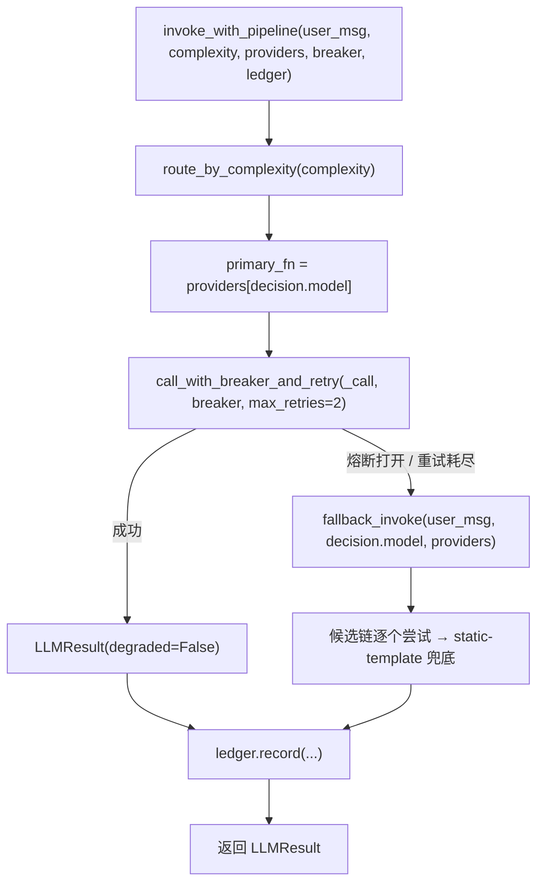
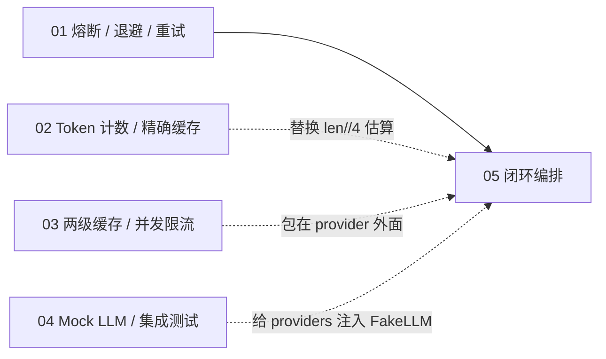

# 05 · 路由 → 熔断 → 重试 → 降级 → 计费 的完整闭环

把前面几节的单点能力串成线上一次调用的真实路径：**先决定用哪个模型，再带着保护去调用，失败就换模型，最后不管成功还是降级都记账**。

- **路由（router）**：按任务复杂度在「能力 / 成本」之间选模型，并给出可解释的理由。
- **熔断 + 重试（复用 01）**：主模型连续失败时先退避重试，达到阈值立刻跳闸，不再继续砸流量。
- **降级（fallback）**：主模型不可用时按链切换备用模型，最后兜底到静态模板，保证永远有回复。
- **计费（billing）**：每一笔调用（包括降级、包括静态模板）都写入账本，`degraded` 标记一路透传。

核心逻辑在 [`pipeline/`](pipeline/) 目录。

---

## 目录结构

```
05/
├── main.py                 # 入口：构造 mock provider，跑一遍完整闭环
├── README.md
└── pipeline/
    ├── __init__.py         # 注入 01/ 到 sys.path，对外导出公共类型与函数
    ├── type.py             # Provider / ProviderOutput / Complexity 契约
    ├── router.py           # 复杂度 → 模型决策
    ├── invoke.py           # 闭环编排：路由 → 熔断 → 重试 → 降级 → 计费
    ├── fallback.py         # LLMResult + 降级链
    └── billing.py          # 账单条目与累计成本
```

## 运行

需要 **Python 3.13+**（`pyproject.toml` 声明 `requires-python = ">=3.13"`；`type X = ...` 是 PEP 695 语法，`call_with_breaker_and_retry[T]` 同理）。零第三方依赖。

```bash
cd 05
python3 main.py
```

实测输出（Python 3.14.3）：

```
=== 路由决策: gpt-4o-pro (复杂任务，走高能力模型) ===
响应: [gpt-4o-mini] 回答: 解释 Transformer 注意力机制
降级: True  模型: gpt-4o-mini
账单条目: BillRecord(model='gpt-4o-mini', prompt_tokens=10, completion_tokens=30, cost_usd=2e-05, degraded=True)
累计成本 USD: 2e-05
```

这一遍跑出来的**不是**「主模型正常返回」的理想路径，而是最值得看的那条：主模型 `gpt-4o-pro` 连续失败 → 跳闸 → 降级到 `gpt-4o-mini` → 记账。下面按这个顺序逐段解释。

---

## 整体流程



四个阶段的顺序是有讲究的：

| 顺序 | 如果换一下会怎样 |
|---|---|
| 路由在前 | 先建连再决定模型，等于给不需要的模型建了连接、写了日志 |
| 熔断在路由之后 | 熔断器无法按模型统计故障，一个模型挂了会误伤其他模型 |
| 降级在熔断之后 | 主模型抖动时直接换模型，白白丢掉「重试就能成功」的机会 |
| 计费在最后、且覆盖降级分支 | 只记成功请求，降级流量就变成一本糊涂账，成本与降级率都对不上 |

一句话：**路由是决策，熔断/重试是同模型内的自愈，降级是跨模型的兜底，计费是唯一的收尾出口。**

---

## `pipeline/type.py`：先定契约

```python
from collections.abc import Callable
from typing import Literal, TypedDict


class ProviderOutput(TypedDict):
    text: str
    prompt_tokens: int
    completion_tokens: int

type Provider = Callable[[str], ProviderOutput]

type Complexity = Literal["simple", "medium", "hard"]
```

| 决策 | 原因 |
|---|---|
| `ProviderOutput` 用 `TypedDict` 而不是 `dict` | 精确表达「必须有 `text` / `prompt_tokens` / `completion_tokens` 三个键」。写成裸 `dict`（即 `dict[Any, Any]`）后，`raw["promt_tokens"]` 这种拼写错误要到运行时才炸；而且**裸 `dict` 不能赋给 `TypedDict`**，类型检查器会直接报错 |
| `Provider` 用 `Callable[[str], ProviderOutput]` 别名 | `main.py` 的 mock 与真实 SDK 客户端只要签名一致就能互换，`invoke.py` 不需要知道具体实现 |
| `Complexity` 用 `Literal` 而不是 `str` | `"hard"` 拼成 `"Hard"` 时会静默落到默认分支（见下文路由表），类型检查阶段就能拦下 |

注意 `type X = ...` 是 PEP 695 的类型别名语法（3.12+），不是变量赋值——它只在类型层面存在，不产生运行时对象，也不能用在 `isinstance` 里。

---

## `pipeline/router.py`：复杂度 → 模型

```python
@dataclass(frozen=True, slots=True)
class RouteDecision:
    model: str
    reason: str

_ROUTE_TABLE: dict[Complexity, RouteDecision] = {
    "simple": RouteDecision("gpt-4o-mini", "简单问答，走低成本模型"),
    "medium": RouteDecision("gpt-4o", "中等推理，走标准模型"),
    "hard": RouteDecision("gpt-4o-pro", "复杂任务，走高能力模型"),
}

def route_by_complexity(complexity: Complexity) -> RouteDecision:
    return _ROUTE_TABLE.get(complexity, RouteDecision("gpt-4o-mini", "未知复杂度，默认 mini"))
```

三点设计：

- **`reason` 不是装饰**：路由决策必须可解释，否则出事故时无法回答「为什么这次走了贵模型」。生产里这个字段应该随请求一起打点。
- **未知复杂度默认最便宜**：宁可降质也不超预算。这是「成本优先」的默认取向，反过来的项目（如 SLA 优先）应该默认最强模型。
- **`frozen=True, slots=True`**：决策是值对象，被下游读取但不该被改写；`slots` 顺带省内存。

> 因为 `Complexity` 是 `Literal`，`_ROUTE_TABLE` 的键覆盖了全部取值，所以 `.get()` 的 `default` 在当前类型下其实是不可达的。保留它是为了防御**运行时**传入来自 JSON / HTTP 的越界字符串——类型系统管不到进程边界之外。

---

## `pipeline/invoke.py`：闭环编排

```python
def invoke_with_pipeline(
    user_msg: str,
    complexity: str,
    providers: dict[str, Provider],
    breaker: CircuitBreaker,
    ledger: BillingLedger,
    max_retries: int = 2,
) -> LLMResult:
    decision = route_by_complexity(complexity)
    primary_fn = providers[decision.model]

    def _call() -> ProviderOutput:
        return primary_fn(user_msg)

    try:
        raw = call_with_breaker_and_retry(_call, breaker, max_retries=max_retries)
        result = LLMResult(text=raw["text"], model=decision.model, ...)
    except Exception:
        result = fallback_invoke(user_msg, decision.model, providers)

    ledger.record(result.model, result.prompt_tokens,
                  result.completion_tokens, degraded=result.degraded)
    return result
```

### 为什么包一层 `_call`

`call_with_breaker_and_retry` 的签名是 `fn: Callable[[], T]` —— 它只要「一个无参可调用」，然后负责 `allow()` / `before_call()` / `on_success()` / `on_failure()` 的记账。`_call` 就是适配器，把 `Provider(user_msg)` 降成 `Callable[[], ProviderOutput]`，**顺带把 `T` 固定成 `ProviderOutput`**，于是 `raw["text"]` 的键名获得类型检查。

### 为什么 `except Exception` 而不是只捕 `ConnectionError`

熔断跳闸抛的是 `RuntimeError("circuit_open")`，重试耗尽抛的是原始异常，provider 还可能抛超时、鉴权失败……这些都是「主模型不可用」，都应该走降级。`Exception` 不会吞掉 `KeyboardInterrupt` / `SystemExit`（它们是 `BaseException`），所以 Ctrl-C 仍然能中断。

代价是也会吞掉**代码 bug**（例如 `KeyError`）。生产实现建议收窄为 `(ConnectionError, TimeoutError, RuntimeError)` 之类的白名单，并在降级日志里带上堆栈。

### 计费收口到单一路径

成功与降级**最后都汇到同一个 `ledger.record(...)`**，而不是在 `try` 和 `except` 两个分支里各写一遍。这样只要走到函数末尾就一定有账，不会出现「新加一条降级分支忘了记账」。

---

## `pipeline/fallback.py`：降级链

```python
FALLBACK_CHAIN = ["gpt-4o", "gpt-4o-mini", "static-template"]

def fallback_invoke(user_msg, failed_model, mock_providers) -> LLMResult:
    try:
        idx = FALLBACK_CHAIN.index(failed_model)
        candidates = FALLBACK_CHAIN[idx + 1:]
    except ValueError:
        candidates = FALLBACK_CHAIN[1:]
    ...
```

降级链的语义是「**从失败模型往后**取候选」，所以一个模型的失败只会触发它下游的模型，不会绕回去重试更强的那个。

三个兜底层次：

| 层次 | 触发 | 结果 |
|---|---|---|
| 备用模型可用 | `providers[model]` 存在且调用成功 | 正常回答，`degraded=True` |
| 备用模型也挂 | `fn(...)` 抛异常 | 打印一行日志，`continue` 下一个 |
| 全部失败 | 走到 `static-template` | 固定话术「服务繁忙…」，保证有回复 |

要点：

- **`static-template` 不要放进 `providers`**。它是链里的哨兵值，由 `fallback_invoke` 特判生成，而不是一个可调用对象——这样它永远「不会失败」，链条必然收敛。
- **兜底回复也计费**：`prompt_tokens=0, completion_tokens=20`，单价 `0.0`，所以金额为 0 但条目仍在。这样「降级率」「兜底覆盖率」可以从账本里直接算出来。
- **降级调用不经过熔断器**：`fallback_invoke` 直接调 `fn(user_msg)`。好处是主模型跳闸不会阻塞降级链；代价是备用模型没有独立保护（见下文「已知取舍」）。

### 当前实现的一个真实跳跃

`FALLBACK_CHAIN` 里**没有** `gpt-4o-pro`，所以当主模型是 pro 时：

```python
FALLBACK_CHAIN.index("gpt-4o-pro")   # -> ValueError
candidates = FALLBACK_CHAIN[1:]      # -> ["gpt-4o-mini", "static-template"]
```

即 **跳过了 `gpt-4o`，直接降到 mini**。上面那段实测输出就是这条路径（`响应: [gpt-4o-mini]`），而不是更合理的 pro → 4o → mini。

如果想按「降到次强模型」的直觉工作，把链改成按模型声明的映射更清晰：

```python
FALLBACK_CHAIN: dict[str, list[str]] = {
    "gpt-4o-pro": ["gpt-4o", "gpt-4o-mini", "static-template"],
    "gpt-4o":     ["gpt-4o-mini", "static-template"],
    "gpt-4o-mini":["static-template"],
}
candidates = FALLBACK_CHAIN.get(failed_model, ["static-template"])
```

顺带能消掉 `try/except ValueError` 那个分支——`str.index()` 失败当控制流用，可读性并不好。

---

## `pipeline/billing.py`：账本

```python
PRICE_PER_1M = {
    "gpt-4o-pro": 10.0,
    "gpt-4o": 5.0,
    "gpt-4o-mini": 0.5,
    "static-template": 0.0,
}

@dataclass
class BillRecord:
    model: str
    prompt_tokens: int
    completion_tokens: int
    cost_usd: float
    degraded: bool

@dataclass
class BillingLedger:
    records: list[BillRecord] = field(default_factory=list)

    def record(self, model, prompt_tokens, completion_tokens, degraded=False) -> BillRecord:
        rate = PRICE_PER_1M.get(model, 1.0)
        total = prompt_tokens + completion_tokens
        cost = round(total / 1_000_000 * rate, 6)
        ...
```

- **单价按 1M token 记**：和各家 API 的报价单位对齐，避免「每 token 多少钱」这种 0.000005 的小数到处飞。
- **`field(default_factory=list)`**：dataclass 的可变默认值必须用工厂，否则所有实例共享同一个 list —— 这是 Python 里最经典的坑之一。
- **未知模型按 1.0 兜底**：刻意的「宁可高估」策略。漏配价格时账本会偏高而不是偏低，能更快被人发现。生产里更稳的做法是**直接报错**，而不是猜一个价格。
- **`round(..., 6)`**：金额保留 6 位小数，避免浮点累加出现 `2.0000000000000004e-05`。

demo 里的数字对得上：`prompt_tokens = len("解释 Transformer 注意力机制") // 4 + 5 = 10`，加 `completion_tokens=30` 共 40 token；mini 单价 0.5 / 1M → `40 / 1e6 * 0.5 = 2e-05` USD。

---

## `pipeline/__init__.py`：跨目录复用 01 的熔断器

```python
_breaker_dir = str(Path(__file__).resolve().parents[2] / "01")
if _breaker_dir not in sys.path:
    sys.path.insert(0, _breaker_dir)

from breaker import CircuitBreaker
```

这是**教学仓库的妥协**：`01/breaker` 不是一个可安装的包，而 `05` 又要原样复用其中的 `CircuitBreaker` 与 `call_with_breaker_and_retry`。

两个必须注意的点：

1. **`sys.path` 注入必须发生在任何 `from breaker import ...` 之前**。`invoke.py` 顶部就有这行导入，所以只能在 `__init__.py` 里做——包初始化先于子模块导入。
2. **`insert(0, ...)` 而不是 `append`**：保证这个路径优先于环境里可能同名的 `breaker` 包。

生产项目里应改成 `pyproject.toml` 的 workspace / 可编辑安装（`uv add --editable ../01` 之类），或用 `src/` 布局把公共代码抽成独立包——把路径注入写在库代码里，是典型的「本地能跑、装到别处就找不到模块」。

---

## 已知取舍与可改进点

当前实现是「能跑通、能讲清」的演示版，下面这些是刻意留白或已知缺口：

| 问题 | 影响 | 建议 |
|---|---|---|
| `FALLBACK_CHAIN` 不含 `gpt-4o-pro` | pro 失败时跳过 4o，直接降到 mini，能力断崖 | 改成「失败模型 → 候选列表」的映射（见上文） |
| `invoke_with_pipeline(complexity: str)` | 已定义 `Complexity` 却没用在签名上，越界字符串仍能通过类型检查 | 改为 `complexity: Complexity` |
| 降级调用绕过熔断器 | 备用模型没有独立保护，故障时会持续被打 | 每个模型各持一个 `CircuitBreaker`，降级也走 `call_with_breaker_and_retry` |
| 单个 breaker 实例被所有模型共享 | pro 跳闸会连带拒绝 4o 的请求（本 demo 因为降级绕过了 breaker 才没暴露） | 按模型分桶，或把 breaker 放进 provider 封装里 |
| `except Exception` 过宽 | 会把 `KeyError` 之类的代码 bug 误判为「模型不可用」并静默降级 | 收窄异常白名单，降级日志带 traceback |
| `BillingLedger` 只在内存 | 进程重启即丢失，多副本各记各的 | 写 DB / 消息队列，或用 03 的 L2 思路集中记账 |
| `PRICE_PER_1M` 硬编码 | 价格调整要改代码发版 | 放配置中心，并给价格表带版本号 |
| 没有超时控制 | provider 卡住会一直占着请求 | provider 层加 timeout，或让熔断器按耗时判定 |

---

## 和前几节的关系



- `01` 提供 `CircuitBreaker` 与 `call_with_breaker_and_retry`，被 `05` 直接复用（通过 `sys.path` 注入）。
- `02` / `03` 可以嵌在 `Provider` 内部：缓存命中就直接返回 `ProviderOutput`，上层闭环完全不用改。
- `04` 的 `FakeLLM` 思路可以直接复用到 `providers`：给 `invoke_with_pipeline` 传一组预设行为的 mock，就能对「路由是否正确、降级链是否按序、账本金额是否正确」写确定性断言——这正是把 `providers` 作为参数注入、而不是在函数里写死客户端的原因。
