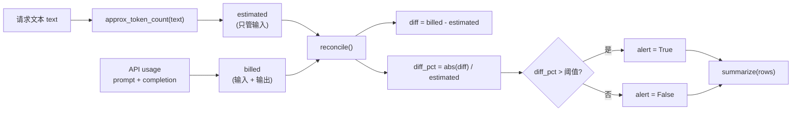
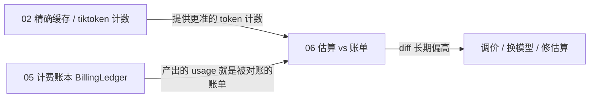

# 06 · Token 估算 vs 账单对账

一句话：**本地估算负责「事前」，API 账单负责「事后」，两者对不上时要有人喊一声。**

- **本地估算**（`approx_token_count`）：不花钱、不联网，用于预算预检、限流配速、路由前判断「这条请求大概多贵」。
- **API 账单**（`UsageFromAPI`）：调用返回的 `usage` 字段，是**财务口径的唯一权威**——真正扣钱的是它。
- **对账**（`reconcile`）：把两者逐请求比对，`diff_pct` 超过阈值就 `alert`。
- **汇总**（`summarize`）：把一页对账结果压成「请求数 / 告警数 / 最大偏差」，用于监控看板。

这个偏差本身是有信息量的：编码差异（中文比英文每字符更贵）、特殊 token、流式响应被截断、缓存命中导致的计费减少、甚至供应商计费口径调整，都会先在 `diff` 上体现出来。

核心逻辑在 [`billing/`](billing/) 目录。

---

## 目录结构

```
06/
├── main.py                 # 入口：3 条样例请求，跑一遍估算 → 对账 → 汇总
├── README.md
└── billing/
    ├── __init__.py         # 对外只暴露 5 个名字（__all__）
    ├── estimate.py         # approx_token_count + UsageFromAPI
    └── reconcile.py        # ReconcileRow + reconcile + summarize
```

## 运行

按仓库 `pyproject.toml`，Python 要求 `>=3.13`。本节代码本身只用到 `dataclass` / `TypedDict` / `list[...]`，实际 Python 3.9+ 就能跑；**零第三方依赖**，`tiktoken` 也不装——这正是 `len // 4` 兜底存在的理由。

```bash
cd 06
python3 main.py
```

实测输出：

```
=== 估算 vs 账单 ===
  req-1: 估算=2 账单=50 diff=+48 (2400.0%) ⚠️ ALERT
  req-2: 估算=70 账单=1500 diff=+1430 (2042.86%) ⚠️ ALERT
  req-3: 估算=1 账单=17 diff=+16 (1600.0%) ⚠️ ALERT
汇总: {'requests': 3, 'alerts': 3, 'max_diff_pct': 2400.0}
```

三条全红，而且偏差都在 1600% 以上——**这不是 bug，是口径错配**。下面先把「为什么会这样」讲清楚，因为它是本节最重要的知识点。

---

## 整体流程



| 字段 | 含义 | 符号方向 |
|---|---|---|
| `estimated` | 本地估算，只覆盖**输入文本** | — |
| `billed` | `prompt_tokens + completion_tokens` | — |
| `diff` | `billed - estimated` | **带符号**：正数=账单更高（低估/多收），负数=账单更低（高估/缓存命中） |
| `diff_pct` | `abs(diff) / max(estimated, 1) * 100` | **取绝对值**，两个方向都告警 |
| `alert` | `diff_pct > alert_threshold_pct` | 严格大于，默认 10% |

两个刻意的设计：`diff` 保号，方便判断是「花超了」还是「估多了」；`diff_pct` 去号，因为高估和低估都是估算不准，都应该进告警队列。

---

## `billing/estimate.py`：本地估算与账单输入

```python
def approx_token_count(text: str) -> int:
    """本地估算 (tiktoken不可用是的兜底)"""
    return max(1, len(text) // 4)

@dataclass
class UsageFromAPI:
    prompt_tokens: int
    completion_tokens: int

    @property
    def total(self) -> int:
        return self.prompt_tokens + self.completion_tokens
```

| 决策 | 原因 |
|---|---|
| `len(text) // 4` | 英文的经验值约 4 字符 / token，成本为 0，适合做**粗粒度**预检 |
| `max(1, ...)` | 空字符串或极短文本会算出 0，而 `diff_pct` 的分母是 `estimated`——0 会让除法炸掉。这里兜到 1，`reconcile` 里还有第二道 `max(estimated, 1)` |
| `total` 用 `@property` 而不是字段 | 派生值不该能被改。写成字段后，只要有人改了 `prompt_tokens` 而忘了同步 `total`，账就错了；而且构造时要多传一个参数 |
| `UsageFromAPI` 是纯 dataclass | 它只是把 API 返回的 JSON 粘成有类型的对象，**不做计算**——真正的计价在 05 的 `BillingLedger` |

### `len // 4` 对中文是错的

同一个系数套在中文上会**系统性低估 3~4 倍**：中文大约 1~1.5 字符 / token，也就是说 `len // 4` 只数到了真实值的四分之一左右。看 `req-1`：

```
"用三句话解释 RAG"  →  len = 10  →  10 // 4 = 2
真实 prompt_tokens = 8
```

估算 2、真实 8，光输入就差了 4 倍。所以这个方法**只适合做「量级」判断**（几百 token 还是几万 token），不能用于计费预扣。需要精度时就该用 `tiktoken`（见 02 的 `cache/tokens.py`，它带 `model` 参数并优先用真实编码器）。

---

## `billing/reconcile.py`：对账与汇总

```python
def reconcile(
    request_id: str,
    estimated: int,
    usage: UsageFromAPI,
    alert_threshold_pct: float = 10.0
) -> ReconcileRow:
    billed = usage.total
    diff = billed - estimated
    base = max(estimated, 1)
    diff_pct = round(abs(diff) / base * 100, 2)
    alert = diff_pct > alert_threshold_pct
    return ReconcileRow(request_id, estimated, billed, diff, diff_pct, alert)
```

- **`base = max(estimated, 1)`**：和第二道防线呼应。即使上游传进 `estimated=0`，也只会得到 100% 的偏差而不是 `ZeroDivisionError`。
- **`round(..., 2)`**：百分比保留两位，避免 `2400.0000000000005%` 这种浮点尾巴污染日志和断言。
- **`>` 而不是 `>=`**：阈值语义是「超过」，正好 10% 不算异常。如果业务想「达到即告警」，改符号即可，但**要在文档里写清**，否则测试用例会为此扯皮。
- **`ReconcileRow` 用 `@dataclass` 而非 `TypedDict`**：这里是要构造对象、按属性访问、进列表、被 `summarize` 消费，dataclass 更顺手；`Summarize` 那种「一次性返回的字典」才用 `TypedDict`。

```python
def summarize(rows: list[ReconcileRow]) -> Summarize:
    alerts = [r for r in rows if r.alert]
    return {
        "requests": len(rows),
        "alerts": len(alerts),
        "max_diff_pct": max((r.diff_pct for r in rows), default=0),
    }
```

- **`max(..., default=0)`**：`max()` 对空序列会抛 `ValueError`。对账任务是定时批处理，「今天一条请求都没有」是完全正常的状态，不能让它把整个任务打成失败。
- **`alerts` 列表造完只用了 `len()`**：可以直接写 `sum(r.alert for r in rows)`。当前写法更好读，但多分配了一个列表；在几十万条的对账场景里值得改。
- **`max_diff_pct` 没有被 token 量加权**：一条 1 token 的请求偏差 100% 会盖过一条 100 万 token 的请求偏差 20%。看板上真正该盯的是**按 token 加权的偏差**：

  ```python
  total_est = sum(r.estimated for r in rows)
  weighted_pct = abs(sum(r.diff for r in rows)) / max(total_est, 1) * 100
  ```

---

## `billing/__init__.py`：只开一扇门

```python
from .estimate import UsageFromAPI, approx_token_count
from .reconcile import ReconcileRow, reconcile, summarize

__all__ = [
    "ReconcileRow",
    "UsageFromAPI",
    "approx_token_count",
    "reconcile",
    "summarize",
]
```

`main.py` 因此只需要一行：

```python
from billing import UsageFromAPI, approx_token_count, reconcile, summarize
```

`__all__` 不只是给 `from billing import *` 用的，它还是**模块的公开契约**：`estimate` / `reconcile` 这两个模块名不会被 `*` 导出，内部实现可以随便重构（拆文件、改类名）而不影响调用方。反过来说，`approx_token_count` 现在被公开了，就等于承诺它不会消失。

---

## 为什么 demo 里三条全告警

这是本节最值得记住的一节。看 `main.py` 的调用：

```python
est = approx_token_count(text)          # 只估算【输入】
row = reconcile(rid, est, usage)        # usage.total = 【输入 + 输出】
```

**分子是「输入 + 输出」，分母是「输入」**，`diff` 里必然塞进整个 `completion_tokens`。`req-1` 的 `completion_tokens=42`、估算输入只有 2，于是 `diff=+48`；哪怕估算器完美命中 `prompt_tokens=8`，`diff` 仍然是 `+42`，也就是 525%——照样告警。

真实项目里也一样：**只要请求有输出，这个对账就一定会全线飘红**。日志一旦全是告警，等于没有告警。

两种修法，取决于你想回答哪个问题：

| 目标 | 做法 |
|---|---|
| 「我的**输入**估算准不准？」 | 只和 `prompt_tokens` 对账：`reconcile(rid, est, UsageFromAPI(usage.prompt_tokens, 0))` |
| 「这次请求的**总成本**估得准不准？」 | 估算也要覆盖输出。但输出长度事前未知，只能用「历史平均输出长度」或「`max_tokens` 上限」参与预估 |

前者是估算器的单元测试，后者是预算系统的需求。两者不该共用一个函数签名——如果都要，就把 `reconcile` 的目标拆成 `billed` 与 `estimated` 的**同口径**参数，由调用方显式决定。

```python
# 推荐：把口径写进参数名，调用方无法"顺手"传错
def reconcile(request_id: str, est_prompt: int, usage: UsageFromAPI) -> ReconcileRow:
    billed_prompt = usage.prompt_tokens
    ...
```

顺带说一句：`req-3` 的 `1600%` 也暴露了**相对阈值在小数值上的失真**——估算 1、账单 17，绝对差只有 16 token，却算出 1600%。生产上应该加一道绝对门槛：

```python
alert = diff_pct > alert_threshold_pct and abs(diff) >= 50
```

---

## 已知取舍与可改进点

| 问题 | 影响 | 建议 |
|---|---|---|
| 估算只覆盖输入，账单是输入+输出 | **所有请求都告警**，告警失去意义 | 统一口径（见上一节），或拆成 input/output 两路对账 |
| `len // 4` 对中文低估 3~4 倍 | 预检预算偏乐观，容易超支 | 用 `tiktoken`；或按语种分别用系数（中文 ~1.2 字符/token） |
| `approx_token_count` 是 02 `cache/tokens.py` 的简化复制 | 两份实现会各自漂移，改了一处漏另一处 | 从 02 导入，或抽成共享包；至少保留 `model` 参数 |
| `UsageFromAPI` 只有 prompt / completion | 缓存命中（`cached_tokens`）、推理模型（`reasoning_tokens`）的账单对不上 | 按供应商字段扩展，并明确「哪些计入 total」 |
| 相对阈值在极小请求上被放大 | 1 token 的请求天天告警 | 加最小绝对偏差门槛，或对 `estimated < 50` 的请求跳过 |
| `max_diff_pct` 未加权 | 小请求的极端比例掩盖真实成本偏差 | 同时输出按 token 加权的偏差 |
| 阈值 `10.0` 是裸默认值 | 不同模型/语种需要不同阈值，改代码才能调 | 提到配置，按模型分组；最好带上样本量再定阈值 |
| 只有内存里的 `list[ReconcileRow]` | 进程退出即丢，无法回溯「上周三为什么告警」 | 落库（带 `request_id` / 时间戳 / 模型），做时间序列聚合 |
| `usage` 字段假定总是存在 | 流式截断、上游 4xx/5xx 时拿不到 usage，代码会崩 | 显式建模 `usage: UsageFromAPI \| None`，缺失单独计数 |
| `main.py` 用 `print` | 无法按级别过滤，接不进日志系统 | 换 `logging`，`alert` 走 `WARNING` 并带上 `request_id` |

---

## 和前几节的关系



- **02** 提供了带 `tiktoken` 的 `approx_token_count(text, model)`，正好补上本节最弱的一环；02 的缓存命中也会让账单里的 `prompt_tokens` 变少，是本节能解释的偏差来源之一。
- **05** 的 `BillingLedger` 按 token 和单价算钱，但它**盲目相信传入的 token 数**。06 就是在验证这个数字是否可信——账本负责「记」，对账负责「查」。
- 再往前，**01** 的重试意味着同一份文本可能被计费多次（失败重试通常也计费或部分计费），对账维度若要精确，得先按 `request_id` 聚合成「一次逻辑请求」再比。

一句话收尾：**估算器永远不准，但偏差必须是可解释、可发现、可收敛的；对账的价值不在「算出百分比」，而在「让口径不一致无处可藏」。**
