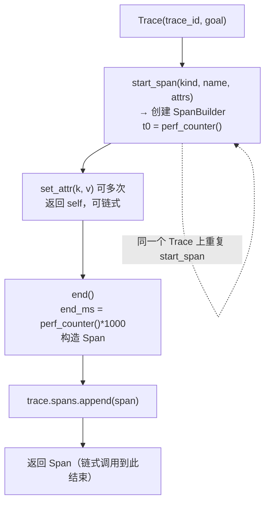
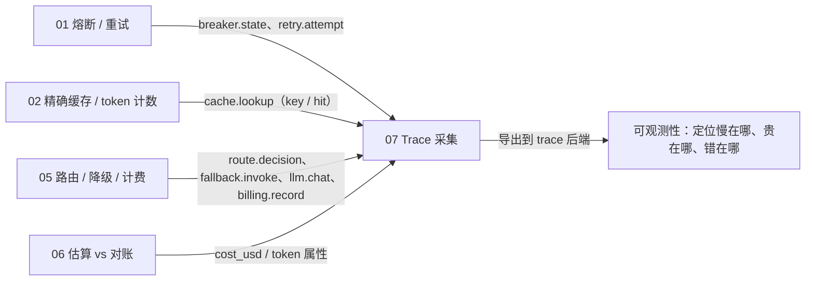

# 07 · Trace Span 采集（OpenTelemetry 风格）

一句话：**前面几节都在"做事"，这一节负责"把做过的事按时间片记下来"——路由、缓存、熔断、重试、LLM、计费，每一步都是一个 `Span`，挂到同一次请求的 `Trace` 上。**

- **`SpanKind`**：枚举出链路里有哪些"动作类型"，值就是线上格式（`route.decision` / `llm.chat` / `cache.lookup` …）。
- **`Span`**：一条**已完成**的时间片记录：谁（kind + name）、从什么时候到什么时候、带了哪些属性（model / tokens / cost…）。
- **`Trace`**：一次逻辑请求的容器，持有 `trace_id`、`goal`，以及按发生顺序平铺的 `spans` 列表。
- **`SpanBuilder`**：打点用的秒表 + 便签，`set_attr()` 可链式累积属性，`end()` 一次性"封口"生成 `Span` 并回挂到 `Trace`。

核心逻辑在 [`trace/`](trace/) 目录。**零第三方依赖**，不接 OTel SDK，只用 `dataclass` + `perf_counter` 手搓一个最小可用的采集层。

---

## 目录结构

```
07/
├── main.py                 # 入口：模拟一次"总结本周迭代"的完整请求，埋 6 类 span
├── README.md
└── trace/
    ├── __init__.py         # 对外只暴露 4 个名字（__all__）
    ├── kinds.py            # SpanKind(str, Enum)：9 种 span 类型
    └── collector.py        # Span / Trace / SpanBuilder 三件套
```

## 运行

按仓库 `pyproject.toml`，Python 要求 `>=3.13`。本节代码只用到 `dataclass` / `Enum` / `perf_counter`，3.10+ 就能跑。

```bash
cd 07
python3 main.py
```

实测输出（Python 3.14.3，耗时列每次略有浮动）：

```
=== Trace 7ba93295c454 goal=总结本周迭代 ===
  [route.decision] pick_model 0.01ms attrs={'complexity': 'medium', 'model': 'gpt-4o'}
  [cache.lookup] exact_cache 6.3ms attrs={'key': 'abc123', 'hit': False}
  [breaker.state] allow_call 6.31ms attrs={'state': 'CLOSED'}
  [retry.attempt] attempt_0 21.32ms attrs={'backoff_sec': 0.5}
  [retry.attempt] attempt_1 25.05ms attrs={'backoff_sec': 1.0}
  [llm.chat] chat_completion 50.86ms attrs={'model': 'gpt-4o', 'prompt_tokens': 120, 'completion_tokens': 80}
  [billing.record] record_usage 5.27ms attrs={'cost_usd': 0.001}

本 Trace 挂载 Span 类型: ['billing.record', 'breaker.state', 'cache.lookup', 'llm.chat', 'retry.attempt', 'route.decision']
```

注意三点：

1. `trace_id` 是 `uuid4().hex[:12]`，每次运行都不同。
2. **总耗时 ≈ 各项之和**，因为 `main.py` 是串行埋点，span 之间不重叠。真实链路里 cache 命中会直接跳过后面的步骤，总耗时就**不等于**各项相加。
3. 最后一行是对 `sp.kind.value` 做的 `set` + `sorted`，用来快速回答"这次请求都碰了哪些环节"。

---

## 整体流程



三个类的关系是**单向依赖 + 一条回写路径**：

```
Trace ──(start_span 把自己传进去)──> SpanBuilder ──(end 时 append)──> Trace.spans
   │                                        │
   └────────────── spans: list[Span] ───────┘
```

`SpanBuilder` 必须持有 `Trace` 的引用，否则 `end()` 不知道该把结果交给谁。这也是为什么 `start_span` 是 `Trace` 的方法，而不是一个自由函数。

---

## 三个类的分工

| 类 | 角色 | 生命周期 | 可变？ |
|---|---|---|---|
| `Trace` | 账本：一次请求的全部 span | 整个请求 | 可变（`spans` 不断追加） |
| `SpanBuilder` | 秒表 + 便签：正在进行的这一步 | 从 `start_span` 到 `end()` | 可变（属性不断累积） |
| `Span` | 账本里的一行：已完成的时间片 | 长期（内存 → 日志 / DB） | 逻辑上只读 |

判断标准很简单：**还没结束的用 Builder，结束了的用 Span**。把"正在计时"和"已经记完"分开，才能保证 `Span` 的 `end_ms` 只有一个值，不会被人事后改写。

---

## `trace/kinds.py`：为什么是 `str, Enum`

```python
class SpanKind(str, Enum):
    ROUTE = "route.decision"
    LLM = "llm.chat"
    TOOL = "tool.invoke"
    CACHE = "cache.lookup"
    BREAKER = "breaker.state"
    RETRY = "retry.attempt"
    FALLBACK = "fallback.invoke"
    RETRIEVE = "retrieve"
    BILLING = "billing.record"
```

`str` 混入让枚举成员**本身就是字符串**，而纯 `Enum` 不是：

| 行为 | `SpanKind(str, Enum)` | 纯 `Enum` |
|---|---|---|
| `SpanKind.LLM == "llm.chat"` | ✅ `True`（且对称） | ❌ `False` |
| 作为 dict key / set 元素与字符串互通 | ✅ 哈希继承自 `str` | ❌ |
| `json.dumps(SpanKind.LLM)` | ✅ `"llm.chat"` | ❌ `TypeError` |
| 直接传给 SQL / HTTP header / OTel attribute | ✅ | ❌ |
| `SpanKind("llm.chat")` 反查 | ✅ | ❌ |

这里值得这么做的原因是 **span 的最终归宿是序列化到外部**（日志、trace 后端、数据库），而 OTel 里的 span kind / attribute 在传输层就是纯字符串。让枚举值直接等于线上格式：

- 写代码时有 IDE 补全 + 类型检查，`SpanKind.TOOL` 打错会当场被发现；
- 导出时不需要转换层，`SpanKind.TOOL` 出去就是 `"tool.invoke"`。

命名上还有个小约定：值统一用 `域.动作` 形式（`cache.lookup`、`billing.record`），方便在 trace UI 里按前缀过滤。

**两个坑要注意：**

1. **`str(x)` 不等于 value**。对 `class X(str, Enum)`，`str(SpanKind.ROUTE)` 仍是 `"SpanKind.ROUTE"`（走 `Enum.__str__`），所以 `main.py` 里统一写 `sp.kind.value`，f-string 也用 `.value`。想要 `str()` 也返回值，用 3.11+ 的 `StrEnum`（本项目 `requires-python >=3.13`，完全可以用）。
2. **类型检查会变松**。成员 `isinstance(x, str)` 为真，于是 `kind.upper()`、`kind + "!"` 这类纯字符串操作合法，误把枚举当字符串用的 bug 编译器抓不到。

对比 `01/breaker/state.py` 的 `State(Enum)` + `auto()`：那是**纯内部状态机**（`CLOSED/OPEN/HALF_OPEN`），不进网络、不进 JSON，所以不需要 `str` 混入——两种写法各有适用场景。

---

## `trace/collector.py`：三件套

### `Span`：最终落库的记录

```python
@dataclass
class Span:
    trace_id: str
    span_id: str
    kind: SpanKind
    name: str
    start_ms: float
    end_ms: float
    attributes: dict[str, Any] = field(default_factory=dict)
```

| 字段 / 写法 | 为什么这样 |
|---|---|
| `trace_id` 冗余存一份 | `Trace` 里已经有，但导出成表格（CSV / SQL / OTel）时每行独立，省一次 JOIN |
| `span_id = uuid4().hex[:8]` | 同一 trace 内碰撞概率可忽略；32 bit 全局唯一性偏弱（见"已知取舍"） |
| `kind` 存枚举而非 `str` | 保留类型信息，同时因为 `str` 混入可以直接序列化 |
| `name` 与 `kind` 分离 | `kind` 是"哪类动作"，`name` 是"具体这一步"，同一个 `kind` 可以有多个 `name`（如两次 `retry.attempt`） |
| 时长不单独存 | 用 `end_ms - start_ms` 现算，少一个可能不同步的派生字段 |
| `field(default_factory=dict)` | dataclass 的可变默认值必须用工厂，否则所有实例共享同一个 dict |

`Span` 没有 `status` / `error` 字段，也没有 `parent_span_id`——这是刻意的简化（见后文）。

### `Trace`：容器 + 唯一入口

```python
@dataclass
class Trace:
    trace_id: str
    goal: str
    spans: list[Span] = field(default_factory=list)

    def start_span(self, kind, name, attributes=None) -> "SpanBuilder":
        return SpanBuilder(self, kind, name, attributes or {})
```

- `goal` 是这次请求的自然语言目标（`"总结本周迭代"`）。线上系统里它对应"用户到底想要什么"，比一串 span 更能回答"这条 trace 为什么存在"。
- `start_span` 自己**不计时**，只负责造 Builder 并把 `self` 传进去——计时起点在 Builder 的 `__init__` 里。
- `attributes or {}`：参数可选的兜底；传空 dict 时也会走 `or`，但 `SpanBuilder` 里还会再 `dict(attrs)` 拷一层，所以无害。
- 返回类型写成字符串 `"SpanBuilder"`，因为 `SpanBuilder` 定义在 `Trace` 之后（前向引用）。

### `SpanBuilder`：整个设计的核心

```python
class SpanBuilder:
    def __init__(self, trace, kind, name, attrs):
        self.attrs = dict(attrs)        # ① 防御性拷贝
        self.t0 = time.perf_counter()   # ② 计时从这里开始

    def set_attr(self, key, value) -> "SpanBuilder":
        self.attrs[key] = value         # ③ 累积属性
        return self                     # ④ 返回 self 以支持链式

    def end(self) -> Span:
        span = Span(..., start_ms=self.t0 * 1000, end_ms=time.perf_counter() * 1000, ...)
        self.trace.spans.append(span)   # ⑤ 回写到 Trace
        return span
```

五处设计各有理由：

| # | 做法 | 原因 |
|---|---|---|
| ① | `dict(attrs)` | 调用方之后改动自己那个 dict 不会污染这条 span |
| ② | `t0` 在**构造时**取 | 计时从 `trace.start_span(...)` 那一行开始，而不是从第一次 `set_attr` 开始 |
| ③ | `attrs` 是普通 dict | 不同 span 的属性差异极大（model / tokens / cost / hit …），不做 schema 约束，保持灵活 |
| ④ | `set_attr` 返回 `self` | 支持 `start_span(...).set_attr(...).set_attr(...).end()` 的流式写法 |
| ⑤ | append 到 `trace.spans` | 采集与存储解耦：Builder 只管"记"，Trace 只管"存" |

`end()` 返回的是 `Span` 而不是 `SpanBuilder`，所以**链式调用在 `end()` 处自然终止**——想强制"结束了就不能再改"，这个类型签名已经起了半道防线（但运行时并不阻止，见后文）。

`main.py` 里的典型用法：

```python
s = tr.start_span(SpanKind.ROUTE, "pick_model").set_attr("complexity", "medium")
s.set_attr("model", "gpt-4o").end()
```

先把 Builder 接住（因为后面还要补属性），最后 `end()` 封口。如果属性一次就够，完全可以写成一行。

### `trace/__init__.py`：只开一扇门

```python
from .collector import Span, SpanBuilder, Trace
from .kinds import SpanKind

__all__ = ["Span", "SpanBuilder", "SpanKind", "Trace"]
```

`main.py` 因此只需 `from trace import SpanKind, Trace`。`__all__` 是**公开契约**：`collector` / `kinds` 这两个模块名不会被 `from trace import *` 导出，内部怎么拆文件都不影响调用方。

---

## `main.py`：一次请求的埋点顺序

```python
tr = Trace(trace_id=uuid.uuid4().hex[:12], goal="总结本周迭代")
```

然后按真实调用顺序埋 6 类 span：

| # | `kind` | `name` | 关键属性 | 对应前面哪一节 |
|---|---|---|---|---|
| 1 | `route.decision` | `pick_model` | `complexity`, `model` | 05 的 `route_by_complexity` |
| 2 | `cache.lookup` | `exact_cache` | `key`, `hit` | 02 的精确缓存 |
| 3 | `breaker.state` | `allow_call` | `state` | 01 的 `CircuitBreaker.allow()` |
| 4 | `retry.attempt` ×2 | `attempt_0/1` | `backoff_sec` | 01 的退避重试 |
| 5 | `llm.chat` | `chat_completion` | `model`, `prompt_tokens`, `completion_tokens` | 05 的 `Provider` |
| 6 | `billing.record` | `record_usage` | `cost_usd` | 05 / 06 的账本 |

两个细节：

- **`time.sleep(...)` 是模拟 IO 耗时的**。第 3 个 span 显示 `6.31ms`，正好是「上一次 `end()` 到现在」的间隔——因为 `start_span` 一调用就开始计时，**上一个 span 的 end 到这一个 span 的 start 之间的时间不会被记进任何 span**（这段"空隙"其实也有信息量，见后文）。
- **两次 retry 是平级兄弟**，不是嵌套。当前数据结构是平铺的 `list[Span]`，靠 `name` 和顺序还原语义；要做调用树得加 `parent_span_id`。

末尾的汇总：

```python
kinds = sorted({sp.kind.value for sp in tr.spans})
```

因为 `SpanKind` 是 `str` 子类，这里就算不写 `.value`，去重和排序结果也一样；写 `.value` 是为了显式拿到线上格式。

---

## 关键细节与坑

### 1. `perf_counter()` 而不是 `time.time()`

`perf_counter` 是**单调时钟**，不受 NTP 校准、系统时间回拨影响，测时长更准——这是测耗时的标准做法（`timeit` 用的也是它）。

代价：`start_ms` / `end_ms` 是相对某个未定义起点的**绝对毫秒数**（通常是开机以来的时间），**不是 Unix 时间戳**，不能直接展示成"几点几分"。要把 trace 和日志按时间对齐，需要另外记录一次 `time.time()` 作为基准：

```python
# Span 里再加一个字段
wall_clock_ms: float = round(time.time() * 1000, 3)
# 相对偏移仍然用 perf_counter，二者互不干扰
```

### 2. `Span` 和 `SpanBuilder` 共享同一个 `attrs` dict

```python
attributes=self.attrs   # 传的是引用，不是拷贝
```

也就是说 `end()` 之后继续 `builder.set_attr(...)`，**已经进了 `trace.spans` 的那条 span 的属性也会被改**。当前写法依赖"打完点就不再碰 builder"的纪律；要更稳，`end()` 里应该写 `attributes=dict(self.attrs)`。

### 3. `end()` 不幂等

同一个 Builder 调两次 `end()` 会 append 两条 span，第二条的时长更长。加一行断言即可：

```python
def end(self) -> Span:
    assert not self._ended, "span already ended"
    self._ended = True
    ...
```

### 4. 只有显式 `end()`，没有 `with` 上下文管理器

好处：实现极简、写法自由，适合"想在哪结束就在哪结束"的演示场景。
代价：**异常不安全**。如果 `start_span` 和 `end()` 之间抛异常，这条 span 永远不 `end()`，直接丢失，而且不会有任何错误标记。生产实现通常会提供：

```python
with trace.span(SpanKind.LLM, "chat_completion") as s:
    s.set_attr("model", model)
    resp = call_llm(...)      # 抛异常也会在 __exit__ 里 end() 并记 error
```

### 5. 包名 `trace` 会遮蔽标准库同名模块

Python 标准库有一个 [`trace`](https://docs.python.org/3/library/trace.html) 模块（语句覆盖率工具）。在 `07/` 目录下运行时 `sys.path[0]` 就是这个目录，`import trace` 会拿到本项目这个包，导致 `python -m trace --count main.py` 之类的命令行为诡异。改名成 `tracing/` 或 `telemetry/` 可以彻底避免这个隐性冲突。

### 6. `span_id` 只有 32 bit

`uuid4().hex[:8]` = 8 个 hex 字符 = 32 bit。同一 trace 内几条 span 碰撞概率可忽略；但如果把 span 当成**全局唯一 ID**（建索引、做关联查询），建议至少截 16 个字符（64 bit）。

### 7. 没有错误状态

`Span` 只有"成功的时间片"这一种语义。一次抛异常的 LLM 调用，要么没有 span，要么看起来一切正常。真实 trace 里 `status`（`OK` / `ERROR`）和 `error.message` 通常比耗时更重要。

---

## 已知取舍与可改进点

当前实现是"能跑通、能讲清"的最小版本，刻意留白如下：

| 问题 | 影响 | 建议 |
|---|---|---|
| 平铺 `list[Span]`，无 `parent_span_id` | 无法还原调用树，"重试的 LLM 调用"和"独立的 LLM 调用"分不清 | 加 `parent_id`，用 `contextvars` 维护当前 span 栈，`start_span` 自动挂到栈顶 |
| 无上下文管理器，`end()` 靠人记得调 | 异常路径丢 span；嵌套埋点容易漏 | 提供 `with trace.span(...) as s:`，`__exit__` 里强制 `end()` 并写 status |
| `end()` 不幂等、`attrs` 共享引用 | 重复 end 会多记一条；事后改 builder 会污染已完成的 span | `_ended` 标志 + `end()` 里 `dict(self.attrs)` 拷贝 |
| `start_ms` / `end_ms` 是 `perf_counter` 值 | 不能当墙钟时间，无法和日志/其他系统按时间对齐 | 额外记 `time.time()` 基准，导出时换算成绝对时间 |
| 只采集、不导出 | 进程退出数据就没了，看不到任何 trace | 加 `to_jsonl()` / `to_otel()`，或实现一个最简 exporter |
| 没有 `status` / `error` | 失败调用无法在 trace 里体现 | 加 `status: Literal["ok", "error"]` + `attributes["error"]` |
| 无采样、无上限 | 长会话 / 高 QPS 下 `spans` 无界增长，吃内存 | 采样率配置 + 单 trace 最大 span 数（如 1000），超出后只计数 |
| span 之间的"空隙"没记录 | 两段埋点之间的时间不知道花在哪 | 记录 `parent.start → child.start` 的 gap，或干脆用嵌套 span 覆盖整段 |
| 包名 `trace` 遮蔽标准库 | `python -m trace`、部分 profiler 行为异常 | 改名为 `tracing` / `telemetry` |
| `SpanKind` 是封闭枚举 | 新增埋点类型必须改库代码 | 保留常用值，同时允许传入 `str`（`kind: SpanKind \| str`） |
| `main.py` 用 `print` | 无法按级别过滤、无法结构化输出 | 换 `logging` + JSON formatter，字段与 `Span` 对齐 |

---

## 和前几节的关系



前六节解决的是**怎么做对**，这一节解决的是**怎么知道做对没做对**：

- **01** 的熔断与重试，在 trace 里就是 `breaker.state` + 多条 `retry.attempt`。跳闸时你能一眼看到"重试了几次、退避多久、最后谁成功了"。
- **02** 的缓存，`cache.lookup` 带上 `hit=True/False`，直接回答"缓存到底省了多少次 LLM 调用"。
- **05** 的闭环，在 trace 里被拆成 `route.decision → cache.lookup → breaker.state → retry.attempt → llm.chat → billing.record`，**这条线的顺序就是 05 的调用顺序**。
- **06** 的对账数据（token / cost）在这里变成 `attributes`，于是"这次请求为什么贵"可以精确到"哪个模型、多少 token、单价多少"。

一句话收尾：**日志告诉你"发生了什么"，指标告诉你"整体怎么样"，而 trace 告诉你"这一次具体慢在哪、贵在哪、错在哪"——前六节把链路搭起来，这一节让链路变得可解释。**
