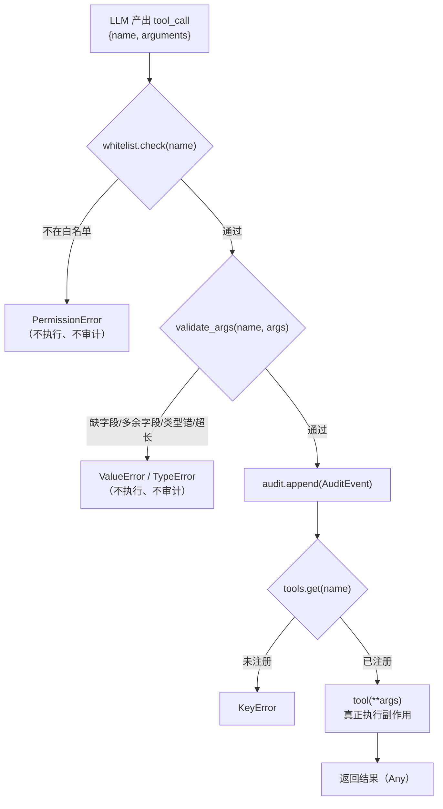

# 08 · 工具调用权限与校验分层

一句话：**LLM 说"我要调用 `send_email`"时，Agent 不该无条件执行——先查白名单、再校验参数、最后留痕，三层缺一不可。**

- **白名单**（`ToolWhitelist`）：这个 Agent 到底被授权调用哪些工具。未授权 → `PermissionError`。
- **Schema**（`validate_args`）：参数是不是对象、必填填了没、有没有多塞字段、类型/长度对不对。不合法 → `ValueError` / `TypeError`。
- **审计**（`AuditLog`）：校验通过后落一条 `AuditEvent`，回答"谁在什么时候拿什么参数调了什么"。
- **执行**（`invoke_tool_layered`）：只有前三步都过了，才真的 `tool(**args)`。

核心逻辑在 [`guard/`](guard/) 目录。**零第三方依赖**，不引入 pydantic / jsonschema，只用 `TypedDict` + 手写校验 + `dataclass` 演示最小可用的守卫层。

---

## 目录结构

```
08/
├── main.py                 # 入口：3 个场景（合法 / 未授权 / 参数非法）+ 打印审计日志
├── README.md
└── guard/
    ├── __init__.py         # 对外只暴露 9 个名字（__all__）
    ├── type.py             # Tool / RawArgs 别名 + AuditEvent / PropertySpec / ToolSchema
    ├── whitelist.py        # ToolWhitelist：不可变白名单
    ├── schema.py           # SCHEMAS + validate_args：参数校验
    └── executor.py         # AuditLog + invoke_tool_layered：编排三层
```

## 运行

按仓库 `pyproject.toml`，Python 要求 `>=3.13`（用到了 `type` 语句）。本节代码本身只需 `TypedDict` / `dataclass` / `frozenset`，**零第三方依赖**。

```bash
cd 08
python3 main.py
# 或在仓库根目录
uv run python 08/main.py
```

实测输出：

```
=== 合法调用 ===
  结果: ['doc about Python']

=== 未授权工具（应拒绝）===
  tool 'send_email' not in whitelist

=== 参数校验失败（应拒绝）===
  q too short

=== 审计日志 ===
  {'event': 'tool_invoke', 'tool': 'search', 'args': {'q': 'Python'}}
```

三个场景值得注意：

1. **被拒绝的调用没有进审计**。`send_email` 在第一步就抛了 `PermissionError`，`AuditLog` 里只剩合法的那一条。这是取舍而非疏漏——见文末「已知取舍」。
2. **`send_email` 明明注册在 `tools` 里**，但白名单没放行，所以照样拒绝。"能调用"和"被授权调用"是两件事。
3. 审计日志里只有 `event / tool / args`，**没有结果、没有耗时、没有调用者身份**——最小示意，真实系统要补。

---

## 整体流程



顺序不是随意的，按「**拒绝成本从低到高**」排：

| 顺序 | 检查 | 成本 | 为什么排在这 |
|---|---|---|---|
| 1 | 白名单 | 一次 `set` 查找 | 最便宜的拒绝。未授权的工具连 schema 都不该看 |
| 2 | Schema | 遍历参数（O(n)） | 便宜且纯内存，绝不能让非法参数走到副作用 |
| 3 | 审计 | 一次 append | 只有"即将真的执行"才值得写一条日志，否则日志会被攻击者刷满 |
| 4 | 执行 | 网络 / 磁盘 / 发邮件 | 唯一不可回滚的一步，必须放在所有检查之后 |

最后一步的 `.get()` + `if tool is None` 是给「**白名单里有、但没注册实现**」这种配置漂移兜底：错误信息会明确说 `not registered`，而不是一个裸 `KeyError: 'send_email'` 让人猜。

---

## `guard/whitelist.py`：白名单要不可变

```python
class ToolWhitelist:
    allowed: frozenset[str]

    def __init__(self, allowed: Iterable[str]) -> None:
        self.allowed = frozenset(allowed)

    def check(self, tool_name: str) -> None:
        if tool_name not in self.allowed:
            raise PermissionError(f"tool '{tool_name}' not in whitelist")
```

| 决策 | 原因 |
|---|---|
| 入参 `Iterable[str]` | 调用方可以传 `set` / `list` / `frozenset` / 生成器，不必为了类型去套一层 |
| 存 `frozenset[str]` | ① 不可变，防住 `wl.allowed.add("send_email")` 这种事后提权；② 可哈希，能当 dict key / 放进缓存；③ 查找仍是 O(1) |
| 抛 `PermissionError` 而非自定义异常 | `PermissionError` 是内置的 `OSError` 子类，语义准确（权限不足），上层不用为了识别它而 import 本模块 |
| `check()` 只做判断、不返回 bool | 让"未授权"是异常而不是返回值，调用方无法"忘了处理返回值"继续往下走 |

注意 `allowed` 是**类级注解 + 实例属性**的写法：注解告诉类型检查器它是 `frozenset[str]`，`__init__` 里的赋值让它成为真正的实例字段。直接写 `self.allowed: frozenset[str] = frozenset(allowed)` 也行，两种风格等价。

---

## `guard/schema.py`：Schema 也是数据，也要有类型

```python
SCHEMAS: Final[dict[str, ToolSchema]] = {
    "search": {
        "type": "object",
        "required": ["q"],
        "properties": {"q": {"type": "string", "minLength": 1, "maxLength": 200}},
    },
    "send_email": { ... },
}
```

`ToolSchema` / `PropertySpec` 定义在 `type.py`：

```python
class PropertySpec(TypedDict, total=False):
    type: Literal["string"]
    minLength: int
    maxLength: int
    format: Literal["email"]

class ToolSchema(TypedDict):
    type: Literal["object"]
    required: list[str]
    properties: dict[str, PropertySpec]
```

这层类型不是为了运行时，而是为了**写 schema 时不写错**：`{"minLenght": 1}` 拼错、`{"type": "strng"}` 写错、`"required"` 忘了写，`ty` / mypy 在检查阶段就会报出来。之前写成 `dict[str, dict[str, Any]]` 时，这些错误全都要等测试或者线上才发现。

### `Final` 标的是「不能重新绑定」，不是「不能修改」

```python
SCHEMAS: Final[dict[str, ToolSchema]] = { ... }
```

`Final`（PEP 591）让类型检查器拒绝对这个名字再次赋值：

```python
SCHEMAS = {}                         # error: cannot assign to Final
SCHEMAS: dict[str, ToolSchema] = {}  # error: already declared with Final
```

但它**只管绑定，不管内容**——被冻结的是「名字指向哪个对象」：

```python
SCHEMAS["delete_all"] = {...}       # ✅ 类型检查通过
SCHEMAS["search"]["required"] = []  # ✅
SCHEMAS.clear()                      # ✅
```

而且它纯属静态契约：运行时没有任何拦截，`Final` 只是个注解对象，解释器不会阻止重新赋值。

| 想要的保证 | 怎么写 |
|---|---|
| 名字不能重新指向 | `Final[dict[str, ToolSchema]]` |
| 内容也不能改 | `Final[Mapping[str, ToolSchema]] = MappingProxyType({...})`（`Mapping` 没有 `__setitem__`，运行期再写会抛 `TypeError`） |

本节的取舍是前者：`SCHEMAS` 的唯一用法是 `SCHEMAS.get(tool_name)`，没人会去写 `SCHEMAS[...] = ...`；上 `MappingProxyType` 只会给「零依赖 + 可读」的 demo 增加噪音。

顺带区分几个容易混的名字：

| 名字 | 作用对象 | 含义 |
|---|---|---|
| `typing.Final` | 变量 | 不能重新绑定 |
| `@typing.final` | 类 / 方法 | 不能被继承 / 被子类覆盖 |
| `typing.ClassVar` | 类属性 | 属于类而非实例状态（可与 `Final` 叠加） |
| 全大写命名 | — | 纯约定，检查器不检查 |

模块级 `Final` 还附带一个效果：其他模块同样不能重新绑定它，等于用类型系统声明「`SCHEMAS` 是本节的唯一事实来源」——`main.py` 注册的工具名必须和它对上。

### `validate_args`：入参收窄，返回值携带「已校验」

```python
def validate_args(tool_name: str, args: object) -> Mapping[str, Any]:
    ...
    if not isinstance(args, Mapping):
        raise TypeError("args must be a mapping")
    ...
    return args
```

| 决策 | 原因 |
|---|---|
| `args: object` 而不是 `dict` | 入参直接来自 LLM 的 JSON 解析结果，**运行时什么都有可能**（`None`、`list`、字符串）。声明成 `dict` 只是自我安慰，还会让 `isinstance` 检查变成类型检查器眼里的"永远为真" |
| `isinstance(args, Mapping)` | 校验即收窄：之后的 `key not in args`、`args.items()` 才有类型依据；用 `Mapping` 而非 `dict` 还能接受 `MappingProxyType` 等只读映射 |
| 返回 `Mapping[str, Any]` 而不是 `None` | 把"已校验"这个事实编码进类型：调用方拿到的返回值就是收窄后的类型，不需要再写一遍 `assert isinstance(...)` |

### `_validate_value`：先判类型，再判长度

```python
def _validate_value(key: str, value: object, spec: PropertySpec) -> None:
    if spec.get("type") != "string":
        raise ValueError(f"unsupported type for field: {key}")

    if not isinstance(value, str):          # ① 先判类型
        raise TypeError(f"{key} must be string")

    max_len = spec.get("maxLength")         # ② 再判长度
    if max_len is not None and len(value) > max_len:
        raise ValueError(f"{key} too long")
```

**必须先判类型再判长度**。原写法是 `if "maxLength" in spec and len(val) > spec["maxLength"]`——如果传进来的是 `{"q": 123}`，`len(123)` 直接抛 `TypeError: object of type 'int' has no len()`，错误信息跟"参数不合法"毫无关系，排查时会误导人。现在会明确告诉你 `q must be string`。

另外 `spec.get("maxLength")` 比 `"maxLength" in spec and spec["maxLength"]` 更直接，也免了两次查表；`None` 判断同时处理了"没配这个约束"。

---

## `guard/executor.py`：编排 + 审计

```python
def invoke_tool_layered(
    tool_name: str,
    args: RawArgs,
    tools: Mapping[str, Tool],
    whitelist: ToolWhitelist,
    audit: AuditLog,
) -> Any:
    whitelist.check(tool_name)
    validate_args(tool_name, args)
    audit.append({"event": "tool_invoke", "tool": tool_name, "args": args})

    tool = tools.get(tool_name)
    if tool is None:
        raise KeyError(f"tool '{tool_name}' not registered")
    return tool(**args)
```

五个参数分两类：

| 参数 | 类型 | 说明 |
|---|---|---|
| `tool_name` | `str` | 来自 LLM，**不可信**，先过白名单 |
| `args` | `RawArgs`（`Mapping[str, Any]`） | 来自 LLM，**不可信**，先过 Schema |
| `tools` | `Mapping[str, Tool]` | 已注册的实现，只读视图即可 |
| `whitelist` | `ToolWhitelist` | 授权表 |
| `audit` | `AuditLog` | 输出端（副作用） |

### 为什么 `tools` 是 `Mapping` 而不是 `dict`

这是本节唯一一个"不改就跑不过类型检查"的点。`main.py` 里：

```python
tools = {"search": search, "send_email": send_email}
```

两个函数签名不同，类型检查器会把值类型 join 成联合：

```
dict[str, ((q: str) -> list[str]) | ((to: str, subject: str) -> SendEmailOutput)]
```

而 `dict` 在**值类型上是不变的（invariant）**：即使每个成员都是 `Callable[..., Any]`，`dict[str, 联合]` 也不能赋给 `dict[str, Callable[..., Any]]`，因为 `dict` 是可变的——如果允许，被调方往里塞一个签名不匹配的函数就会炸。换成语义上只读、值类型**协变**的 `Mapping` 就通了：

```python
def invoke_tool_layered(..., tools: Mapping[str, Tool], ...) -> Any:
```

同时 `main.py` 里显式标注 `tools: dict[str, Tool]`，两处配合，既过类型检查也表达了"这张表只读"的意图。

### 为什么返回值只能是 `Any`

工具名 → 签名的映射是**运行时**才确定的，`tool(**args)` 展开 kwargs 后，静态类型无法还原成 `list[str]` 或 `SendEmailOutput`。想强类型只有两条路：

1. 给每个工具写 `@overload`（按 `Literal["search"]` 重载 `tool_name`）——会把具体工具类型反向依赖进执行器，加一个工具就要改执行器；
2. 用 pydantic / 每个工具自带 `validate(args) -> TypedDict`，把校验下沉到工具自己。

这个 demo 选了**保留 `Any`，但把它收敛在唯一一个边界**（`guard/type.py` 的 `type Tool = Callable[..., Any]` + 文档字符串），其余所有参数和结构都是具体类型。`Any` 不可怕，可怕的是它到处蔓延。

### `AuditLog`：先结构，后存储

```python
@dataclass
class AuditLog:
    entries: list[AuditEvent] = field(default_factory=list)

    def append(self, event: AuditEvent) -> None:
        self.entries.append(event)
```

`entries: list[AuditEvent]` 而不是 `list[dict]`，`AuditEvent` 里 `event` 是 `Literal["tool_invoke"]`——以后加了 `"tool_denied"`、`"tool_error"`，拼错事件名会被类型检查器拦住，而不是在日志平台里多一种谁也查不到的 event。

`field(default_factory=list)` 是 dataclass 的硬要求：`entries: list = []` 会让所有 `AuditLog` 实例**共享同一个列表**，第二个 Agent 的日志会混进第一个里。

---

## 类型设计一览

本节特意把"类型"当成设计的一部分，而不是事后补注解。要点：

| 问题 | 原写法 | 改后 | 收益 |
|---|---|---|---|
| 工具表无法传入 | `dict[str, Callable[..., Any]]` | `Mapping[str, Tool]` | `dict` 值类型不变导致联合类型被拒；`Mapping` 协变，通过 |
| 参数类型撒谎 | `args: dict` | `args: object` → `isinstance` 收窄 | 诚实描述不可信输入，且让校验逻辑有意义 |
| 结构丢失 | `entries: list[dict]` | `list[AuditEvent]` | 事件字段可被静态检查 |
| schema 拼错 | `dict[str, dict[str, Any]]` | `Final[dict[str, ToolSchema]]` | `TypedDict` 让写错的 key / 枚举值当场报错；`Final` 再挡住整表被换掉 |
| 可被提权 | `set[str]` | `frozenset[str]` | 不可变 |
| `Any` 蔓延 | 各处 | 只在 `Tool` 别名一处 | 收敛动态边界 |

可以自己验证：

```bash
uvx ty check 08     # 期望输出 All checks passed!
```

---

## 已知取舍

- **被拒绝的调用没有审计**。真实审计需要记录"尝试"，因为**未授权尝试本身就是安全信号**（可能有人在探测能力边界）。改法：把 `audit.append` 提到 `whitelist.check` 之前，或给 `AuditEvent.event` 加 `"tool_denied"` 并 `try/except` 记一笔再重新抛出。
- **审计日志在内存里，谈不上"不可篡改"**。生产环境要写 append-only 存储（WORM 对象存储 / 专用审计服务），并带上 `request_id`、`agent_id`、时间戳、参数哈希。
- **只实现了 `type: "string"`**。`schema.py` 里的 `format: "email"` 只写进了数据、**没有任何校验逻辑**——`to="not-an-email"` 能通过。要么实现 format 校验，要么把这个字段删掉，别让 schema 撒谎。
- **长度按字符数、不按 token 数**。`maxLength: 200` 对中文和英文的实际成本差很多；真要控成本得接 02/06 的 token 计数。
- **`required` 与 `properties` 可能不一致**。若 `required` 写了 `properties` 里没有的 key，校验会先因"未知字段"逻辑漏过（`required` 检查通过，因为 `key in args`），再因为 `props.get` 为 `None` 报 unknown field——错误信息会指错方向。可以在模块加载时加一次自检。
- **白名单与实现表是两份数据**，会漂移。demo 里靠 `.get()` 兜底报 `KeyError`；生产里通常合成一张 `ToolRegistry`，注册即授权。
- **没有限流与审批**。真实 Agent 平台对"高风险工具"（发邮件、转账、删库）需要人工确认或额度限制，这一节只做了静态授权。

---

## 往下接什么

- 把 `AuditLog.append` 换成 07 的 `Trace` + `Span`：`tool.invoke` 的 span 天然就是审计事件，还附带耗时。
- 把失败计入 01 的熔断器：某个工具连续失败，`HALF_OPEN` 之前直接拒绝，别让 Agent 反复撞墙。
- 参数校验升级成 pydantic：`format="email"`、数值范围、嵌套对象都能现成支持，只是会引入依赖。
- 工具多起来之后，把 `SCHEMAS` 换成由工具自己声明（`@tool(schema=...)` 装饰器），注册时自动汇总，消灭"两份数据"。
