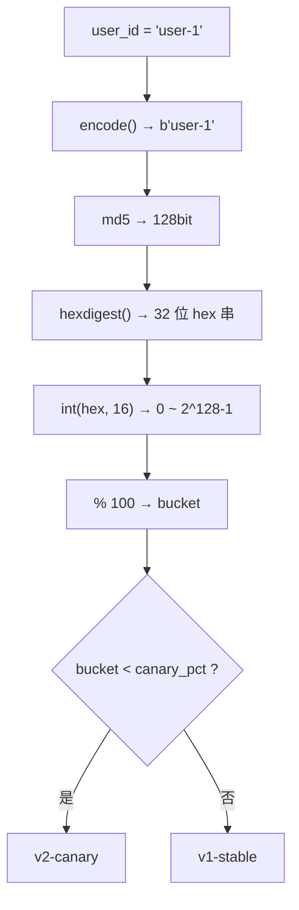
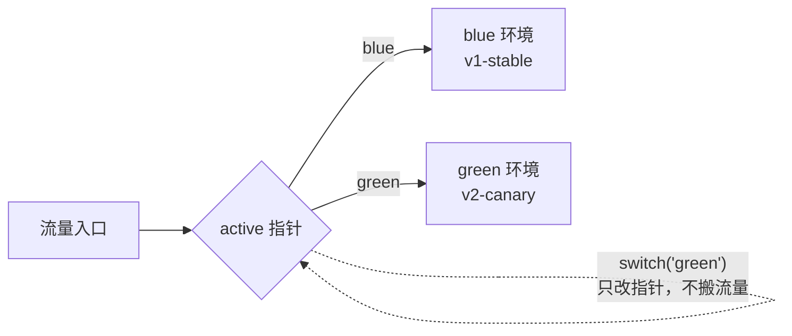
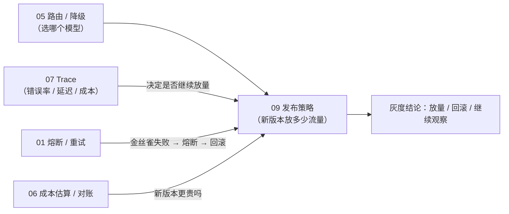

# 09 · 发布策略：金丝雀与蓝绿

一句话：**新版本上线不是"全量替换"，而是先让一小部分流量试毒（金丝雀），或者准备好两套完整环境、用一个指针瞬间切换（蓝绿）。**

- **金丝雀**（`pick_canary_version`）：按 `user_id` 哈希稳定分桶，命中前 `canary_pct` 个桶的用户走新版本，其余走旧版本。放量只需调大百分比，**同一用户在放量过程中只可能从旧到新，不会来回跳**。
- **蓝绿**（`BlueGreenRouter`）：两套环境同时存在，`active` 指向其中一套；`switch()` 只是改指针，所以"回滚"和"发布"是同一种操作、同样快。
- **对外只暴露 3 个名字**：`BlueGreenRouter` / `pick_canary_version` / `describe_canary`，见 [`deploy/__init__.py`](deploy/__init__.py)。

核心逻辑在 [`deploy/`](deploy/) 目录，**零第三方依赖**：`hashlib` + `dataclass` + `Literal` 就够。

---

## 目录结构

```
09/
├── main.py                 # 入口：100 用户金丝雀分布统计 + 蓝绿切换演示
├── README.md
└── deploy/
    ├── __init__.py         # 对外只暴露 3 个名字（__all__）
    ├── canary.py           # pick_canary_version：哈希分桶；describe_canary：说明文字
    └── blue_green.py       # Env 别名 + BlueGreenRouter（route / switch / describe）
```

## 运行

按仓库 `pyproject.toml`，Python 要求 `>=3.13`。`blue_green.py` 用了 PEP 695 的 `type` 语句，**最低 3.12**；其余代码 3.10+ 就能跑。

```bash
cd 09
python3 main.py
# 或在仓库根目录
uv run python 09/main.py
```

实测输出（Python 3.14.3）：

```
=== 金丝雀分流（10% → v2）===
  金丝雀：新版本接 5%~10% 流量，观察错误率/latency/成本后逐步放量；适合模型/API 频繁迭代。
  100 用户分布: {'v1-stable': 93, 'v2-canary': 7}

=== 蓝绿切换 ===
  蓝绿：两套完整环境整包切换，回滚快；适合大版本/配置整体变更，代价是双倍资源。
  当前活跃: blue
  切换后:   green
```

注意三点：

1. **写的是 10%，跑出来是 7%**。样本只有 100 个用户，二项分布的波动就是这样——$n=100, p=0.1$ 时标准差约 $\sqrt{np(1-p)} \approx 3$，`7%` 完全在正常范围内。把样本放大到 1 万后实测是 `971 / 10000 = 9.71%`。
2. **数字每次运行都一样**。没有任何随机数、没有 `time`、没有 `hash()`——同样的 `user_id` 永远落在同一个桶里，这是分流能当实验凭证的前提。
3. **蓝绿那段没有"流量"概念**。切换前后每次 `route()` 都只返回一个版本，不存在 5%/95% 这种中间态——这就是蓝绿和金丝雀最本质的区别。

---

## 整体流程

金丝雀：请求进来先问"你是哪一个桶"。



蓝绿：两套环境 + 一个可写的指针。



两者的关键差别是**分流发生在哪一层**：

| | 金丝雀 | 蓝绿 |
|---|---|---|
| 决策依据 | 请求身份（`user_id`）计算出的桶号 | 一个全局字段 `active` |
| 新旧版本共存粒度 | 同一个服务里两份代码/两个后端，按请求选 | 两套完整环境，请求整体指向其中一套 |
| 切换粒度 | 1%（`% 100` 决定） | 0% 或 100%，没有中间态 |
| 回滚成本 | 把百分比调回去即可，但已放量的用户会"退回" | 改一次指针，秒级 |
| 资源成本 | 新版本只接小流量，但通常要常驻两份 | 双倍机器 / 双倍配额 |
| 适合 | 模型、Prompt、API 的频繁小步迭代 | 大版本、依赖升级、配置整体变更 |

---

## `deploy/canary.py`：一行代码劈出 100 个桶

```python
def pick_canary_version(user_id: str, canary_pct: int = 10) -> str:
    """金丝雀：按 user_id 哈希稳定分流 small % 到新版本。"""
    bucket = int(hashlib.md5(user_id.encode()).hexdigest(), 16) % 100
    return "v2-canary" if bucket < canary_pct else "v1-stable"
```

逐段拆解：

| 步骤 | 作用 | 类型 / 范围 |
|---|---|---|
| `user_id.encode()` | `str` → `bytes`（默认 UTF-8），`md5` 只吃 bytes | `b"user-1"` |
| `hashlib.md5(...)` | 算出摘要，得到一个 hash 对象 | `_hashlib.HASH` |
| `.hexdigest()` | 输出 32 位十六进制字符串 | 128 bit |
| `int(..., 16)` | 按 16 进制解析成大整数 | $0 \sim 2^{128}-1$ |
| `% 100` | 映射到 100 个桶 | `0 ~ 99` |

实测几个用户落在哪：

| `user_id` | bucket | `canary_pct=10` | `canary_pct=50` |
|---|---|---|---|
| `user-0` | 25 | v1-stable | v2-canary |
| `user-1` | 20 | v1-stable | v2-canary |
| `user-2` | 75 | v1-stable | v2-canary |
| `user-3` | 82 | v1-stable | v2-canary |

### 四个设计决策

**① 为什么必须用哈希，而不是随机数？**
`random.random() < 0.1` 每次请求都重新抽签，同一个用户会在 v1/v2 之间闪烁：体验割裂、A/B 数据没法归因、有状态功能（比如新版本的会话格式）直接坏掉。哈希把"随机"从**请求级**变成**用户级**——每个用户被分配一次，之后永远一致。

**② 为什么不能用内置 `hash()`？**
Python 对 `str` 的 `hash()` 每个进程都加了随机盐（`PYTHONHASHSEED`），重启后结果全变，等于每次发版都重新洗牌。`hashlib` 的输出是确定性的、跨进程跨机器一致，这才是分布式环境下能用的分桶函数。

**③ 为什么 `% 100`，而不是 `% 1000` 或浮点比较？**
`% 100` 直接定义了**最小放量粒度 1%**，也让 `canary_pct` 是一个整数百分比、可读可配置。用 `bucket / 2**128 < 0.1` 也能写，但浮点比较在边界上不直观，而且改百分比时难以解释"哪些用户被换掉了"。

**④ 为什么 `bucket < canary_pct` 是"单调"的？**
桶号是先算好、再比较的，所以 `10% ⊂ 50% ⊂ 100%`。放量过程中**只会新增用户进入新版本，不会有老用户被踢回旧版本**——这正是灰度发布需要的性质。如果改成 `bucket % something` 之类的变体，很容易破坏单调性。

### 两个容易忽略的细节

- **理论上不是严格均匀**：$2^{128} \bmod 100 = 56$，所以桶 `0~55` 比 `56~99` 各多占 1 个哈希值，概率差约 $10^{-36}$——在 1 亿用户规模下期望偏差远小于 1 个人，可以忽略。
- **`canary_pct` 没有做范围校验**：`0` 全走 v1、`100` 全走 v2（已验证），但 `-5` 也是全走 v1、`150` 也是全走 v2，不会报错。演示代码图简洁；生产里应该 `if not 0 <= canary_pct <= 100: raise ValueError`。

---

## `deploy/blue_green.py`：把"发布"降级成"改一个字段"

```python
from dataclasses import dataclass
from typing import Literal

type Env = Literal["blue", "green"]

@dataclass
class BlueGreenRouter:
    active: Env = "blue"

    def route(self) -> Env:
        return self.active

    def switch(self, target: Env) -> None:
        self.active = target
```

| 决策 | 原因 |
|---|---|
| `type Env = Literal["blue", "green"]`（PEP 695） | 给"环境名"一个类型，`switch("yellow")` 在类型检查阶段就报错，而不是线上才发现打错字。`type` 语句需要 3.12+，这也是本节版本门槛的来源 |
| `@dataclass` | 只装一个字段的容器，手写 `__init__` 毫无价值；`repr` 还能在日志里直接看出当前指向哪套环境 |
| `active: Env = "blue"` | 有默认值 → `BlueGreenRouter()` 就能用，且默认行为是"什么都不改" |
| `route()` 而不是让调用方直接读 `.active` | 留出一个方法边界：真实实现里 `route()` 会去配置中心 / feature flag 取值，还可能要带健康检查；直接读字段就把这条路堵死了 |
| `switch()` 只改指针 | 蓝绿的精髓就在这：**不搬数据、不重启、不改代码**，所以切换和回滚都是 O(1) |

需要明确的是，**这个 `switch()` 只是"改了指针"，真正的蓝绿还需要外部配合**：两套环境同时部署、共享或同步数据（尤其是数据库 schema）、健康检查通过才允许切、切换后观察一段时间再决定是否保留旧环境。

`describe()` 写成 `@staticmethod`：它不依赖任何实例状态，是"文档字符串的可执行版本"，用来在 `main.py` 里直接打印策略说明。

---

## `deploy/__init__.py`：对外只暴露 3 个名字

```python
from .blue_green import BlueGreenRouter
from .canary import describe_canary, pick_canary_version

__all__ = ["BlueGreenRouter", "describe_canary", "pick_canary_version"]
```

- 让调用方写 `from deploy import pick_canary_version`，而不必知道它躺在 `deploy/canary.py` 里——内部分文件重构时外部代码不用改。
- `__all__` 同时约束 `from deploy import *` 和文档工具"这个包公开了什么"。
- `Env` 没有导出：它只是 `BlueGreenRouter` 的类型细节，用户通过 `switch("green")` 就够了。想显式导入的人仍可 `from deploy.blue_green import Env`——但那时他就该知道自己越界了。

---

## `main.py`：两段演示各自在证明什么

```python
counts = {"v1-stable": 0, "v2-canary": 0}
for i in range(100):
    v = pick_canary_version(f"user-{i}", canary_pct=10)
    counts[v] += 1
print(f"  100 用户分布: {counts}")
```

这段的目的**不是**"验证比例是 10%"（100 个样本做不到），而是证明三件事：

1. **两种结果都会出现**——分流逻辑没写反、没有全量落到一边；
2. **分布接近 10%**——哈希足够均匀，不是把所有用户塞进同一批桶（比如某些有缺陷的哈希在 `user-0..99` 这种规律输入上会聚集）；
3. **可重复**——跑两次结果完全一致，说明没有隐藏的随机性。

紧接着的蓝绿部分只做两件事：`route()` 前是 `blue`、`switch("green")` 后是 `green`。用来说明"切换就是改一个字段"，`main.py` 里没有任何服务重启、流量迁移的代码——这正是它想表达的点。

---

## 关键细节与坑

| 现象 | 为什么会发生 | 怎么处理 |
|---|---|---|
| MD5 被人说"不安全" | MD5 可构造碰撞，不适合签名 | 这里只当"确定性伪随机函数"用，与安全性无关；若 `user_id` 可被用户任意构造（想挤进/逃离金丝雀），换 `sha256` / `blake2b`，写法不变 |
| 多个实验互相污染 | 同一批 10% 用户会同时进入所有实验 | 哈希前加实验名：`md5(f"{exp_name}:{user_id}")`，不同实验的分桶互相独立 |
| 小流量产品比例不准 | 样本小，二项分布波动 | 看置信区间而不是点估计；或按 `session_id`/请求分流换更大样本（代价是体验不一致） |
| 用户量太少时金丝雀"看不见" | 10% 的新版本请求量不足以在 1 小时内积累出有统计意义的错误率 | 降到内测用户白名单 / 内部流量，再谈百分比 |
| 同一用户多设备行为不同 | 按 `user_id` 分流就很稳定；按 `device_id` 会分裂 | 选对维度，且维度要在服务端可信（别用客户端传上来的 `user_id`） |
| 蓝绿环境数据不一致 | 两套环境共用数据库时，新版本改了 schema，旧版本就崩 | 蓝绿的前提是 schema 向后兼容，否则要用扩展-收缩（expand-contract）迁移 |
| `switch()` 是原子的吗 | 单进程里是；多副本时每个副本各有一份 `active`，会有一段时间版本混杂 | 真实实现把 `active` 放配置中心，配合下发与等待（或短暂摘流量再切） |

---

## 已知取舍与可改进点

当前实现是"能跑通、能讲清"的最小版本，刻意留白如下：

| 问题 | 影响 | 建议 |
|---|---|---|
| 只有 `v1` / `v2` 两个硬编码字符串 | 无法表达多版本、无法按版本号回滚 | 抽象成 `Version` 配置对象（`name` / `weight` / `endpoint`），由配置驱动 |
| `canary_pct` 无校验、无动态调整 | 传错值静默生效；放量要改代码重发 | `0 <= pct <= 100` 断言 + 从配置中心/环境变量读取 |
| 没有"自动放量 / 自动回滚" | 金丝雀只是分流，判断好坏仍靠人看监控 | 接 07 的 trace 统计错误率/延迟/成本，超阈值自动把 `canary_pct` 归零 |
| 没有白名单 / 强制分组 | 内部测试账号可能被随机分到旧版本 | 先查 `allow_list`，命中直接走新版本；再算哈希 |
| `canary_pct` 按用户数算，不按流量权重 | 大客户和长尾用户等权，实际请求量分布会很偏 | 支持按请求数加权分流，或对大客户单独打标 |
| `BlueGreenRouter.active` 是进程内状态 | 多副本不一致；进程重启丢失 | 存配置中心（etcd / Nacos / LaunchDarkly 等），本地做缓存 + 订阅 |
| 没有健康检查 | 指针切到一套起不来的环境，等于全站故障 | `switch()` 前探活，失败不切；切换后保留短时双向流量做验证 |
| 没有数据迁移/兼容层 | 新旧版本共存期间 schema 不一致会炸 | 强制 expand-contract：先加字段（双写）、再切流量、最后删旧字段 |
| 没有"沾粘"到会话级 | 同一会话的多轮请求若跨版本，上下文语义可能不连续 | 按 `session_id` 或首轮命中的 `user_id` 固定版本，并在会话内复用 |
| 蓝绿 = 双倍资源 | 小团队跑不起两套 GPU 推理集群 | 在推理层用"同一集群内多模型版本共存 + 网关按权重分流"，更接近 05 的 router |

---

## 和前几节的关系



- **05 vs 09**：05 的 `router` 回答"这一次请求该用哪个模型"，09 回答"新版本的模型/Prompt 该接多少流量"。前者是**请求级路由**，后者是**发布级分流**——很多系统最后会把两者合成一层网关，但概念必须分开。
- **07 是最佳搭档**：金丝雀的价值完全取决于"能不能看出来新版本更差"。`canary_pct=10` 之后，需要在 trace 里按版本维度切分错误率、P99 延迟、单请求成本——没有 07，金丝雀就只是"随机让用户踩坑"。
- **01 提供自动回滚的执行器**：错误率超阈值 → 熔断新版本 → `canary_pct` 归零，这条链路里 01 的 `CLOSED / OPEN / HALF_OPEN` 状态机可以直接复用。
- **06 提供放量判据的另一维**：模型迭代经常"效果更好但更贵"，成本对账数据是决定"能不能放量"的必要条件。
- **08 是前提**：灰度开关本身是高危操作，谁能改 `canary_pct`、谁能 `switch()`，应该先过 08 的白名单与审计。

一句话收尾：**前八节把"一次请求走对"做扎实，这一节解决"新版本来的时候，怎么让它在真实流量里验证、又能在出问题时几秒钟退回去"——发布策略不是运维细节，而是模型迭代速度的上限。**
