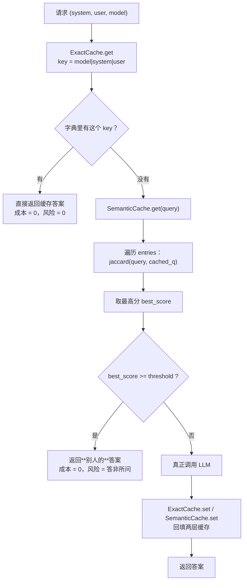
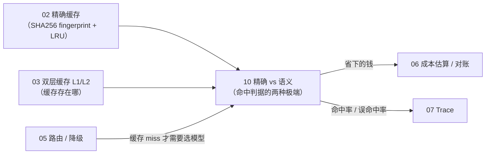

# 10 · 精确缓存与语义缓存：漏召回只是少省钱，误命中是真答错

一句话：**精确缓存只在"一个字都不差"时命中，安全但接不住"换个说法"的重复请求；语义缓存靠一个相似度阈值去接，能省更多，但阈值同时决定了它会不会把别人的答案套到你头上。**

- **`ExactCache`**（[`exact.py`](semantic_cache/exact.py)）：`model|system|user` 拼成 key，字典精确匹配。改一个字就 miss，**不可能误命中**。
- **`SemanticCache`**（[`semantic.py`](semantic_cache/semantic.py)）：对每条缓存过的问法算 Jaccard 相似度，取最高分、且 **≥ `threshold`** 才算命中。演示用集合相似度，生产换向量 embedding。
- **`RISK_NOTES`**（[`risks.py`](semantic_cache/risks.py)）：四条语义缓存风险清单，被 `main.py` 直接打印出来当 checklist。
- 对外只暴露 4 个名字：`ExactCache` / `SemanticCache` / `jaccard` / `RISK_NOTES`，见 [`__init__.py`](semantic_cache/__init__.py)。

核心逻辑在 [`semantic_cache/`](semantic_cache/)，**零第三方依赖**：`re` + 内置 `dict` / `list` 就够。

## 目录结构

```
10/
├── main.py                    # 入口：精确缓存 miss 对比 + 语义缓存漏召回演示 + 风险清单
├── README.md
└── semantic_cache/
    ├── __init__.py            # 对外只暴露 4 个名字（__all__）
    ├── exact.py               # exact_key：拼 key；ExactCache：get / set
    ├── semantic.py            # _normalize：切词；jaccard：集合相似度；SemanticCache：阈值命中
    └── risks.py               # RISK_NOTES：语义缓存四条典型风险
```

## 运行

按仓库 `pyproject.toml`，Python 要求 `>=3.13`（代码本身只用到 `dict[str, str]`、`str | None` 等 3.10+ 语法）。

```bash
cd 10
python3 main.py
# 或在仓库根目录
uv run python 10/main.py
```

实测输出：

```
=== 精确缓存 ===
  同 prompt 命中: RAG 是检索增强生成。
  换措辞 miss:    None

=== 语义缓存（演示漏召回：换措辞仍 miss）===
  新问法: 我想取消订单怎么办
  匹配到: None  相似度=0.00
  返回答案: None

=== 语义漏召回示例（查询 vs 取消 同样没命中）===
  问: 取消订单  最佳匹配: None  score=0.00  答案: None
  → 分词把整句当成一个 token，两句话交集为空 → 相似度 0.00
  → 这是「漏召回」：该命中却没命中，代价是没省下钱
  → 若分词细化后命中「查询物流」的答案，那才是「误命中」：省了钱但答错

=== 语义缓存风险清单 ===
  1. 答非所问：相似问法语义不同（如「取消订单」vs「查询订单」）
  2. 过期知识：缓存未 TTL，旧政策仍被返回
  3. 租户串数据：未按 user/tenant 隔离 key
  4. 幻觉放大：错误答案被高频命中，难以发现
```

注意三点：

1. **语义缓存那两段全都 miss 了，`score=0.00`，而且阈值降到多少都没用。** 原因不在阈值，在切词：两句话被切成了两个互不相交的 token，相似度恒为 0（下一小节有逐字对照）。
2. **精确缓存那段的对比是干净的。** 同一句话命中、换措辞 miss，`ExactCache` 不会因为"看起来很像"就返回别人的答案——它贵在"零误命中"，便宜在"命中率低"。
3. **风险清单是唯一不依赖算法结论的部分。** 不管你用 Jaccard 还是 embedding，`RISK_NOTES` 里那四条都成立——它们来自缓存机制本身，而不是某一种相似度实现。

### 为什么相似度是 0.00：一句话被切成了几个词

`_normalize` 用的是 `re.findall(r"[\w\u4e00-\u9fff]+", text.lower())`。其中 `+` 是贪心的，中文又没有空格，于是**一整句中文只会产出一个 token**：

```
"如何取消我的订单"    →  {"如何取消我的订单"}      ← 整句 1 个 token
"我想取消订单怎么办"  →  {"我想取消订单怎么办"}    ← 整句 1 个 token
交集 = ∅，并集 = 2      →  Jaccard = 0 / 2 = 0.00
```

两句话明明共享「取消」「订单」四个字，但既然各自被切成了**一整个** token，交集就是空的，相似度只能是 0——阈值降到多少都没用。英文稍好一点（有空格），`"cancel order"` / `"cancel my order"` 至少能共享 `cancel`、`order` 两个 token。

### 两种失败模式：漏召回 vs 误命中

语义缓存只有这两种出错方式，方向完全相反、代价也完全不同：

| | 漏召回（false miss） | 误命中（false positive） |
|---|---|---|
| 现象 | 该命中的没命中 | 不该命中的命中了 |
| 本次运行的表现 | 两段 demo 全都 `score=0.00` | 本章 demo 走不到这一步（切词太粗，永远不命中） |
| 后果 | 多花一次生成的钱，答案仍然正确 | 省了钱，但**答错**，还会被后续请求反复返回 |
| 谁该紧张 | 成本部门 | 业务 / 客服 / 质量 |
| 怎么调 | 切词更细、阈值调低、换 embedding | 阈值调高、加意图校验、高风险类目禁用 |
| 本章 demo | **演示的就是它** | 只在 `RISK_NOTES` 第 1 条里描述 |

关键点：**这两个方向是同一个旋钮的两端**——阈值调低，漏召回↓、误命中↑；调高则相反。本章代码因为切词太粗，整条曲线被压成了"永远相似度 0"，于是只落在了漏召回一端。

### 换成更细的切词方式，分数会变成什么样

下面是用三种切法把几对问法各算了一遍，括号里是 `threshold=0.6` 时是否命中：

- **当前 token 级**：就是本章代码，整句一个词
- **字符集合**：把每个字当一个词，去重后算 Jaccard
- **字符 bigram**：相邻两个字组成一个单位，如 `取消`、`消订`、`订单`

| 问法 A | 问法 B | 当前 token 级 | 字符集合 | 字符 bigram |
|---|---|---|---|---|
| 如何取消我的订单？ | 我想取消订单怎么办 | **0.00**（miss） | 0.417（miss） | 0.154（miss） |
| 查询订单物流 | 取消订单 | **0.00**（miss） | 0.250（miss） | 0.143（miss） |
| 什么是 RAG？ | RAG 是什么？ | 0.333（miss） | **1.000（命中）** | 0.429（miss） |

这张表就是语义缓存的全部难点：

- 要接住第 1 行（同一个问题换了措辞），阈值必须降到 **0.41 以下**；
- 可阈值一旦降到 0.41 以下，第 2 行（**取消** vs **查询**，两个完全不同的意图）也会跟着命中——那一次命中不是省钱，是答错事故。

**两个诉求不可能同时满足**，所以语义缓存光有阈值不够，还得配意图校验、分组阈值和误命中监控；精确缓存则完全不用面对这个取舍。

---

## 整体流程

请求进来先走精确缓存，miss 了才走语义缓存，语义命中后不再调模型：



这条链上"省钱"和"答错"共用同一个开关：`threshold` 越低，第二层接住的问法越多（省钱），把不同意图混为一谈的概率也越高（答错）。`ExactCache` 之所以保留在最前面，是因为它的正确性来自"字面相等"这个可验证的事实，而不是一个概率。

---

## `semantic_cache/exact.py`：key 就是全部设计

```python
def exact_key(system: str, user: str, model: str) -> str:
    return f"{model}|{system}|{user}"

class ExactCache:
    def __init__(self) -> None:
        self._store: dict[str, str] = {}

    def get(self, system: str, user: str, model: str) -> str | None:
        return self._store.get(exact_key(system, user, model))

    def set(self, system: str, user: str, model: str, value: str) -> None:
        self._store[exact_key(system, user, model)] = value
```

| 决策 | 原因 |
|---|---|
| key 里包含 `model` | 同一个 prompt 换个模型，答案质量/风格/价格都不同。不含 `model` 的缓存会在模型升级后**静默返回旧模型的答案**，而且没人能复现 |
| key 里包含 `system` | system prompt 往往承载"角色/格式/安全策略"，改一句就该算另一个问题 |
| 拼成 `f-string` 而不是 `tuple` | `tuple` 做 dict key 更快更省内存；但字符串能直接当 **Redis key**、能打进日志一眼看懂。演示版选可读性，代价见下一行 |
| 三层顺序 `model` → `system` → `user` | 纯习惯，便于人眼排查；**但用竖线当分隔符本身是隐患**：任一字段里含竖线时，不同的字段切分会拼出同一个 key（system 是 `a\|b`、user 是 `c`，与 system 是 `a`、user 是 `b\|c` 撞车）。生产里应改 hash（02 章做法）或做转义/长度前缀 |
| `get()` 返回 `str \| None` | 用 `None` 表示 miss，调用方 `if ans is None` 即可；不要用 `""` 表示 miss，空字符串也可能是合法答案 |
| 没有 TTL、没有容量上限 | 演示图简洁。生产必须补：政策/价格/模型都会变，**没有 TTL 的精确缓存同样会返回过期知识**（`RISK_NOTES` 第 2 条对两层缓存都成立） |

一句话：**精确缓存的正确性来自 key 的完备性。** key 少一个维度，就是"把不同问题当成同一个问题"——这和语义缓存的误命中是同一类错误，只是它发生在**写入时**而不是读取时，而且一旦发生，所有用户都会中。

---

## `semantic_cache/semantic.py`：一个正则 + 一个阈值

```python
def _normalize(text: str) -> set[str]:
    return set(re.findall(r"[\w\u4e00-\u9fff]+", text.lower()))

def jaccard(a: str, b: str) -> float:
    sa, sb = _normalize(a), _normalize(b)
    if not sa or not sb:
        return 0.0
    return len(sa & sb) / len(sa | sb)
```

$$J(A, B) = \frac{|A \cap B|}{|A \cup B|}$$

| 步骤 | 作用 | 结果示例 |
|---|---|---|
| `text.lower()` | 归一化大小写 | `RAG` → `rag` |
| `[\w\u4e00-\u9fff]+` | 抓"词"：`\w` 在 Python 的 str 正则里是 **Unicode 感知**的，已包含中日韩汉字；`\u4e00-\u9fff` 写出来只是把意图显式化 | — |
| `+`（贪心） | **一整串连续中文 = 一个 token** | `如何取消我的订单` → `{"如何取消我的订单"}` |
| `set(...)` | 去重、丢掉顺序 | `"a a b"` → `{"a", "b"}` |
| `if not sa or not sb: return 0.0` | 空集合会让分母为 0 | 空串 → `0.0` |

`\w` 已经覆盖汉字，所以 `\u4e00-\u9fff` 是冗余的；真正决定效果的是那个 `+`——它让中文（不像英文有空格）退化成**整句一个 token**，相似度只剩"字面完全相等"这一种可能。

`SemanticCache.get()` 是线性扫描：

```python
def get(self, query: str) -> tuple[str | None, float, str | None]:
    best_score = 0.0
    best_answer: str | None = None
    best_query: str | None = None
    for cached_q, ans in self._entries:
        score = jaccard(query, cached_q)
        if score > best_score:            # 严格大于：并列时保留最先写入的那条
            best_score = score
            best_answer = ans
            best_query = cached_q

    if best_score >= self.threshold:      # 阈值用 >=：正好等于阈值算命中
        return best_answer, best_score, best_query
    return None, best_score, best_query   # miss 时也把最高分带出去
```

| 决策 | 原因 |
|---|---|
| 返回三元组 `(answer, score, matched_query)` 而不是 `str \| None` | **可观测性是语义缓存的命门**。只返回答案，你永远不知道这次命中是"真的相似"还是"踩线过一次"；带上 `score` 才能打点、才能发现阈值漂移，带上 `matched_query` 才能排查"为什么返回了这个答案" |
| miss 时也返回 `best_score` / `best_query` | 调阈值时必须看"差多少才够"，只给 `None` 是调不了的 |
| `>` 比较后取最相似 | 并列时取最先写入的，结果可复现；改成 `>=` 就是"后写入者胜"，同一份数据两次运行可能不同 |
| `>= threshold` | `0.0 >= 0.0` 不成立，所以即使阈值设成 0，也不会返回空的 `best_answer`（此时返回 `(None, 0.0, None)`） |
| `_entries` 用 `list` 全表扫描、不淘汰 | 演示用。生产里这步是向量检索，要换 ANN 索引（HNSW / FAISS / pgvector），成本从"一次字典查询"变成"一次近邻搜索" |
| `threshold` 默认 `0.85`，`main.py` 传 `0.6` | 默认偏保守（少误命中）；demo 传 0.6 是想让命中真的发生——但切词粒度让两段都没命中，见上文 |
| `set()` 直接 `append`，不合并 | 同一问题缓存两次就有两条记录，越多越慢，也越容易被旧答案抢先命中。生产要 upsert（同 key 覆盖）+ TTL |

---

## `semantic_cache/risks.py`：把风险写成代码里的常量

```python
RISK_NOTES = [
    "答非所问：相似问法语义不同（如「取消订单」vs「查询订单」）",
    "过期知识：缓存未 TTL，旧政策仍被返回",
    "租户串数据：未按 user/tenant 隔离 key",
    "幻觉放大：错误答案被高频命中，难以发现",
]
```

写成 `list[str]` 常量而不是只写在 README 里，是因为它能被 `main.py` 直接 `for` 循环打印，也能被未来的告警文案 / 上线 checklist 复用。四条风险也可以看成四道防线：

| 风险 | 本质 | 防线 |
|---|---|---|
| 答非所问 | 相似度判断错（误命中） | 阈值 + 意图分类 + 高风险类目禁用语义缓存 |
| 过期知识 | 缓存没有失效机制 | TTL + 把政策/模型版本写进 key |
| 租户串数据 | key 维度不全 | key 加 `tenant_id`/`user_id`，租户隔离到不同命名空间 |
| 幻觉放大 | 缓存会把一次错误变成 N 次 | 写入前校验 / 命中后抽样复核 / 一键清空 + 命中率监控 |

---

## `main.py`：三段演示各自在证明什么

**① 精确缓存的两行对比**——证明"字面相等"这条规则的边界：

```python
exact.set("sys", "什么是 RAG？", "gpt-4o", "RAG 是检索增强生成。")
print(f"  同 prompt 命中: {exact.get('sys', '什么是 RAG？', 'gpt-4o')}")   # 命中
print(f"  换措辞 miss:    {exact.get('sys', 'RAG 是什么？', 'gpt-4o')}")   # None
```

两个问题在人类看来是同一件事，`ExactCache` 说不是。这不是缺陷——它保证"命中即正确"，代价是这类重复请求**一分钱也省不到**。

**② 语义缓存的两段**——演示漏召回：

```python
sem = SemanticCache(threshold=0.6)
sem.set("如何取消我的订单？", "请登录后在订单页点击取消。")
ans, score, matched = sem.get("我想取消订单怎么办")   # → (None, 0.0, None)
```

阈值 0.6 在这里是"摆设"，因为切词让两句话的交集为空，分数恒为 0。想让它真的命中，把 `_normalize` 换成字符级或 bigram（数字见上表），或者直接用 embedding——但那时就要开始担心误命中了。

**③ 风险清单**——`for i, note in enumerate(RISK_NOTES, 1)` 直接打印。价值不在输出，而在于提醒：**上面两段"没命中"只是少省钱；一旦换成能命中的实现，"命中错"就直接变成线上事故。** 同一个 `threshold` 旋钮，一头是漏召回，一头是误命中。

---

## 关键细节与坑

| 现象 | 为什么会发生 | 怎么处理 |
|---|---|---|
| 中文换措辞的相似度恒为 `0.00` | `[\w\u4e00-\u9fff]+` 的 `+` 贪心，整句一个 token；中文又没有空格 | jieba 分词 / 字符 bigram / 字符集合，或直接上 embedding |
| 该命中却 miss（漏召回） | 切词粒度太粗，或阈值太高 | 换粒度、降阈值（但会引入误命中）；最稳的是向量召回 + 重排 |
| 不该命中却命中（误命中） | 两句话共享高频词（"订单"、"退款"、"价格"），集合相似度被拉高 | 提高阈值、按意图分组阈值、高风险意图禁用语义缓存、命中后加一次轻量校验（如让 LLM 判断"这个答案适用于该问题吗"） |
| `\w` 和 `\u4e00-\u9fff` 重复 | Python `str` 正则的 `\w` 是 Unicode-aware，本来就含汉字 | 保留无害，只是容易让人误以为汉字需要特殊处理 |
| 相似度不看语序 | 集合/词袋模型，"狗咬人" 和 "人咬狗" 的 Jaccard = 1.0 | 接受它（缓存只要求"答案相同"，不要求"句子相同"），或用 bigram / 向量 |
| 过期知识被返回 | 两层缓存都没 TTL，`dict`/`list` 只增不减 | key 里带政策/模型版本号 + TTL + 主动失效（写操作触发清理） |
| 串租户数据 | `ExactCache` 的 key 里 `user` 是"用户问题"而不是"用户 ID" | key 加 `tenant_id`/`user_id`；或每租户一个命名空间（Redis key 前缀） |
| 幻觉被放大 | 一次错误答案写入后，后续每次相似提问都命中它；命中率高反而掩盖了错误率 | 写入前过滤（低置信度不入缓存）、命中后抽样复核、提供"一键清空"和误命中反馈入口 |
| `SemanticCache.get()` 是 O(n) 全表扫描 | `list` + 逐条算 Jaccard | 生产用向量索引 + TTL 控制表大小 |
| 同一问题被写入多条 | `set()` 直接 `append`，不去重 | upsert（同 key 覆盖）+ 记录 `created_at` / `hits` |
| 阈值到底 0.6 还是 0.85 | 没有客观标准，取决于语料和业务容忍度 | 用真实 query 日志离线跑 P/R 曲线，按"误命中一次的成本 / 命中一次省下的成本"定阈值 |
| `exact.py` 里 `exact_key(system,user,model)` 少了空格 | 手写时的笔误，不影响语义 | 跑 `ruff format` 即可；也正是这种小不一致最容易在 review 时被漏掉 |

---

## 已知取舍与可改进点

当前实现是"能跑通、能讲清"的最小版本，刻意留白如下：

| 问题 | 影响 | 建议 |
|---|---|---|
| 缓存只存在进程内存 | 多副本不共享、重启即失；命中率被副本数摊薄 | Redis（精确层）+ 向量库（语义层） |
| 没有容量上限 / LRU | 长跑必内存上涨；旧数据挤掉新数据 | 接 02 的 LRU 思路，或交给 Redis 的 `maxmemory-policy` |
| 精确 key 用 `\|` 拼接且不转义 | 字段含 `\|` 时不同请求可能撞成同一个 key | 改 SHA256 fingerprint（02 章做法），或长度前缀 / JSON 序列化 |
| `SemanticCache` 用 Jaccard 词袋 | 不懂同义词、不懂否定、不懂语序 | embedding（`text-embedding-3-small` 等）+ 余弦相似度 |
| 没有 embedding 成本核算 | 语义缓存要先付一次 embedding 调用费（甚至每个请求都要付），净收益可能为负 | 用 06 的对账思路算：`命中次数 × 单次生成成本 − embedding 成本 − 误命中返工成本` |
| 没有并发保护 | 缓存 miss 时并发请求会同时打到模型（cache stampede） | 接 03 的 single-flight / 信号量 |
| 没有观测指标 | 漏召回率、误命中率、节省成本都无从得知 | 接 07 的 trace：记录 `hit_layer` / `score` / `matched_query` / `saved_tokens` |
| 两层缓存没有版本联动 | 模型升级后旧缓存仍被使用 | 版本号进 key（`gpt-4o@2024-08-06`），升级即天然失效 |
| 没有"可缓存性"判断 | 实时数据、个性化答案被缓存会立刻过时 | 白名单可缓存意图；`temperature > 0` / 带工具调用的结果默认不入缓存 |
| 没有多轮上下文 | key 只看单轮 `system+user`，多轮对话里同一问题在不同上下文中答案不同 | 把对话摘要或 `session_id` 纳入 key，或只缓存"独立可回答"的问题 |

---

## 和前几节的关系



- **02 是本节的前身**：02 的 `exact_cache.py` 用 `sha256(system+user+model)` 做指纹、配 LRU；本节把 key 换成可读字符串（为了调试和讲解），并在它旁边加了一个"阈值判定"的语义层做对照。
- **03 回答"缓存放哪里"**，本节回答"什么算同一个问题"。前者是基础设施（L1 内存 / L2 Redis），后者是判据（字面相等 / 相似度）。两者正交：生产里通常语义层放 L1（要快、要能快速失败），精确层可以放 L2 共享。
- **05 决定"miss 之后走哪个模型"**：缓存的所有收益，本质是把 05 那条链路上的一次真实调用换成零成本；缓存没接住的请求才轮到路由、降级、fallback 花钱。
- **06 是语义缓存的裁判**：语义缓存比精确缓存多付一份 embedding 成本，也多了误命中风险。值不值只能靠对账（省下的 token − embedding − 返工）说话，不能靠"命中率 40% 听起来不错"。
- **07 是唯一能发现误命中的手段**：没有 trace，你只看到"命中率高、成本下降"，看不到"用户重问率上升、投诉变多"。语义缓存上线必须同时盯命中质量和命中率。
- **08 是上线前提**：能改阈值、能清缓存、能关掉语义层，都是高危操作，应纳入 08 的白名单与审计。

一句话收尾：**cache 的本质是"用空间和一次判断，换掉一次生成"——精确缓存让这次判断不可能出错，语义缓存让它便宜但可能出错。真正难的从来不是写缓存，而是决定"什么程度的相似可以接受"，并且有能力知道自己判断错了。**
