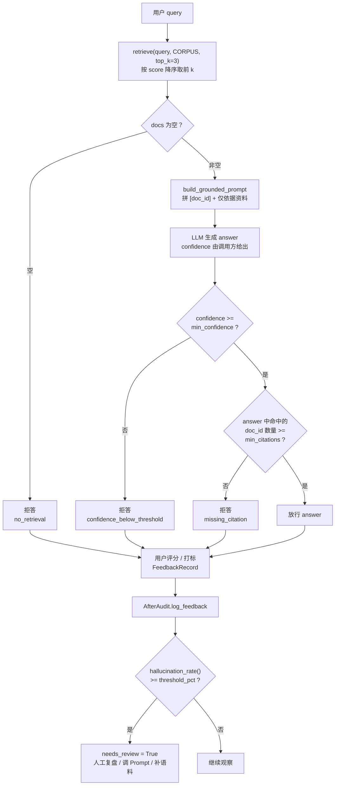
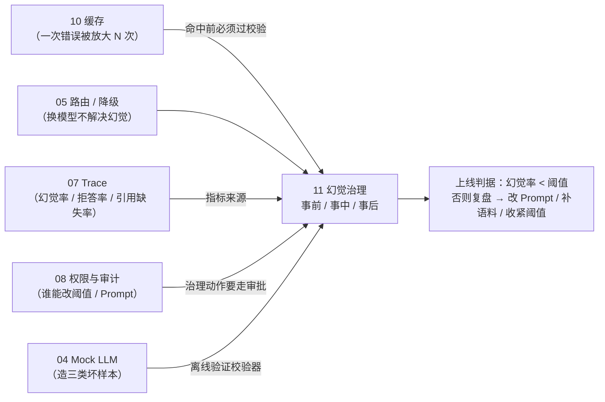

# 11 · 幻觉治理：事前检索、事中校验、事后复盘

一句话：**幻觉不是"换个大模型"就能消失的问题，它是一条时间线上三个不同的关口——事前给它可依据的资料，事中检查它有没有真的引用资料、够不够自信，事后把用户打标的错误收集起来，决定要不要人工复盘。**

- **事前 `before.py`**：`retrieve()` 从语料里按分数取 top-k，`build_grounded_prompt()` 把资料拼成带 `[doc_id]` 标记的上下文，并写上"仅依据以下资料回答，无依据则拒答"。**没有这一步，后面两步都无从校验。**
- **事中 `during.py`**：`check_during()` 先看置信度，再看答案里有没有出现 `sources` 中的 doc_id；任一条不过就 `refuse()` 给出固定拒答文案。输出是一个 `GenerationCheck` 而不是裸 `str`。
- **事后 `after.py`**：`FeedbackRecord` 记录一次反馈，`AfterAudit` 算**打标幻觉率**，并按阈值决定 `needs_review()`——**"要不要人工复盘"是一个可以被计算的布尔值，不是一句口头约定。**
- 对外只暴露 8 个名字（3 个类 + 5 个函数/常量），见 [`governance/__init__.py`](governance/__init__.py)。

核心逻辑在 [`governance/`](governance/)，**零第三方依赖**：`dataclasses` + 内置 `sorted` / `dict` 就够。真正难的不是写这三个函数，而是搞清楚**每个关口能挡住什么、挡不住什么**。

## 目录结构

```
11/
├── main.py                  # 入口：三段演示（事前检索 / 事中校验 / 事后复盘）
├── README.md
└── governance/
    ├── __init__.py          # 对外只暴露 8 个名字（__all__）
    ├── before.py            # RetrievalResult + retrieve + build_grounded_prompt
    ├── during.py            # GenerationCheck + check_during + refuse
    └── after.py             # FeedbackRecord + AfterAudit（log_feedback / hallucination_rate / needs_review）
```

## 运行

按仓库 `pyproject.toml`，Python 要求 `>=3.13`；代码本身只用到 `dataclass`、`list[...]`、`str | None`，3.10+ 都能跑。

```bash
cd 11
python3 main.py
# 或在仓库根目录
uv run python 11/main.py
```

实测输出：

```
=== 事前：检索 + Grounded Prompt ===
  命中 3 条，首条 score=0.92

=== 事中：Citation + 置信度校验 ===
  放行: 根据 [d1]，公司年假为 10 个工作日。
  幻觉样例拒答: 未找到可引用依据，拒绝生成。

=== 事后：反馈与复盘 ===
  幻觉率: 50.0%
  需人工复盘: True
```

注意三点：

1. **两条模拟答案的差别只有"有没有 `[d1]`"。** `mock_llm()` 返回的 `"公司年假 20 天。"` 从文本上看无比自信、格式无比正常——人类读者一眼能看出数字不对，但 `check_during()` 判断它不可信的唯一理由是**它没有任何引用**。这就是事中校验的本质：**它验的是"可追溯性"，不是"正确性"。**
2. **`mock_llm()` 的两个触发条件里，`len(prompt) < 30` 实际上永远不会生效。** 因为 `build_grounded_prompt()` 光模板就超过 30 个字符，只要走正常路径就命中不了这条分支；demo 里真正生效的是 `"无相关内容" in prompt`。
3. **`幻觉率: 50.0%` 的分母只有 2 条记录。** 这个数字在数学上没错，在业务上毫无意义——它是用来演示 `hallucination_rate()` 的计算方式和 `needs_review(30)` 的比较方向，不是用来说明"这个系统一半的答案是幻觉"。

## 整体流程

三个关口串在同一条请求链上，任一关口拦下都直接返回，不再往后走：



这张图里有一条容易被忽略的边：**三个拒答出口都汇入反馈流**。拒答不是终点，它是"这一轮很可能有问题"的强信号——**拒答率高说明事前检索没喂饱模型**（`no_retrieval` 指向语料，`missing_citation` 指向 Prompt 约束或模型不听话）。

## `governance/before.py`：把"资料"变成 Prompt 的一部分

```python
@dataclass
class RetrievalResult:
    doc_id: str
    text: str
    score: float

def retrieve(query: str, corpus: list[RetrievalResult], top_k: int = 3) -> list[RetrievalResult]:
    ranked = sorted(corpus, key=lambda r: r.score, reverse=True)
    return ranked[:top_k]

def build_grounded_prompt(query: str, docs: list[RetrievalResult]) -> str:
    ctx = "\n".join(f"[{d.doc_id}] {d.text}" for d in docs)
    return f"仅依据以下资料回答，无依据则拒答。\n{ctx}\n\n问题：{query}"
```

| 决策 | 原因 |
|---|---|
| `score` 由调用方传进来，`retrieve` 不自己算 | 演示版把"检索"抽象成一个纯排序问题。真实系统里 score 来自向量余弦相似度 / BM25 / 混合排序，这一步在本章是**输入**，不是本章要讲的东西 |
| `sorted(..., reverse=True)` 而不是维护有序结构 | 一次请求只取 top-3，全量排序的 $O(n\log n)$ 完全可以接受；语料上万条以后再谈堆或 ANN 索引 |
| **没有分数阈值** | 这是本章最大的留白：`0.10` 分的文档和 `0.92` 分的文档一样会被塞进 Prompt。语料里只要有东西，`docs` 就永远非空，于是 `retrieve` **永远不会返回空列表**（除非 `corpus` 本身为空，实测 `retrieve('q', []) == []`） |
| `query` 参数完全没被用到 | 签名是为了对齐"检索"这个词的语义。演示版拿不到真实检索器，`query` 只能空挂着——这也是它只能叫"排序"不能叫"检索"的原因 |
| `doc_id` 必须显式存在于 Prompt 里 | 事中的引用校验靠字符串匹配 `doc_id`，**没有 `[d1]` 这种标记，事中校验就彻底失效**。事前和事中是通过 `doc_id` 这个约定耦合在一起的 |
| `"仅依据以下资料回答，无依据则拒答"` 写死在模板里 | 这是 Prompt 层的"软约束"，模型可以不听。它和事中的"硬校验"是两层防线：软约束降低幻觉概率，硬校验负责在有幻觉时抓住它 |
| `docs` 为空时模板仍然正常 | 实测输出 `'仅依据以下资料回答，无依据则拒答。\n\n\n问题：q'`——**空上下文也长得像个正常 Prompt**，模型很可能会开始自由发挥。生产里应该在这里就短路成拒答 |

一个具体提醒：**`[d1]` 这种标记是"可校验性"的来源，不是美观问题。** 如果你是让模型自由生成引用（比如"根据《员工手册》第 3 章"），事中就没法做字符串匹配，只能上更贵的方案（LLM 裁判 / NLI 模型）。标记越规整，校验越便宜。

## `governance/during.py`：两个判据，一个顺序

```python
def check_during(
    answer: str,
    sources: list[str],
    min_citations: int = 1,
    min_confidence: float = 0.5,
    confidence: float = 0.8,
) -> GenerationCheck:
    """事中：要求引用来源；低置信度拒答。"""
    if confidence < min_confidence:
        return GenerationCheck(False, "confidence_below_threshold")
    cited = sum(1 for sid in sources if sid in answer)
    if cited < min_citations:
        return GenerationCheck(False, "missing_citation")
    return GenerationCheck(True, "ok", answer=answer)
```

| 决策 | 原因 |
|---|---|
| 返回 `GenerationCheck` 而不是 `str \| None` | 拒答是**业务结果**，不是异常。`allowed` 表达"能不能用"，`reason` 表达"为什么不能用"，`answer` 只在放行时有值。调用方可以据此分区打点、分类告警，而不是拿到 `None` 后靠猜 |
| `answer: str \| None = None` | 拒答时真的没有答案可说。用 `""` 表示拒答会和"模型返回了空串"混淆 |
| `reason` 用固定字符串码（`missing_citation` 等）而不是中文句子 | 码用来**判断和统计**，中文文案交给 `refuse()` 映射。如果直接返回句子，任何文案改动都会让下游的 `if reason == "...":` 全部失效 |
| **先查置信度，再查引用** | 顺序决定了输出：低置信 + 有引用 → 报 `confidence_below_threshold`；高置信 + 无引用 → 报 `missing_citation`。实测 `check_during("根据 [d1] 是的", sources=["d1"], confidence=0.2)` 得到 `confidence_below_threshold`，引用那一步根本没执行 |
| `confidence` 是**入参**，不是模型自评 | 这是最容易被误读的地方：`check_during` 不做任何"测量"，它只是把调用方给的数字和一个阈值比大小。demo 里写死 `confidence=0.85`、`min_confidence=0.5`，所以**置信度这条分支在 demo 里永远不触发**，只有引用分支在工作 |
| 引用判定是 `sid in answer` 子串匹配 | 便宜到几乎零成本——代价见下一小节 |
| `sources` 由调用方决定 | 只用"本轮检索到的 doc_id"作为合法来源，才能防止模型引用语料外的"文档"（学名：**fabricated citation**）。如果 `sources` 传全量语料，校验就退化成"答案里有没有出现过任何 doc_id" |

### `sid in answer` 的三种误判（都在 demo 之外）

| 场景 | 实测 / 推演结果 | 说明 |
|---|---|---|
| 答案引用 `[d10]`，`sources=["d1"]` | `allowed=True, reason='ok'` | `"d1" in "参考 [d10] 的说法"` 为真 → **子串误判**，幻觉被放行。语料超过 9 条就可能踩到，生产里必须按 `[doc_id]` 完整标记匹配（正则 `\[d\d+\]` 提取后做集合比较） |
| 答案正文里恰好出现 `d1`（如"ID 是 d1x"） | 被当作合法引用 | 同上，缺少边界约束 |
| 答案引用了真实存在、但本轮未检索到的 `[d9]` | `cited=0` → `missing_citation` | 这个方向是**误杀**：模型引用了语料里的真文档，却因为不在 `sources` 里被拒。演示版选"宁可误杀"，因为误杀的代价是拒答，误放的代价是错误答案 |

另外 `min_citations=1` 只要求"至少出现一个来源"，不要求**答案里每个事实都有来源**。`"根据 [d1]，公司年假 10 天，报销截止每月 5 日。"` 只会被检查到 `[d1]` 一处——后半句可能完全是编的。要做到句级引用，得让模型逐句标注并逐句校验。

`refuse()` 是一张纯映射表：

```python
messages = {
    "confidence_below_threshold": "置信度不足，无法可靠回答。",
    "missing_citation": "未找到可引用依据，拒绝生成。",
    "no_retrieval": "知识库无相关内容，请换个问法或联系人工。",
}
return messages.get(reason, "无法回答。")
```

**`no_retrieval` 这一条在当前代码里不可达**：`retrieve()` 不会拒答（它只会返回空列表），`check_during()` 也从不返回这个 reason。它是一条"预留好了、但还没接线"的分支——`main.py` 里也没有出现。真正接线需要调用方在 `docs` 为空时自己 `refuse("no_retrieval")`。`.get(reason, "无法回答。")` 的兜底保证：即便出现未登记的码，也不会抛 `KeyError` 把整条请求打挂。

## `governance/after.py`：把"要不要复盘"变成可计算的布尔值

```python
@dataclass
class FeedbackRecord:
    query: str
    answer: str
    user_rating: int  # 1~5
    flagged_hallucination: bool

@dataclass
class AfterAudit:
    records: list[FeedbackRecord] = field(default_factory=list)

    def log_feedback(self, record: FeedbackRecord) -> None:
        self.records.append(record)

    def hallucination_rate(self) -> float:
        if not self.records:
            return 0.0
        flagged = sum(1 for r in self.records if r.flagged_hallucination)
        return round(flagged / len(self.records) * 100, 2)

    def needs_review(self, threshold_pct: float = 5.0) -> bool:
        return self.hallucination_rate() >= threshold_pct
```

| 决策 | 原因 |
|---|---|
| `records: list[...] = field(default_factory=list)` | **不能用 `= []`**。可变默认值在 `dataclass` 里会让所有实例共享同一个 list，第二个 `AfterAudit()` 会看到第一个实例的反馈。`field(default_factory=list)` 才是每个实例一份 |
| 空集合返回 `0.0` 而不是抛异常 | 刚上线、还没有反馈时不该炸。语义上"没有数据"和"幻觉率 0%"确实不同，但演示版选了可用性 |
| `round(..., 2)` | 避免 `33.33333333333333` 这种输出。只影响展示，不影响比较 |
| 返回**百分比**（0~100）而不是比例（0~1） | 和 `threshold_pct` 的单位保持一致。**单位不一致是这类代码最常见的事故**：阈值写 `0.05`、算出 `50.0`，比较结果永远是 `True` |
| `>= threshold_pct` | 正好等于阈值就复盘，方向偏保守（宁可多看一次） |
| 默认阈值 `5.0`，demo 传 `30` | 默认值是给生产用的常用档；demo 传 30 是因为只有 2 条样本（`50%`），用一个宽松阈值让 `True` 和 `False` 都有机会出现 |
| 只算 `flagged_hallucination`，不看 `user_rating` | `user_rating` 只有 1~5 的分档、且"低分"可能因为慢/贵/格式差，不等于幻觉。打标是更明确的信号。实测：两条记录里 1 条打标 → `50.0%`，而低分的那条正好也是被打标的那条，两个字段在 demo 里"碰巧一致" |
| 没有时间戳、没有用户 ID、没有模型版本 | 所以这个 `AfterAudit` **只能算全局累计值**，算不了趋势、算不了"新模型上线后幻觉率变了没有"、也没法去重同一个用户重复提交 |

**这个"幻觉率"是上限的下界**：只有用户主动打标的错误才会被计入，沉默的错误、没被发现的错误一律不算。所以 50% 不代表一半答案是错的，5% 也不代表可以放心——它衡量的是**用户愿意投诉的比例**。真正的幻觉率需要抽样人工标注。

## `governance/__init__.py`：对外只暴露 8 个名字

```python
from .after import AfterAudit, FeedbackRecord
from .before import RetrievalResult, build_grounded_prompt, retrieve
from .during import GenerationCheck, check_during, refuse

__all__ = [
    "AfterAudit", "FeedbackRecord", "GenerationCheck", "RetrievalResult",
    "build_grounded_prompt", "check_during", "refuse", "retrieve",
]
```

- 让 `main.py` 只写一行 `from governance import (...)`，不必知道每个名字在哪个文件里——将来把 `after.py` 拆成 `audit.py` + `feedback.py`，外部代码不用改。
- `__all__` 同时约束 `from governance import *` 和文档工具对"这个包公开了什么"的认知。
- 8 个名字刚好对应三个关口：事前 3 个、事中 3 个、事后 2 个。**看导入清单就知道这个包能干什么。**

## `main.py`：三段演示各自在证明什么

**① 事前**——只打印了 `docs` 数量与首条分数：

```python
docs = retrieve(query, CORPUS)
print(f"  命中 {len(docs)} 条，首条 score={docs[0].score}")
```

`CORPUS` 只有 3 条、`top_k` 默认 3，所以"命中 3 条"是必然的，`0.92` 也只是语料里的最大值。这段的价值不在于数字，而在于**它成功构造了一个非空的 `docs`，让后面两步有东西可校验**。注意按分数排序后 `d3`（0.60）也在里面——没有阈值，低分文档照样进 Prompt。

**② 事中**——同一次校验跑了两个输入：

```python
check = check_during(raw, sources=["d1", "d2"], confidence=0.85)   # allowed=True
bad = mock_llm("无相关内容")
check_bad = check_during(bad, sources=["d1"], confidence=0.85)     # missing_citation
```

两次调用的 `confidence` 都是 0.85，`min_confidence` 都是默认 0.5，所以**唯一的变量就是答案里有没有 `d1`**。这是刻意设计的对照实验：它证明这套校验能分辨"有引用"和"没引用"，同时也就暴露了它分辨不了的东西——**只要模型在编造的答案后面加上 `[d1]`，校验就放行**。引用校验能挡住"忘记引用"，挡不住"引用错"。

**③ 事后**——一条好评、一条打标：

```python
audit.log_feedback(FeedbackRecord(query, raw, user_rating=5, flagged_hallucination=False))
audit.log_feedback(FeedbackRecord("年假 30 天？", bad, user_rating=1, flagged_hallucination=True))
print(f"  幻觉率: {audit.hallucination_rate()}%")          # 50.0
print(f"  需人工复盘: {audit.needs_review(threshold_pct=30)}")  # True
```

`50.0 >= 30` → `True`。如果换回默认阈值 `5.0` 也是 `True`——这条 demo 真正演示的是**计算路径和单位**，而不是"当前系统健康度"。

## 关键细节与坑

| 现象 | 为什么会发生 | 怎么处理 |
|---|---|---|
| 编造的答案只要加上 `[d1]` 就能过校验 | 事中只验"有没有引用"，不验"引用是否支持该结论" | 加一步 claim–evidence 校验（NLI / LLM 裁判），或要求逐句引用并逐句核对 |
| `[d10]` 被当作引用了 `d1` | `sid in answer` 是子串匹配 | 正则提取 `\[([^\]]+)\]` 得到引用集合，再做集合运算 |
| 引用了真文档却被拒 | `sources` 只包含本轮检索结果 | 明确"合法来源"的定义：本轮检索结果 or 整个语料；并在拒答文案里区分"没有依据"和"引用了非本轮资料" |
| `confidence` 永远不触发拒答 | demo 写死 0.85，且它本来就是入参 | 真实置信度要靠 logprob、多次采样一致性、或模型自评（还要防范自评过高）；demo 里可以用它演示 `confidence=0.2` 的分支 |
| `no_retrieval` 从不出现 | `retrieve()` 不拒答、`check_during()` 不返回这个码 | 在 `main.py` 里加 `if not docs: print(refuse("no_retrieval"))`，或让 `retrieve()` 带分数阈值 |
| 低分文档污染 Prompt | `retrieve()` 无阈值，`0.10` 分照样入选 | `retrieve(..., min_score=0.5)`，过滤后为空就走 `no_retrieval` |
| `mock_llm` 的 `len(prompt) < 30` 分支是死代码 | `build_grounded_prompt` 的模板本身就超 30 字 | 要么删掉这个条件，要么改成"docs 为空"之类的语义条件 |
| 幻觉率 5% 却觉得"还行" | 只统计用户主动打标，沉默错误不计入 | 配合抽样人工标注 + 引用缺失率 + 用户重问率，三者一起看 |
| 幻觉率单位搞错 | `hallucination_rate()` 返回 0~100，阈值却是 0~1 的写法 | 统一单位，类型上可以用 `float` + 命名后缀 `_pct` 提醒 |
| `AfterAudit()` 两个实例共享记录 | 可变默认值写成 `records: list = []` | `field(default_factory=list)`（本章已正确处理） |
| `user_rating` 与 `flagged_hallucination` 不一致 | 低分可能是因为慢/贵/格式，不一定是幻觉 | 两个指标分开看：`rating` 看满意度，`flagged` 看事实性 |
| 反馈无法归因 | `FeedbackRecord` 没有 model / prompt 版本 / `trace_id` | 加 `model`、`prompt_version`、`trace_id`，才能按版本切分幻觉率 |

## 已知取舍与可改进点

当前实现是"能跑通、能讲清"的最小版本，刻意留白如下：

| 问题 | 影响 | 建议 |
|---|---|---|
| `retrieve()` 只是按 score 排序 | 没有真正的检索，`query` 参数空挂 | 接向量检索 + 混合排序；演示可先用关键词命中做最小实现 |
| 没有 `min_score` 阈值 | 低质量资料污染 Prompt，反而**增加**幻觉 | 加阈值 + 空结果短路到 `no_retrieval` |
| 引用校验是子串匹配 | 误判（`d10`→`d1`）和误杀（`[d9]`）都存在 | 正则提取引用集合；或改用结构化输出（让模型返回 `citations: list[str]`） |
| 只校验"有没有引用"，不校验"引用是否成立" | 假引用照样放行 | 加 NLI / LLM 裁判做 claim–evidence 对齐；高风险场景可要求"回答中每个数字都必须带引用" |
| `confidence` 靠调用方硬编码 | 置信度校验形同虚设 | 用 logprob 或多次采样投票得出；阈值按业务容忍度调 |
| 拒答文案是固定三句 | 用户被拒后不知道下一步做什么 | 按 reason 给不同引导（换问法 / 转人工 / 展示检索到的资料） |
| 反馈只有累计值 | 无法看趋势、无法按模型/版本切分 | 加时间戳与 `model`、`prompt_version`、`trace_id` |
| 没有自动闭环 | `needs_review=True` 之后仍然靠人 | 接 08 的白名单审计：复盘结论要能反哺 Prompt / 语料 / 阈值 |
| 存储只在内存 | 重启即失，多副本不共享 | 落库（反馈表）+ 指标进 07 的 trace 体系 |
| 没有对抗样本测试 | 不知道校验在"模型不听话"时是否还有效 | 接 04 的 FakeLLM，专门造"无引用""假引用""引用错"三类用例 |

## 和前几节的关系



- **10 是本章最直接的搭档**：缓存会把一次错误答案变成 N 次命中。语义缓存命中前如果不跑一遍 `check_during`，等于把幻觉**批量分发**。反过来，`RISK_NOTES` 里"幻觉放大"那一条的解法就在这里——**写入缓存前先校验**。
- **05 说明为什么需要本章**：路由、降级、fallback 解决的是"哪个模型能答"，解决不了"这个模型答得对不对"。换更强的模型只是降低幻觉概率，不会让幻觉消失，也不会告诉你哪些答案不可信。
- **07 提供判据**：`needs_review()` 的阈值不该拍脑袋定。拒答率、引用缺失率、用户打标率都该进 trace，按模型/Prompt 版本切维度，才能看出"改了 Prompt 之后是真的变好了"。
- **08 是治理动作的关卡**：改 `min_confidence`、放宽引用要求、把某类问题加进白名单跳过校验——这些都是能直接导致幻觉上线的操作，应该和工具调用一样走白名单与审计。
- **04 是验证手段**：这套校验器本身也需要测试。用 `FakeLLM` 造"无引用""假引用（`[d10]`）""引用错（引 d1 说 d2 的事）"三类样本，跑一遍就知道校验器的边界在哪。
- **06 是成本视角**：事前检索要花检索成本，事中校验（尤其是 LLM 裁判）要花生成成本，事后复盘要花人力。幻觉治理不是免费的，值不值要看 06 那套对账。

一句话收尾：**前几节关心"请求能不能走通、走对、走得便宜"，这一节关心"走通了之后，答案值不值得信"。三个关口各自只能挡住一类问题：事前让模型有据可依，事中让错误可被追溯和拦截，事后让系统知道自己错了多少次——少了任何一环，另外两环都只是摆设。**
