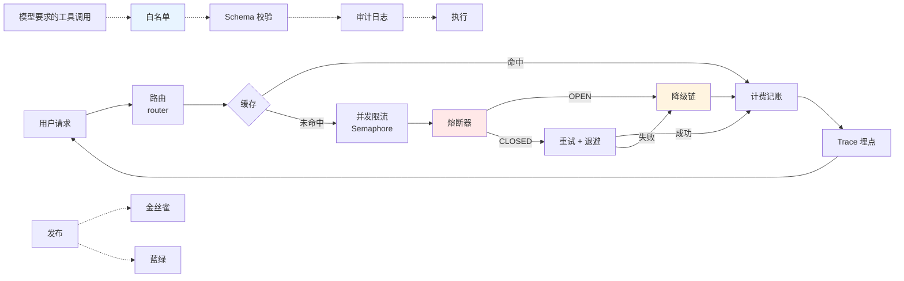

# model-route · 从零手搓一个模型路由层

一个**零第三方依赖**（除 `pytest`）的教学仓库：用 11 个递进的小节，把「一次 LLM 请求从进入到离开」需要的那点基础设施全部手写一遍——路由、熔断、重试、缓存、限流、计费、埋点、工具守卫、发布策略、幻觉治理。

不是框架，也不是可以直接上线的 SDK。每个目录都是一个**能独立跑、能独立读**的最小实现，目的是让你在几十行代码里看清每个机制的边界和取舍。

---

## 为什么需要这一层

直接 `client.chat(model="gpt-4o", ...)` 能跑通 Demo，但上线后会立刻撞上一串问题：

| 问题 | 这一层的答案 | 在哪节 |
| --- | --- | --- |
| 下游挂了，重试把对方打死 | 熔断 + 指数退避抖动 | 01 |
| 同一个问题被反复问，每次都花钱 | 请求指纹 + 精确缓存 | 02 / 10 |
| 并发打满配额 | `Semaphore` 限流 + 两级缓存 | 03 |
| 不知道一次调用到底花了多少 | Token 估算 + 账单对账 | 02 / 06 |
| 简单问题用了最贵的模型 | 复杂度路由 + 降级链 | 05 |
| 出问题只会看日志猜 | Trace / Span 结构化埋点 | 07 |
| 模型要求调用危险工具 | 白名单 + Schema 校验 + 审计 | 08 |
| 新版本不敢全量发 | 金丝雀 / 蓝绿 | 09 |
| 模型一本正经地编 | 事前检索 + 事中校验 + 事后复盘 | 11 |

---

## 章节地图

| # | 主题 | 核心模块 | 一句话 |
| --- | --- | --- | --- |
| 01 | 熔断与重试 | `breaker/` | 连续失败后立刻跳闸，冷却后再放探测请求 |
| 02 | Token 估算与精确缓存 | `cache/` | 事前算钱，相同请求第二次直接命中 |
| 03 | 并发限流与两级缓存 | `runtime/` | `Semaphore` 控并发，L1 内存 + L2 远端 |
| 04 | Mock LLM 与编排测试 | `agent/` | 用 `FakeLLM` 让 Agent 逻辑变成确定性测试 |
| 05 | 完整调用闭环 | `pipeline/` | 路由 → 熔断 → 重试 → 降级 → 计费 |
| 06 | 估算 vs 账单对账 | `billing/` | 本地估算负责事前，API 账单负责事后 |
| 07 | Trace Span 采集 | `trace/` | 每一步都是一条带属性的时间片 |
| 08 | 工具调用守卫 | `guard/` | 白名单 → 参数校验 → 审计 → 执行 |
| 09 | 发布策略 | `deploy/` | 哈希分桶金丝雀 + 指针切换蓝绿 |
| 10 | 语义缓存 | `semantic_cache/` | 漏召回只是少省钱，误命中是真答错 |
| 11 | 幻觉治理 | `governance/` | 事前给依据，事中查引用，事后算幻觉率 |

每节都有自己的 `README.md`，包含**逐文件讲解、实测输出、流程图和踩坑记录**，根目录这份只负责串起来。

---

## 整体架构

一次线上请求穿过整层的顺序：



对应的代码分布：

- **主路径**：`05/pipeline/`（编排）+ 复用的 `01/breaker/`（熔断重试）+ `02`/`03`/`10`（缓存）+ `06`（计费）
- **旁路**：`07`（埋点）、`08`（工具守卫）、`09`（发布）、`11`（幻觉治理）
- **测试支撑**：`04`（`FakeLLM` + `pytest`）

---

## 目录结构

```
model-route/
├── pyproject.toml          # 仅声明 pytest；ty 的 root 指向 01..11
├── .python-version         # 3.13
├── 01/  breaker/           # state / circuit_breaker / retry / backoff
├── 02/  cache/             # tokens / fingerprint / exact_cache
├── 03/  runtime/           # limited_call / two_level_cache
├── 04/  agent/ tests/      # llm / fake_llm / stub + test_agent
├── 05/  pipeline/          # type / router / invoke / fallback / billing
├── 06/  billing/           # estimate / reconcile
├── 07/  trace/             # kinds / collector
├── 08/  guard/             # type / whitelist / schema / executor
├── 09/  deploy/            # canary / blue_green
├── 10/  semantic_cache/    # exact / semantic / risks
├── 11/  governance/        # before / during / after
└── ...
```

每个章节目录都是 `包 + main.py + README.md` 的固定结构，`main.py` 就是这一节的"验收脚本"。

---

## 快速开始

环境用 [`uv`](https://docs.astral.sh/uv/) 管理，Python 3.13：

```bash
git clone <this-repo>
cd model-route
uv sync
```

跑任意一节：

```bash
uv run python 01/main.py
uv run python 05/main.py
uv run python 08/main.py
```

跑测试（第 04 节）：

```bash
uv run pytest 04 -v
# 或直接跑 04 的入口，它会透传 pytest 的退出码
uv run python 04/main.py
```

类型检查（`ty`）：

```bash
uvx --quiet ty check 08
```

不需要 `uv` 也可以，直接 `cd 01 && python3 main.py`，全部代码零第三方依赖（`02` 的 `tiktoken` 是可选增强，缺失时自动回退）。

---

## 代码约定

- **零依赖**：只用标准库，避免把「机制本身」和「某个库的 API」混为一谈。
- **类型先行**：`type X = ...` 别名、`TypedDict` 描述外部数据、`Enum` 描述状态、`dataclass` 承载记录。
- **显式导出**：每个包的 `__init__.py` 用 `__all__` 收缩对外 API（`08`/`09`/`10`/`11` 都是这样）。
- **可观测的返回**：函数返回结构化结果（如 `GenerationCheck`、`AuditEvent`、`ReconcileRow`），而不是裸 `str` 或裸 `bool`。
- **不隐藏失败**：`circuit_open`、`PermissionError`、`ValueError` 都直接抛，由调用方决定怎么降级。

---

## 关键细节与坑

1. **章节包名必须全仓库唯一。** `pyproject.toml` 里 `[tool.ty.environment] root` 把 11 个目录都列成了搜索根，重复的顶层包名（例如曾经的 `02/cache` 与 `10/cache`）会让 `ty` 解析到第一个匹配项并报 `Cannot resolve imported module`。所以第 10 节的包被命名为 `semantic_cache`，而不是 `cache`。运行时不受影响。
2. **第 05 节靠 `sys.path` 复用第 01 节。** `pipeline/__init__.py` 会把 `01/` 注入 `sys.path`，这样 `from breaker... import ...` 才能成立——这是「章节独立」和「不复制粘贴」之间的折中。
3. **Python 版本下限是 3.13（仓库级）。** 部分文件用了 PEP 695 的 `type` 语句和泛型语法，单个文件最低 3.12，其余代码 3.10+ 也能跑。
4. **`04` 的 `pytest.ini` 负责 `pythonpath`**，所以测试必须从 `04/` 目录（或带上 `-c 04/pytest.ini`）运行，否则 `agent` 包不可见。
5. **缓存的两端风险不对称。** 精确缓存不可能误命中，但接不住换句话问；语义缓存的阈值越低越省钱，也越容易把别人的答案套到你头上（见 `10/semantic_cache/risks.py`）。

---

## 已知取舍

- 缓存是进程内实现，重启即失效；生产应换成 Redis 并处理一致性。
- 语义缓存用 Jaccard 集合相似度做演示，生产应换 embedding + 向量检索。
- 计费按 token 单价估算，没有区分缓存读写、批处理折扣、阶梯价格。
- Trace 只在本进程内采集，没有导出到 OTLP / Jaeger 的后端适配。
- 路由规则是写死的阈值表，没有做在线学习或 A/B 反馈闭环。

这些取舍都写在对应章节的 README 里——**先看清代价，再决定要不要引入复杂度**。

---

## 适合谁看

- 想把「调 API」变成「做系统」的后端 / AI 工程师；
- 面试前想梳理 LLM 应用工程化知识点的人；
- 需要给现有项目补熔断、缓存、埋点、权限的同学：可以直接把某一节的文件拿走，改成适配自己接口的版本。

## 不适合什么

- 想找现成生产级 SDK：用 LiteLLM / OpenRouter / Langfuse 更省事；
- 想学模型训练或 Prompt 调优：这里只讲工程侧。

---

## 继续往下走

读完 11 节，比较自然的补充方向：

- 把 `07` 的 `Span` 接到 OpenTelemetry，落到真实后端；
- 把 `10` 的 Jaccard 换成 embedding + HNSW，加上**失效策略**（模型升级后旧缓存必须清）；
- 给 `05` 的 `invoke` 加一个幂等键，防止重试导致的重复计费；
- 把 `09` 的金丝雀从「按用户分桶」扩展到「按请求特征分桶」。